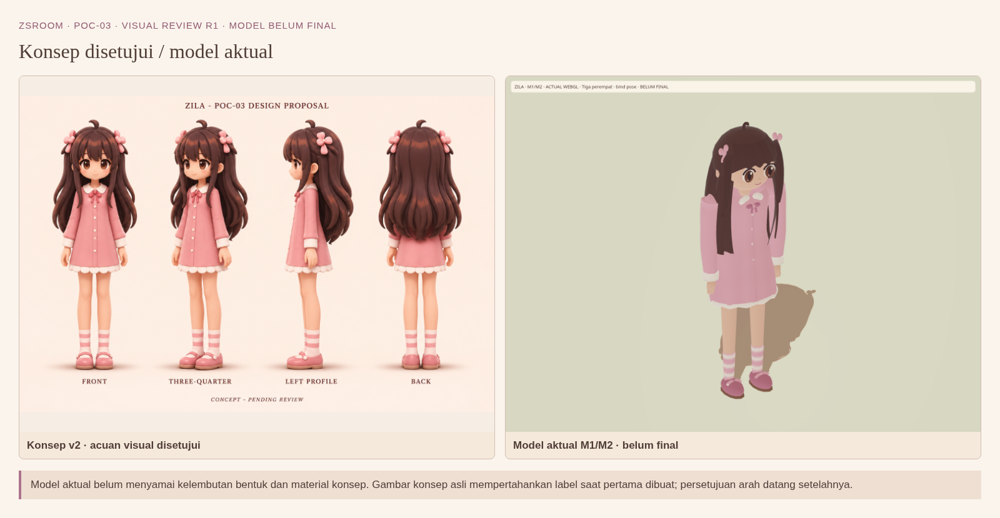
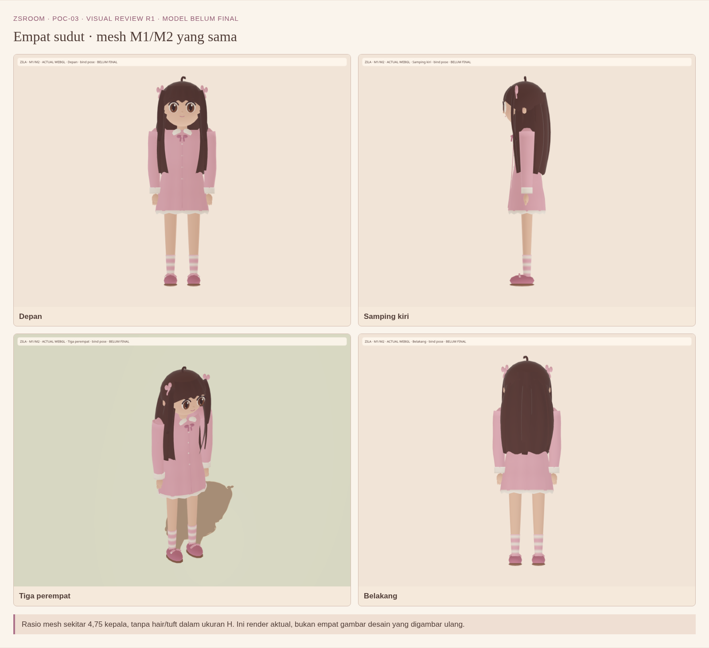
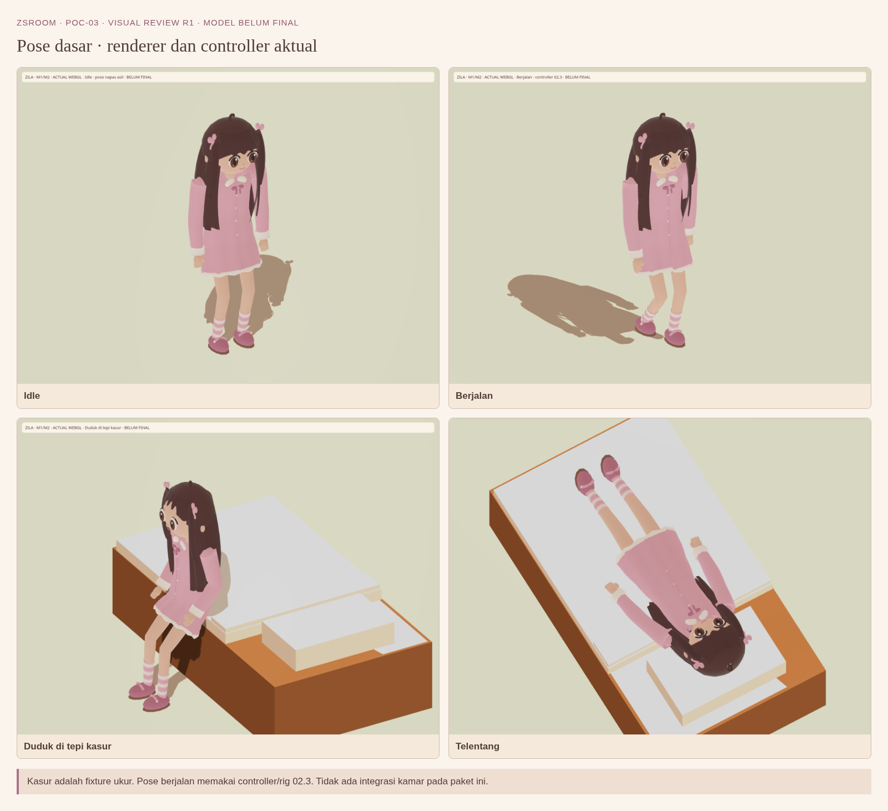
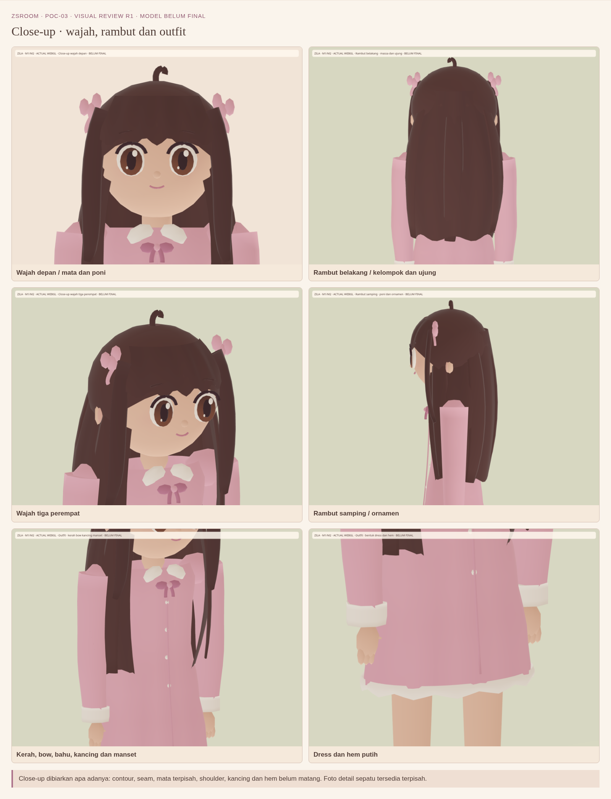
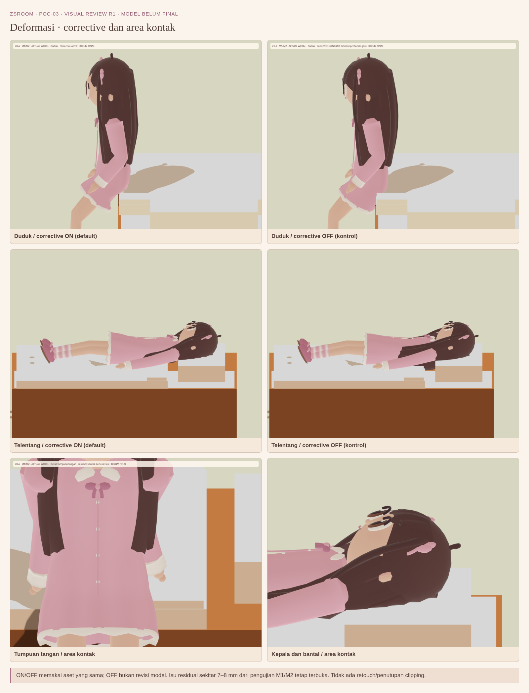

# ZsRoom PoC-03 — Visual review R1

**Konsep disetujui; model M1/M2 belum disetujui sebagai model final.** Paket ini menampilkan
model aktual apa adanya. Model, rig, material dan kamar tidak diubah saat membuat paket visual.

[Unduh seluruh PNG/MP4 + galeri offline dalam ZIP](https://github.com/nugrohofebri681-oss/ZsRoom/raw/refs/heads/poc03-visual-review-export/zsroom-poc03-visual-review-r1.zip)
· [Manifest/checksum](poc03-visual-review-r1-manifest.json).

Setelah ekstraksi, buka `index.html`. Jika file manager HP tidak membuka HTML lokal, buka PNG
atau MP4 langsung. Tidak perlu menjalankan game, Node, Blender, atau layanan cloud.

## Perbandingan konsep dengan model aktual

[PNG penuh](images/01-comparison.png)

Kualitas bentuk dan material model aktual belum menyamai konsep: mata/kelopak belum menyatu,
rambut lebih kaku, shoulder/sleeve serta kerah/bow/hem/kancing masih perlu refinement. Identitas
warna, rambut panjang/poni, dua ornamen pink, outfit pink-putih dan arah 4,75 kepala dipertahankan.
Ringkasan lengkap ada di `DIFFERENCES.md` dalam ZIP.

## Empat sudut

[PNG penuh](images/27-four-views.png)

## Idle, berjalan, duduk, telentang

[PNG penuh](images/28-poses.png)

## Close-up wajah, rambut dan outfit

[PNG penuh](images/29-closeups.png)

## Deformasi dan area kontak

[PNG penuh](images/30-deformation.png)

OFF adalah kontrol perbandingan, bukan model baru atau kondisi default. Corrective tidak
menutup seluruh isu: residual kontak kepala/tangan M1/M2 sekitar 7–8 mm masih perlu review.

## MP4 pendek

- [Idle → berjalan](https://github.com/nugrohofebri681-oss/ZsRoom/raw/refs/heads/poc03-visual-review-export/videos/01-idle-walk.mp4)
- [Duduk → rebahan → telentang → bangun → berdiri](https://github.com/nugrohofebri681-oss/ZsRoom/raw/refs/heads/poc03-visual-review-export/videos/02-seat-lie-wake.mp4)

H.264 Main, 960×720, yuv420p, faststart, tanpa audio. Rekaman menangkap renderer/controller asli
dengan clock capture 30 sampel/detik. **30 fps video bukan bukti performa browser atau Samsung
A05.** Tidak ada injeksi pose atau beauty render AI yang dipakai sebagai bukti model aktual.

Untuk umpan balik, sebut nama PNG atau nama MP4 + timestamp, bagian yang mengganggu dan prioritas.
Contoh: “video kasur 00:06 — bentuk rambut di bantal” atau “close-up outfit — sambungan bahu”.
Branch ini hanya distribusi media review; bukan source, integrasi kamar, deployment atau Pages.
