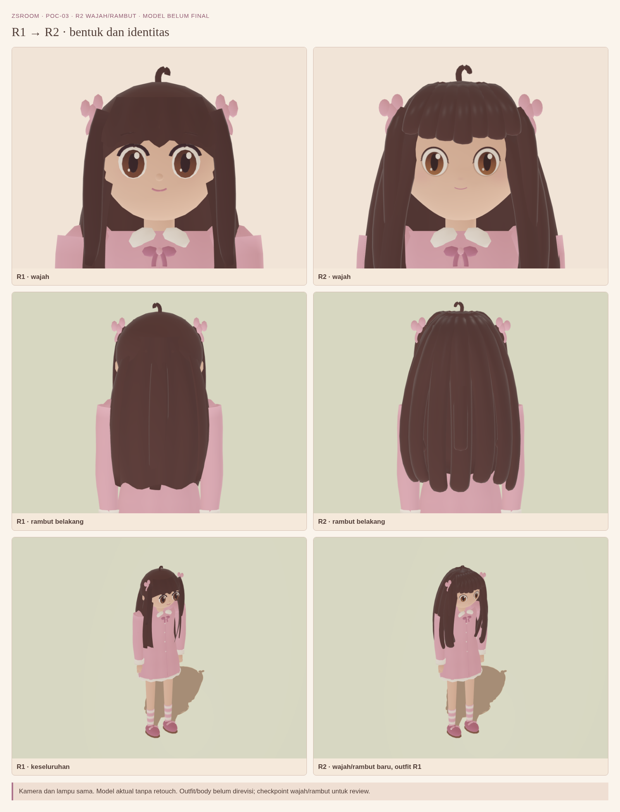
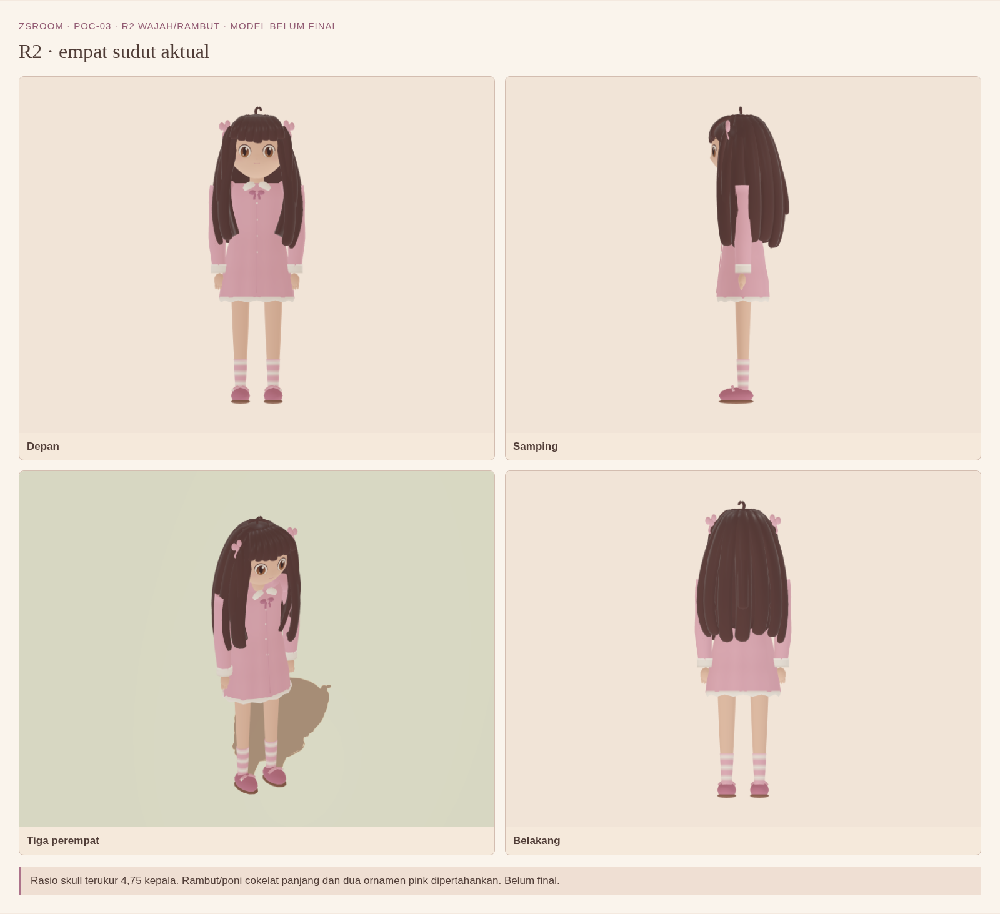
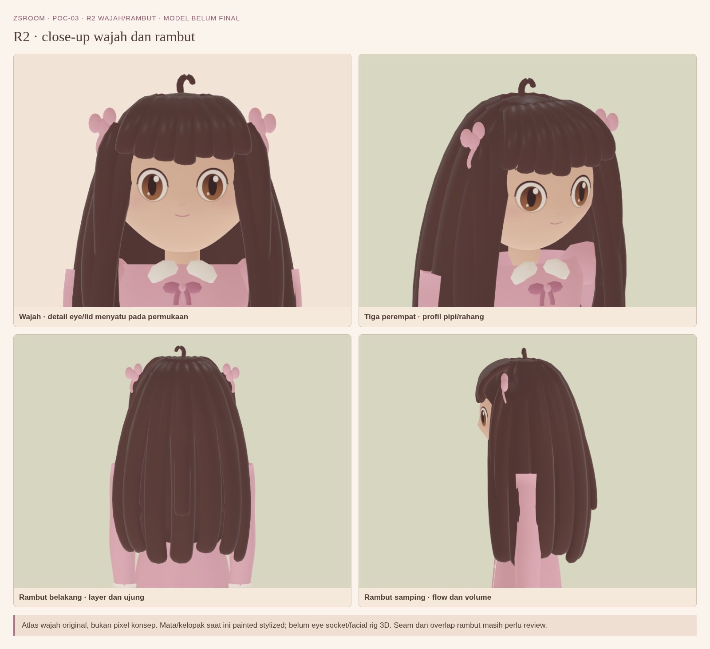
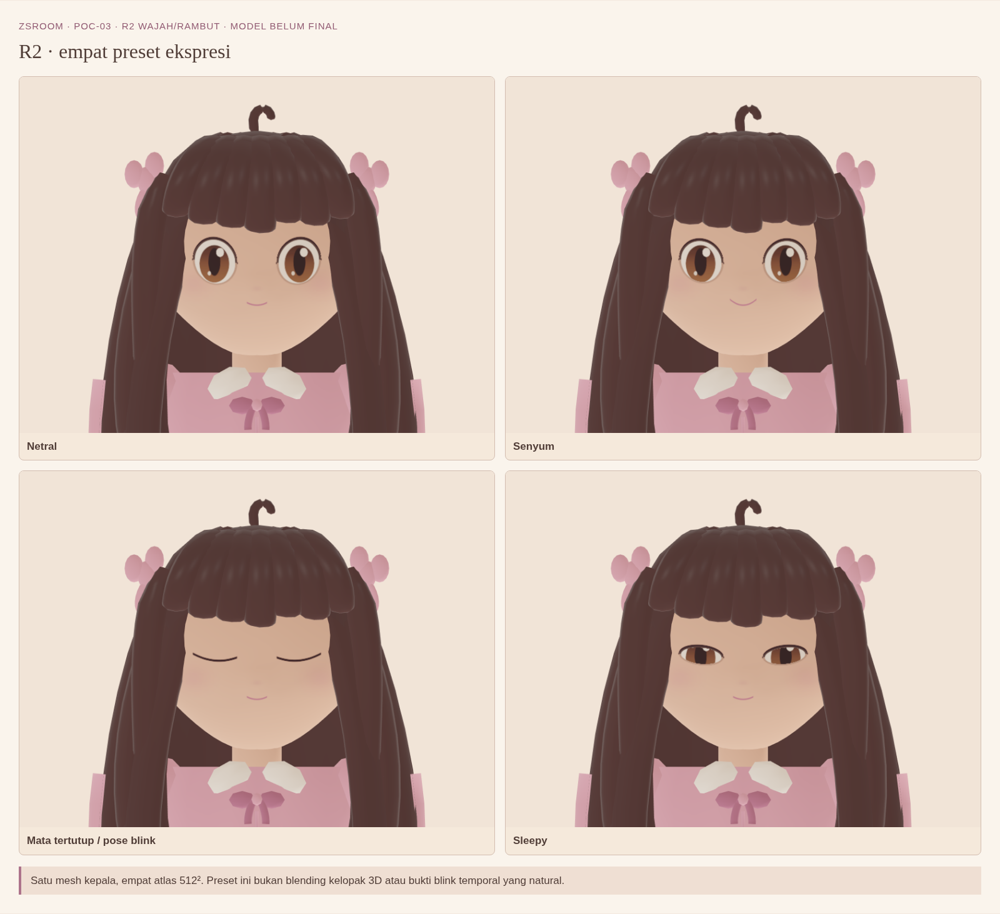
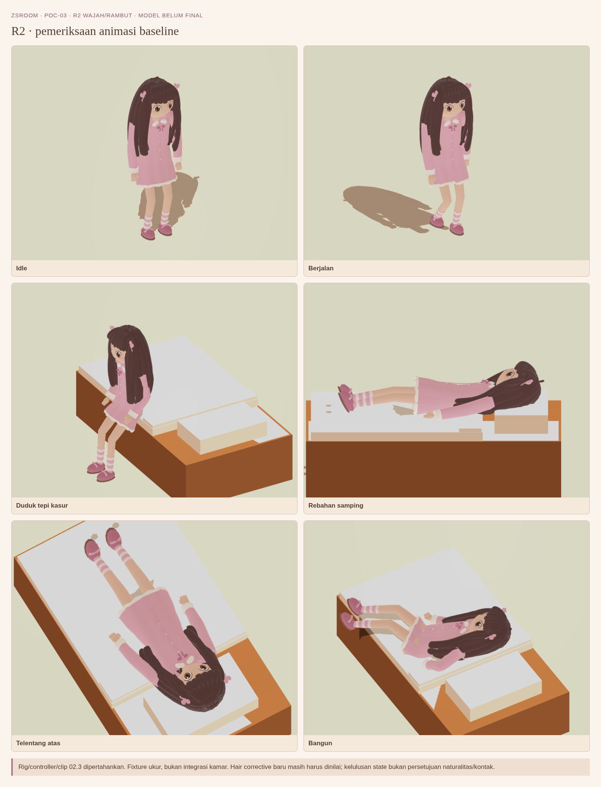

# ZsRoom PoC-03 R2 — review wajah dan rambut

**Belum disetujui sebagai model final.** Paket ini hanya distribusi media review; tidak ada perubahan/integrasi model atau outfit. PNG dari renderer WebGL aktual, tanpa retouch atau perubahan kualitas.

[Unduh ZIP lengkap — 30 PNG asli dan galeri offline](https://github.com/nugrohofebri681-oss/ZsRoom/raw/refs/heads/poc03-r2-review-export/zsroom-poc03-r2-review.zip) · [Manifest/checksum](poc03-r2-review-manifest.json).

Setelah ekstraksi buka `index.html`, atau PNG langsung dari folder images pada HP. Paket tidak memerlukan game server/Node/Blender.

## Audit terukur

| Material | Triangle |
| --- | ---: |
| skin | 1,216 |
| hair | 8,592 |
| cloth | 4,668 |
| face | 2,800 |
| **Total** | **17,276** |

Hair 8,592 triangle (49.73% total), di luar 1,324 triangle ornamen/ribbon cloth. Rincian kelompok dan setiap part serta opsi optimasi ada di `TRIANGLE_AUDIT.md` dalam ZIP dan manifest.

Opsi belum diterapkan: sampling lintasan helai panjang, scalp dan volume penghubung lebih adaptif; penghematan topologi teoritis gabungan 1.024 triangle, bukan hasil model/LOD teruji. Pertahankan ujung/akar/contour dan volume yang menutup celah. Target 10k dan performa A05 belum tercapai/terverifikasi.

## R1 vs R2

[PNG resolusi asli](images/00-r1-vs-r2.png)

## Empat sudut

[PNG resolusi asli](images/01-four-views.png)

## Close-up wajah/rambut

[PNG resolusi asli](images/02-face-hair-closeups.png)

## Empat preset ekspresi

[PNG resolusi asli](images/03-expressions.png)

## Pose/pemeriksaan animasi

[PNG resolusi asli](images/04-animation-checks.png)

## Batas review

Outfit/body masih checkpoint R1. Preset ekspresi adalah atlas, belum facial rig/blink temporal matang. Kontak checkpoint masih mencatat sekitar 24 mm rambut dan 7,3 mm ibu jari pada envelope fixture. Hasil tes gameplay adalah catatan checkpoint 7 November, bukan tes perangkat A05. Model tidak dioptimasi atau diperbaiki saat menyiapkan distribusi.

Feedback: sebut nama PNG, bagian yang perlu diperbaiki, dan prioritas. Branch hanya artefak visual; bukan source, game, Pages atau deployment.
