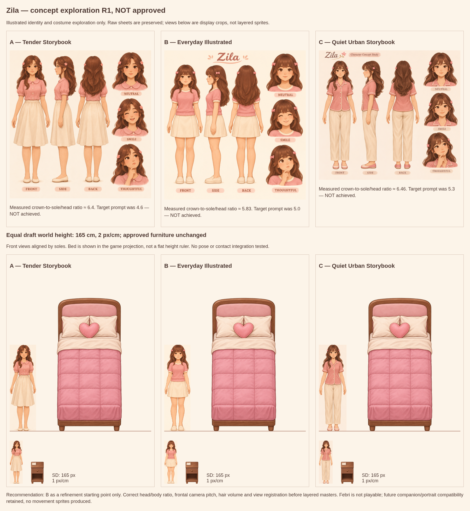
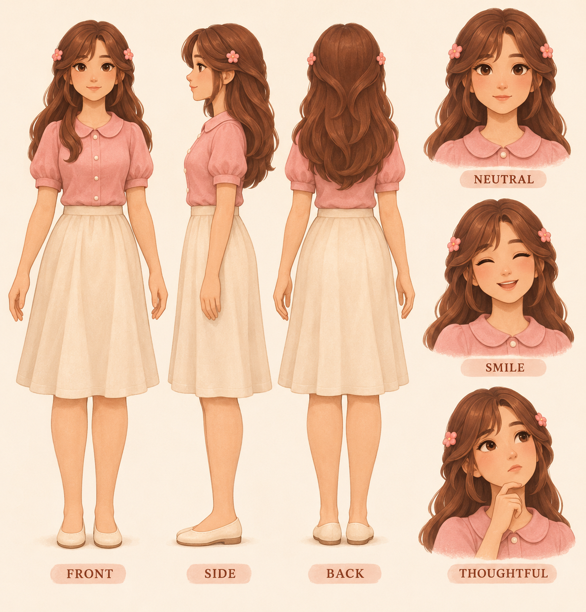
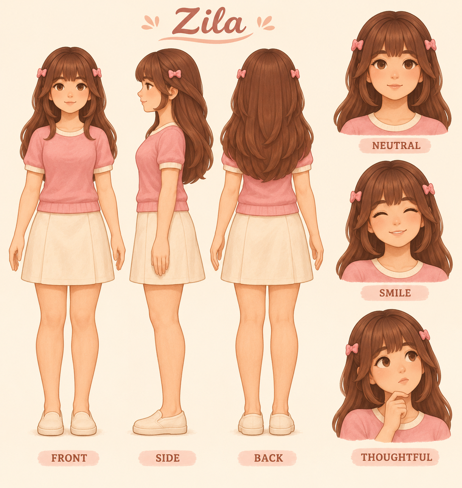
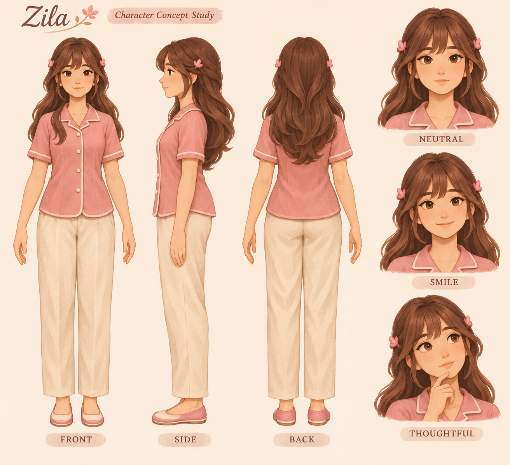

# Zila concept exploration R1 — not approved

| Direction | Strength | Trade-off |
|---|---|---|
| A — Tender Storybook | Warm rounded collar, flower clips, flowing skirt | Puff sleeves/long skirt and numerous hair locks complicate layers; actual6.4-head ratio is too slender for initial target |
| B — Everyday Illustrated | Clearest bangs, bow pair, simple knit top and short A-line skirt; strongest SD read | Actual5.83 heads rather than5.0; front/side hair volume differs; face still needs more individual identity |
| C — Quiet Urban Storybook | Practical trousers, quieter expression and petal clips | Piping reads as sleepwear; longer body and smaller face weaken SD expression, more realistic than target |

Recommend B for a directed refinement, not final approval. First decide face/ornament/costume language, then author one registered proportion sheet with measured landmarks. Do not start walk frames yet.

## Direction A original

## Direction B original

## Direction C original

## Measurements

All figures displayed at the same draft165cm visible height,330pxHD/165pxSD. Bed and nightstand retain original pixel dimensions and pivots. Bed projected length/height is not a human-height ruler.

| Direction | Crown Y | Chin Y | Sole Y | Visible height px | Head height px | Ratio |
|---|---:|---:|---:|---:|---:|---:|
| A | 41 | 214 | 1148 | 1107 | 173 | 6.4 |
| B | 124 | 300 | 1150 | 1026 | 176 | 5.83 |
| C | 97 | 252 | 1098 | 1001 | 155 | 6.46 |

These manual estimates include hair crown and are approximate; no mathematical proportion approval implied.

## Layering plan after approval

Hair-back behind body; separate legs/feet, bottom garment, torso/top, upper/lower arms, head/face, fringe and symmetric ornament pair. Preserve shoulder/hip/hand/foot landmarks across authored views; shirt hem covers torso-bottom seam. A skirt hides knee topology but needs seated folds; trousers need separate knee/crotch folds. All current images are flattened concepts only.

## Limitations

- Exploration only: review board is not a runtime frame, atlas or layered master. Draft256x400 production canvas intentionally not used.
- Actual front crown-to-sole/head ratios approx A6.40, B5.83, C6.46 (+/-0.2), rather than requested4.6/5.0/5.3. Measurements use hair crown to chin; not a production anatomical standard.
- Views are illustrated silhouette studies, not registered flat silhouette masks. Side views vary in chin, body thickness and hair volume. Camera is closer to frontal illustration than the final game elevation.
- Face language still shares generic storybook/animation conventions; identity needs deliberate refinement before final approval. A and C remain more slender than proposed.
- Opaque paper backgrounds and baked local foot shadows remain in concept sheets. No separated layers, transparency cleanup, animation, rigging or gameplay integration.
- At SD165px height eye/ornament microdetail diminishes. Brown hair/pink top/cream bottom remain recognisable; portrait polish must not substitute for sprite testing.

## Febri compatibility

Febri is not playable. Chat/call/VC and eventual Travel companion roles only. Retain cream jacket, blue shirt, correct asymmetric bag; no full movement production. Once Zila scale is approved, keep matching head size and derive3–6cm visible difference through body/legs, including shoes/hair. No private story details invented.

## Review tooling

Requested concept branch does not match current production-only branch regex. The concept board is not a256x400 runtime frame; do not label it TECHNICAL PASS for production. Specs, validator and manifest remain unchanged. Review raw sheets, hashes and the board; concept-aware CI is a future tooling decision for Claude.

Actual production validator attempted: fails canvas1800x1958 versus256x400 and RGB versusRGBA. This is not an animation-ready submission. Original sheets and review PNG integrity passed. Base64 local HTML was moved outside repository to /workspace/scratch/zila-concept-review.html; it is not committed.
