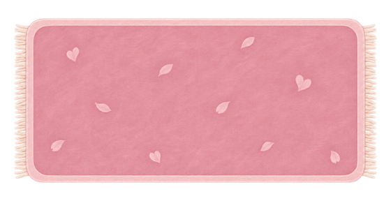
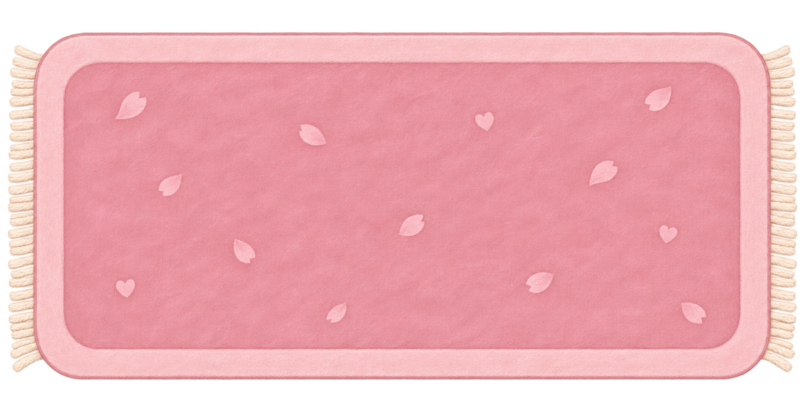
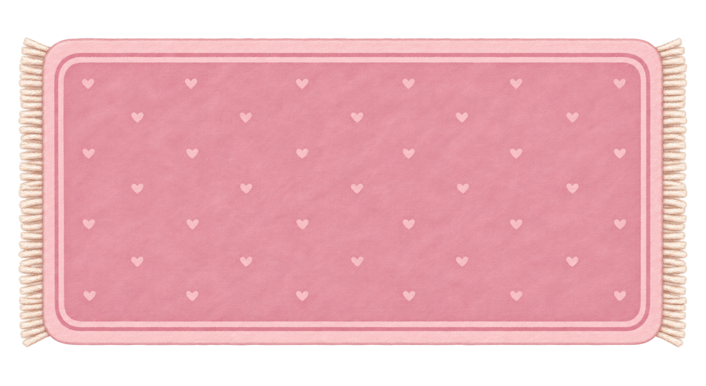
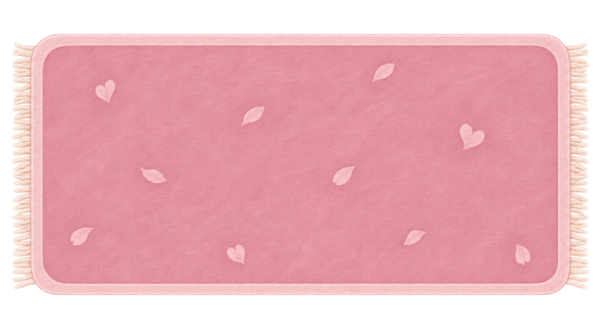

# decal_rug_zila v001 — Batch C review

Not visually approved. Do not merge or integrate automatically.

## Selected export

## Candidate comparison

A: raised-looking border; B: regular hearts and double border; C selected: quieter scattered petals and flat single border.

### Candidate A

### Candidate B

### Candidate C

## Measured geometry and limitations

Painted extent520x236 centred280,144, top26/bottom261. Nominal projected depth252px is16px greater. Border remains subtly shaded but no sidewall/cast shadow. Fitter fails on missing baseLine for centre-pivot spec; equivalent uniform trim/resize/centre fallback documented in prompt.md, no official script changed.

Measurements are visual estimates on fitted native-resolution PNGs (typically ±2px); automated canvas/bounds checks do not validate perspective, contact or artistic quality. No pivot/spec/engine changes used to hide discrepancies.

## Review reproduction

Run `npm run validate:art` and `npm run gallery`. Inspect this asset on light, dark, checker, native and SD views next to approved bed and nightstand at the same 2px/cm scale. Candidate raw SHA-256 and master hash are in metadata.json.

## Actual validation

TECHNICAL PASS: 22/22 automated checks. Official gallery inspected in Chromium. Palette and illustration are cohesive with approved references; perspective/height discrepancies above remain unresolved and are not covered by automated validation. Screenshots retained in ignored local review-gallery; recreate with npm run gallery.
