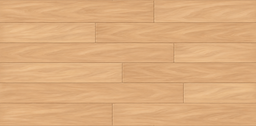
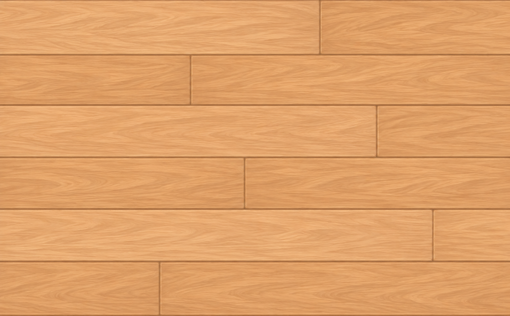
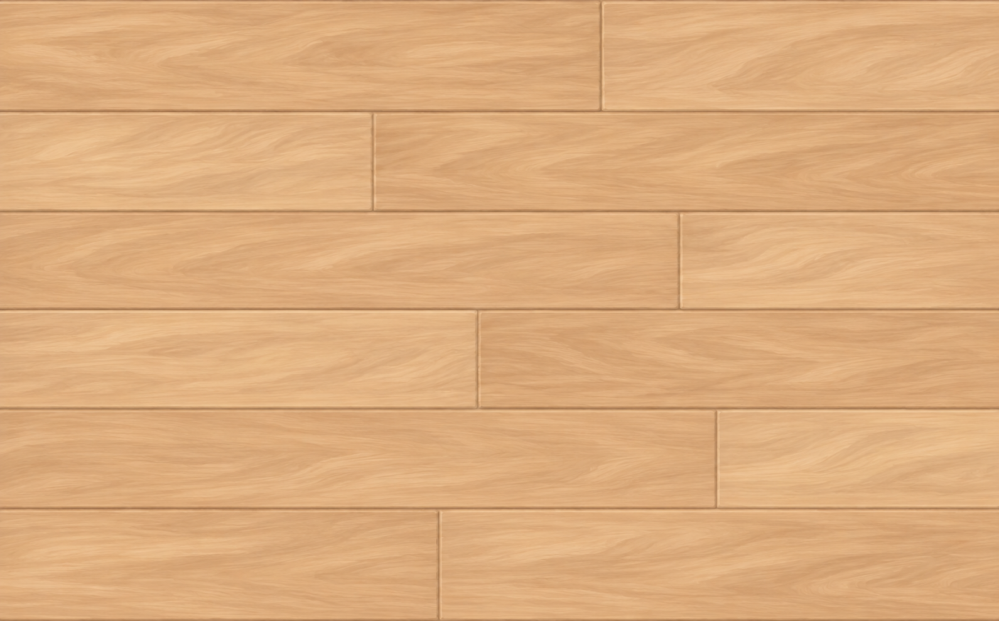
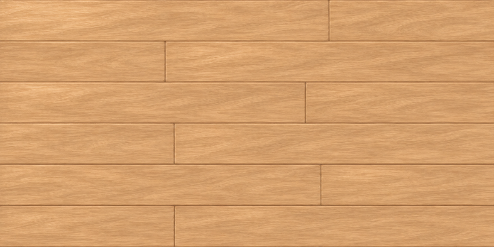

# env_floor_planks_honey — Batch E R1

Pending Creative Director review.



A warmer orange and more active grain; B selected for pale honey and quiet joints; C has larger grain movement and more orange colour.

## Candidate A



## Candidate B



## Candidate C



## Export details

Lanczos resize full original to256x126, no trim. Local symmetric edge-colour correction fading quadratically across8px left/right and2px top/bottom; opposite edge pixels match exactly. Six original plank rows retained.

## Actual validation and visual review

{
  "status": "TECHNICAL PASS",
  "checksPassed": 23,
  "checks": [
    {
      "name": "asset id format",
      "pass": true,
      "detail": "env_floor_planks_honey"
    },
    {
      "name": "version format (v###)",
      "pass": true,
      "detail": "v001"
    },
    {
      "name": "spec exists",
      "pass": true,
      "detail": "specs/environments/env_floor_planks_honey.json"
    },
    {
      "name": "master file present",
      "pass": true,
      "detail": "env_floor_planks_honey_v001.png"
    },
    {
      "name": "metadata.json present",
      "pass": true,
      "detail": ""
    },
    {
      "name": "only png/webp/json/md files",
      "pass": true,
      "detail": ""
    },
    {
      "name": "metadata schema",
      "pass": true,
      "detail": ""
    },
    {
      "name": "metadata.assetId matches folder",
      "pass": true,
      "detail": "env_floor_planks_honey"
    },
    {
      "name": "metadata.version matches folder",
      "pass": true,
      "detail": "v001"
    },
    {
      "name": "metadata.specVersion matches spec",
      "pass": true,
      "detail": "1.0.0 vs 1.0.0"
    },
    {
      "name": "createdAt is a date",
      "pass": true,
      "detail": ""
    },
    {
      "name": "master sha256 matches metadata",
      "pass": true,
      "detail": "30e7d44b1e6fad17cffd9ef3b3925ecf17601139ce43b7089bd2fa016d00e8de"
    },
    {
      "name": "format PNG",
      "pass": true,
      "detail": "png"
    },
    {
      "name": "canvas size",
      "pass": true,
      "detail": "256x126, expected 256x126"
    },
    {
      "name": "RGBA (alpha channel)",
      "pass": true,
      "detail": "4 channels"
    },
    {
      "name": "8-bit depth",
      "pass": true,
      "detail": "uchar"
    },
    {
      "name": "sRGB colour space",
      "pass": true,
      "detail": "srgb"
    },
    {
      "name": "file size",
      "pass": true,
      "detail": "37250 bytes (max 600000)"
    },
    {
      "name": "transparent edge padding",
      "pass": true,
      "detail": "0 non-transparent px within 0px of the edge"
    },
    {
      "name": "opaque coverage \u2265 min",
      "pass": true,
      "detail": "1.000"
    },
    {
      "name": "opaque coverage \u2264 max (no baked background)",
      "pass": true,
      "detail": "1.000"
    },
    {
      "name": "seamless horizontally (left\u2194right edge)",
      "pass": true,
      "detail": "mean edge delta 0.0 (max 14)"
    },
    {
      "name": "seamless vertically (top\u2194bottom edge)",
      "pass": true,
      "detail": "mean edge delta 0.0 (max 14)"
    }
  ],
  "pixelMetrics": {
    "alphaMin": 255,
    "alphaMax": 255,
    "edgeDeltaX": 0.0,
    "edgeDeltaY": 0.0
  },
  "officialGallery": "FAIL: build-gallery.mjs overlay accesses missing environment spec.pivot; not changed.",
  "alternativeGallery": "review-gallery/batch-e-review.html inspected; repeated tiles and native candidates.",
  "browser": {
    "screenshots": 9,
    "contexts": [
      "1440x1000 desktop DPR1",
      "360x800 Android portrait DPR2/touch",
      "800x360 Android landscape DPR2/touch"
    ],
    "zoomMultipliers": [
      0.75,
      1,
      1.6
    ],
    "pageErrors": 0,
    "method": "Browser-only TEMP canvas texture replacement via __ZS_GAME; no engine or manifest changes.",
    "hardware": "Emulation only, not physical Samsung A05 performance validation."
  },
  "visualApproval": "pending"
}

No obvious edge discontinuity in the inspected repeated patterns or bedroom screenshots. Floor grain recurrence remains visible on large uninterrupted areas; panel repetition is intentional. Android detail zoom crops the room as the existing camera dictates. FPS in these screenshots reflects cloud Chromium and is not A05 evidence.

Official gallery has an environment-pivot bug; temporary alternative gallery and nine actual bedroom captures are in ignored local review-gallery. No approved art changed, no new assets integrated.

## Reproduce actual bedroom preview

Use npm run dev -- --host 127.0.0.1 --port 4195, then this local Playwright script (adjust absolute workspace path):

```js
import {chromium} from '/workspace/ZsRoom-art-batch-e/node_modules/@playwright/test/index.mjs';
import fs from 'node:fs';
const root='/workspace/ZsRoom-art-batch-e',out=root+'/review-gallery';
const browser=await chromium.launch({executablePath:'/usr/bin/chromium',args:['--no-sandbox']});const results=[];
for(const device of [{name:'desktop',viewport:{width:1440,height:1000},deviceScaleFactor:1},{name:'android-portrait',viewport:{width:360,height:800},deviceScaleFactor:2,isMobile:true,hasTouch:true,userAgent:'Mozilla/5.0 (Linux; Android 13; SM-A055F) AppleWebKit/537.36 Chrome/131.0.0.0 Mobile Safari/537.36'},{name:'android-landscape',viewport:{width:800,height:360},deviceScaleFactor:2,isMobile:true,hasTouch:true}]){
 const {name,...opts}=device,ctx=await browser.newContext(opts),p=await ctx.newPage();const errors=[];p.on('pageerror',e=>errors.push(e.message));await p.goto('http://127.0.0.1:4195/?fresh');await p.waitForFunction(()=>window.__ZS?.state());
 const inject=await p.evaluate(async()=>{const g=window.__ZS_GAME,keys=g.textures.getTextureKeys().filter(k=>k.startsWith('temp:env_'));for(const k of keys){const id=k.split(':')[1].split('@')[0],im=new Image();im.src='/art/submissions/'+id+'/v001/'+id+'_v001.png';await im.decode();const t=g.textures.get(k),c=t.getContext();c.setTransform(1,0,0,1,0,0);c.clearRect(0,0,t.width,t.height);c.drawImage(im,0,0,t.width,t.height);t.refresh();}return keys;});
 if(inject.length!==2)throw Error('missing tile injection');
 for(const [label,z]of [['wide',.75],['normal',1],['detail',1.6]]){await p.evaluate(z=>{window.__ZS.zoomBy(z-window.__ZS.state().zoomMul);window.__ZS.teleport(300,230)},z);await p.waitForTimeout(400);await p.screenshot({path:out+'/'+name+'-'+label+'.png'});results.push({device:name,zoom:label,injected:inject,errors,state:await p.evaluate(()=>window.__ZS.state())});}await ctx.close();
}
fs.writeFileSync(out+'/browser-evidence.json',JSON.stringify(results,null,2));await browser.close();console.log('9 actual bedroom screenshots; runtime canvas injection only, no source or manifest edits.');

```
