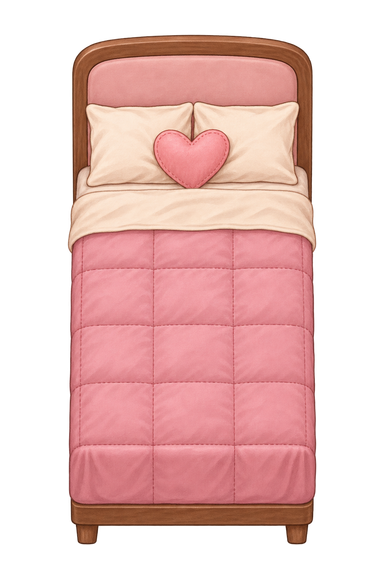
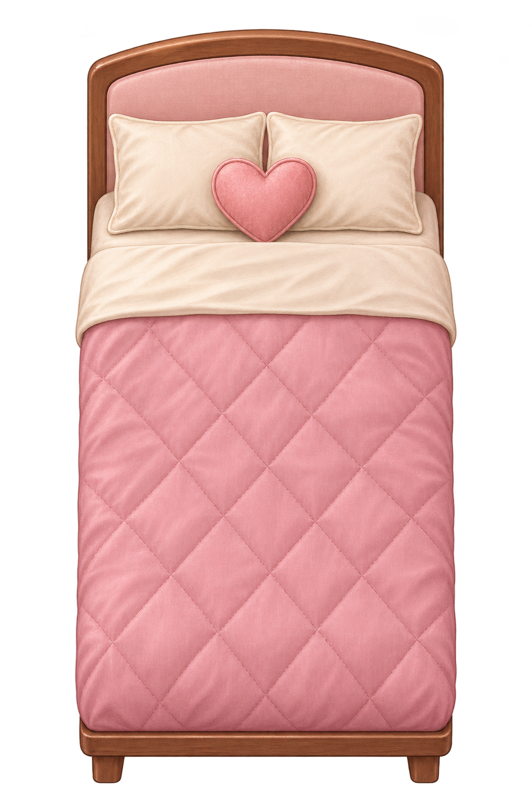
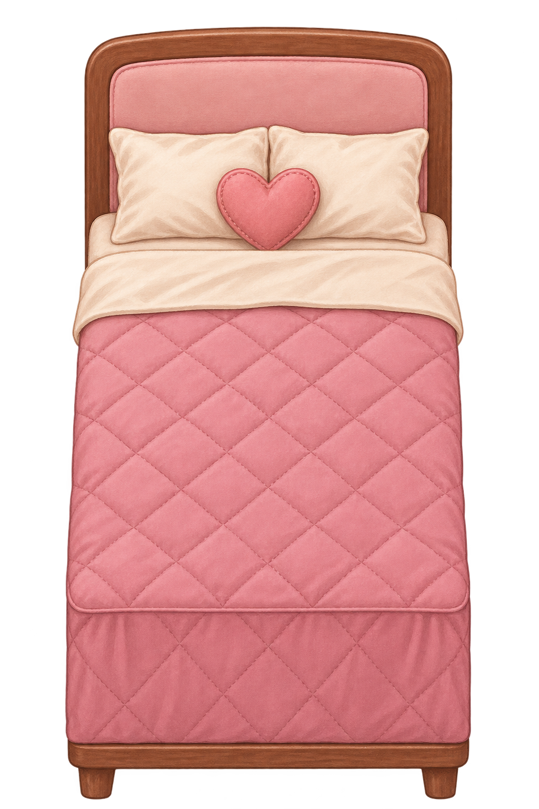
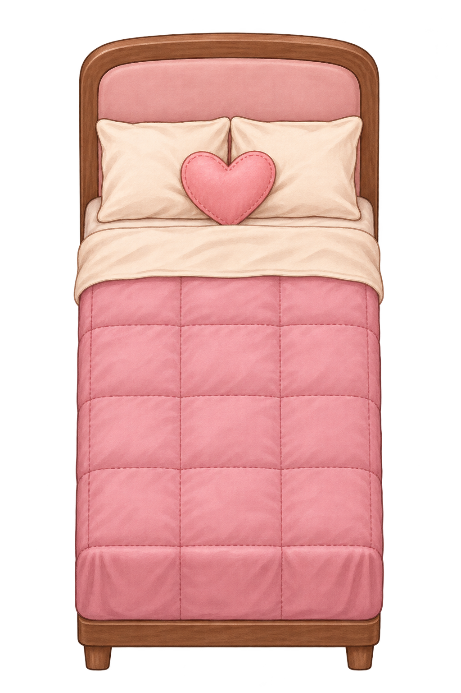
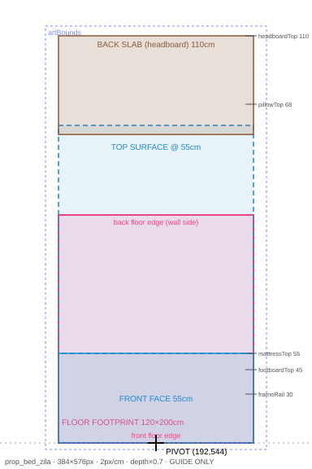
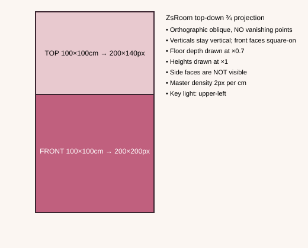

# prop_bed_zila v001 — Creative Director review

Status: TECHNICAL PASS locally; VISUAL PENDING; NOT PRODUCTION READY. No integration, engine edits or approval-manifest changes.

## Selected export

## Raw candidate comparison

| A | B | C — selected |
| --- | --- | --- |
|  |  |  |

A: gentle arch and broad diamond quilt, but weak top/front surface break. B: stronger front drape, but more crowded diamond pattern and widening towards the foot. C: quieter square quilting, most parallel silhouette and clearest low frame. All are actual built-in image-generation outputs, not procedural artwork.

## Official reference comparison

The master uses centered top/front-only projection, two cream pillows, pink heart cushion, rose bedding and walnut frame. Exact vertical guide agreement is not achieved: headboard top about y35 vs y44, bedding top/front break about y445 vs y434, and pillows extend lower than the guide. The fitter height-limited content to 250x512 instead of nominal 272px overhang width. No distortion was applied to hide this difference.

## Remaining artistic limitations

- Soft material texture is stronger than the Art Bible's contour-led line hierarchy. A manual contour/edge pass may be appropriate after direction approval.
- Pillow scale and fold positions need Creative Director review against the nominal mattress geometry.
- Most solid raw alpha is 253/255, leaving slight translucency. On the reviewed light/dark floors there is no obvious large halo, but this is not a claim of perfect edge quality.
- Headboard is a restrained rounded rectangle; all dimensions are visual approximations, not a measured 3D construction.
- In-game placement, occlusion and interaction are not tested or implemented by this submission.

## Technical evidence

- Official npm run validate:art: all 23 checks passed; 384x576 RGBA8 sRGB; 251044 bytes; coverage 0.540; bbox (67,34) 250x511; lowest solid row 543 vs pivot544±10; zero transparent-padding violations.
- SHA-256: d41d329432175add32b33c6d98589d289152f3188dac408d231e5fbf1bbe6acc.
- npm run validate:privacy passed before submission.
- npm run gallery generated review-gallery/index.html. Chromium inspected checker/overlay, light, dark, nominal character scale and SD-size views; all 14 gallery images loaded after activating lazy images.
- Gallery is generated, ignored output, deliberately not committed. Reproduce with npm ci && npm run gallery. The official PR workflow uploads it as an artifact once a PR runs.
- Existing gameplay screenshots in the generated gallery are foundation evidence, not tests of this new artwork.

No paid API or external paid service used. Built-in generator model identifier was not exposed. Raw PNG SHA-256 values are recorded in metadata.json.
