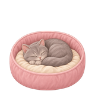
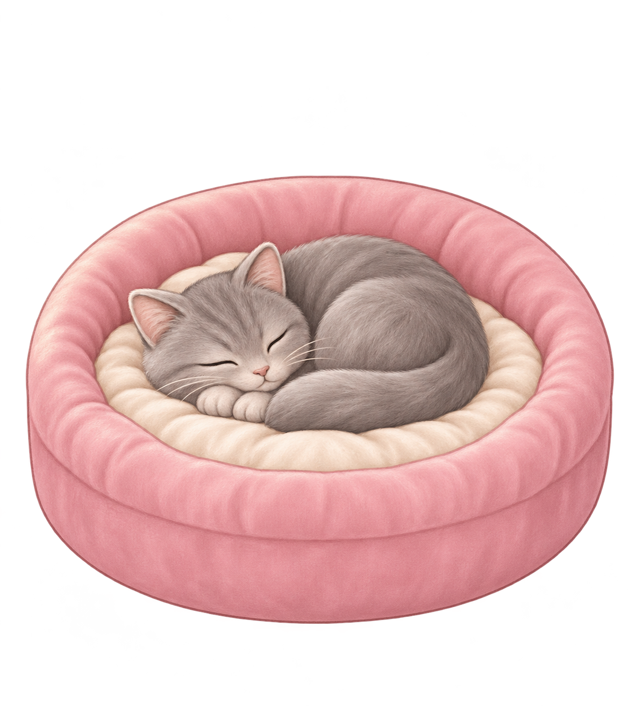
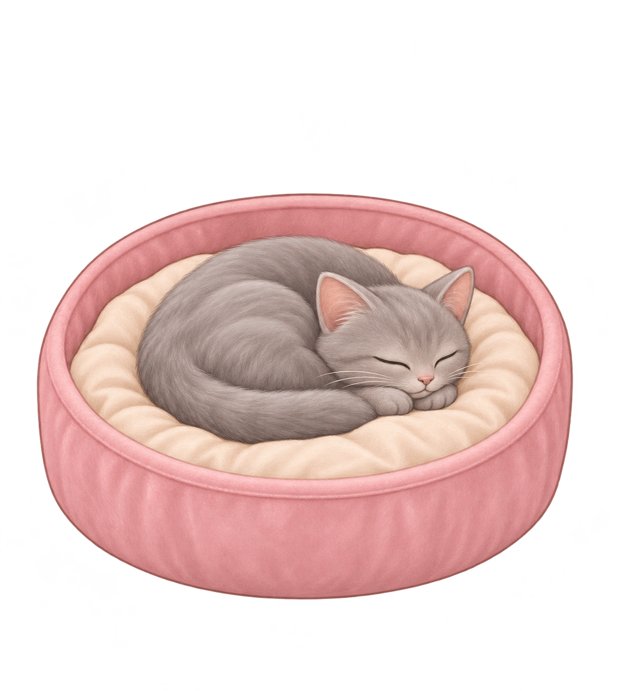
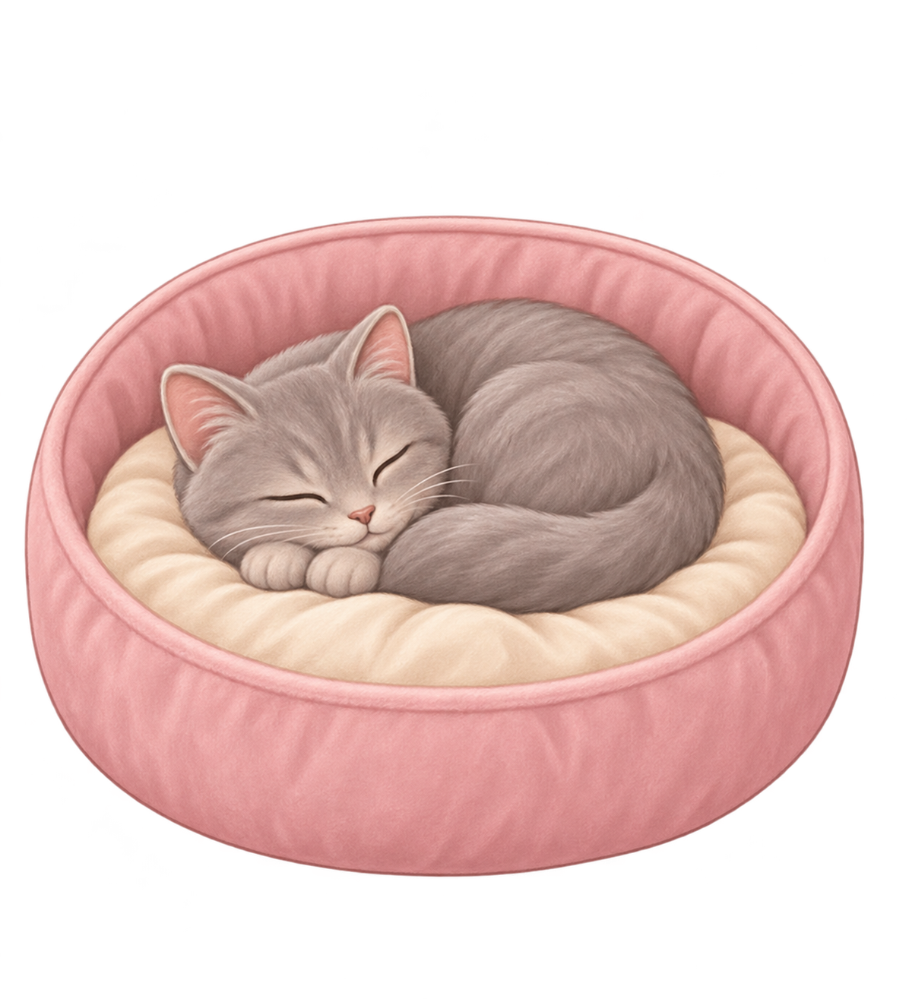

# prop_catbed_mochi v001 — Batch D review

Not visually approved. Do not merge or integrate automatically.

## Selected export

## Candidate comparison

A: thicker plush rim; B: face right and thinner rim; C selected: largest clear sleeping face, medium rim and wrapped tail.

### Candidate A

### Candidate B

### Candidate C

## Measured geometry and limitations

Top52/base152; rim back~54/front highlight~126. Projected top depth~72px versus70px target. Frontwall~26px versus44px target FAIL. Cat pillow and rim overlap anatomically plausibly; ears and closed eyes remain identifiable at SD, whiskers do not. Fur detail may still look more realistic than furniture.

Measurements are visual estimates on fitted native-resolution PNGs (typically ±2px); automated canvas/bounds checks do not validate perspective, contact or artistic quality. No pivot/spec/engine changes used to hide discrepancies.

## Review reproduction

Run `npm run validate:art` and `npm run gallery`. Inspect this asset on light, dark, checker, native and SD views next to approved bed and nightstand at the same 2px/cm scale. Candidate raw SHA-256 and master hash are in metadata.json.

## Actual validation

TECHNICAL PASS: 23/23 automated checks. Official gallery inspected in Chromium. Palette and illustration are cohesive with approved references; perspective/height discrepancies above remain unresolved and are not covered by automated validation. Screenshots retained in ignored local review-gallery; recreate with npm run gallery.
