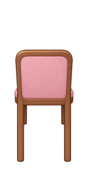
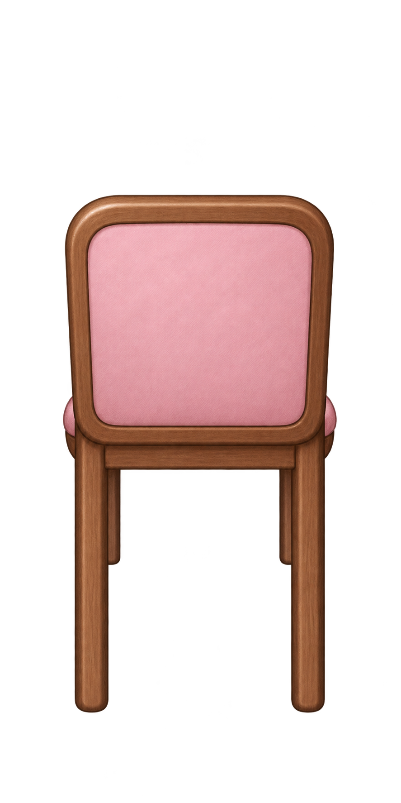
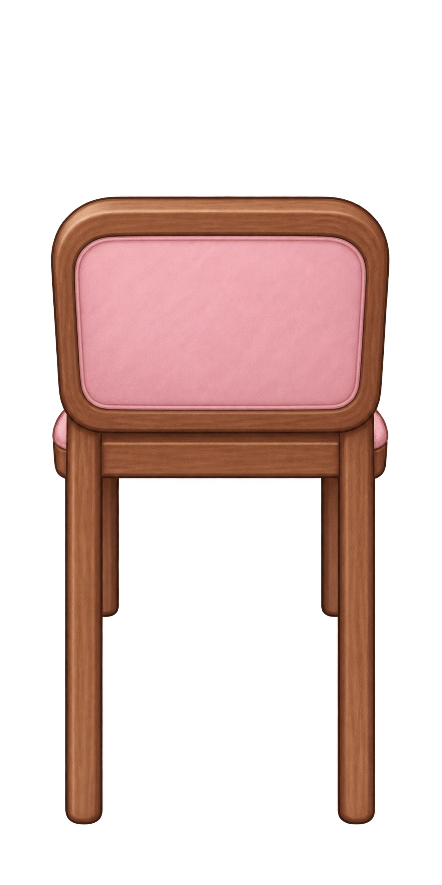
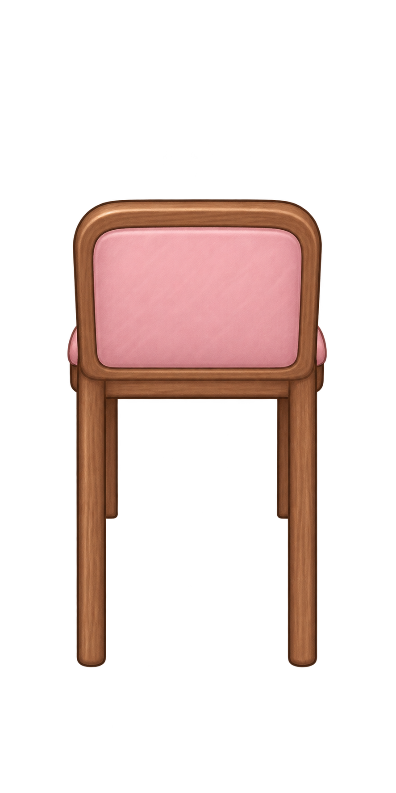
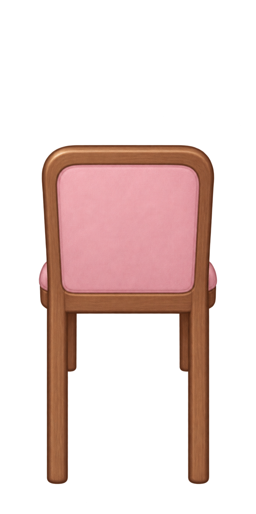

# prop_chair_desk v002 — Batch B Round2 review

Visual approval pending Creative Director. NOT PRODUCTION READY.

## Candidate comparison

A: rear view, tall backrest. B: wider upholstered frame. C: shorter/narrower back silhouette. D SELECTED: strongest rear reading with both approved finish references and near nominal back height.

### candidate-a

### candidate-b

### candidate-c

### candidate-d

## Measurements and known limitations

- Backrest top y81 vs84 target; front floor264 =>183px vs180 nominal. Width98 includes overhang.
- Rear orientation: backrest occludes seat; only side tips show. Visible cushion side region roughlyy149–161; full near seat edge at nominal174 is hidden, so exact45cm seat contact cannot be verified from artwork alone. Requires seated-character integration check.
- Rear appearance is materially improved vsR1. Broad upholstered rear changes visible backrest proportions slightly. No character/engine integration performed.

## Validation and review

Run npm ci, npm run validate:art and npm run gallery. Gallery is generated locally/CI and ignored, not committed as an extra asset. Same-scale bed/nightstand and light/dark alpha review required. No engine, approved assets, wardrobe, spec, or integration changes. No gameplay claims.

## Actual verification — 20 November 2026

TECHNICAL PASS: 23/23 official checks. Official gallery generated and inspected in Chromium on checker, light/dark backgrounds and same-scale approved bed/nightstand. Static desk/laptop/mug and vanity/stool placement inspected; no gameplay or seated-avatar test claimed. All raw candidate SHA256 checks match original generator outputs. Metadata includes per-file checksums. Privacy scan passed. Visual approval remains pending.
