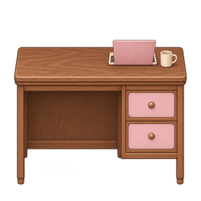
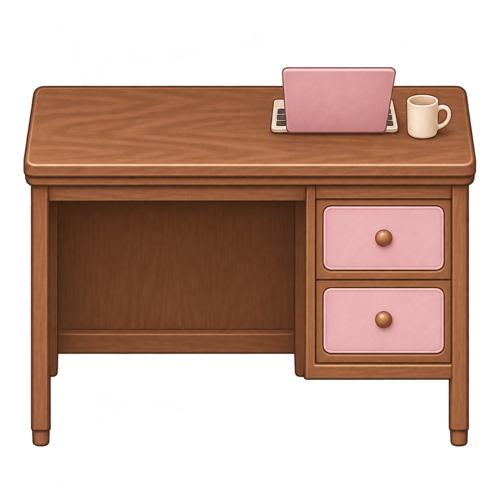

# prop_desk_zila v001 review

VISUAL PENDING. NOT PRODUCTION READY. Batch B round1; one original generated candidate for this asset. Wardrobe was generated first and selected as the batch finish reference; the four remaining assets were also conditioned on its fitted master. This is a working style reference, NOT a visual approval. Official approved bed and nightstand condition every asset. Measurements are manual approximate master-pixel readings, not a geometric certification.

## Raw candidates

## Measurements and limitations

- Measured approximate tabletop backEdgeY67, frontEdgeY112, floor264. Front height152 vs150 (+1.3%, within10%); depth45 vs84 (-46.4%, outside25%). Top plane is too shallow and slightly tapered.
- Laptop rear lid and keyboard fragments are present, screen unlit; left half stays clear. Added large back panel and two right drawers make the desk heavier than requested slim construction. Need knee-clearance/geometry review before integration.

## Reproduction

Run npm ci, npm run validate:art and npm run gallery. The generated gallery is ignored, not committed; official PR CI uploads it when available. Existing gameplay screenshots are baseline evidence, not integration tests of this asset. Metadata records checksums and all references. No engine or approved asset changes.

Local technical result: TECHNICAL PASS, 23 checks, no validator errors; coverage 0.464. Privacy and branch ownership checked separately. Official gallery inspected in Chromium; all114 images loaded. Both approved references were visually compared at the same2px/cm scale, with light/dark and SD views. Warm wood/pink/cream family is coherent; the geometry issues above remain unresolved. No visual approval is granted.
