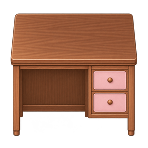
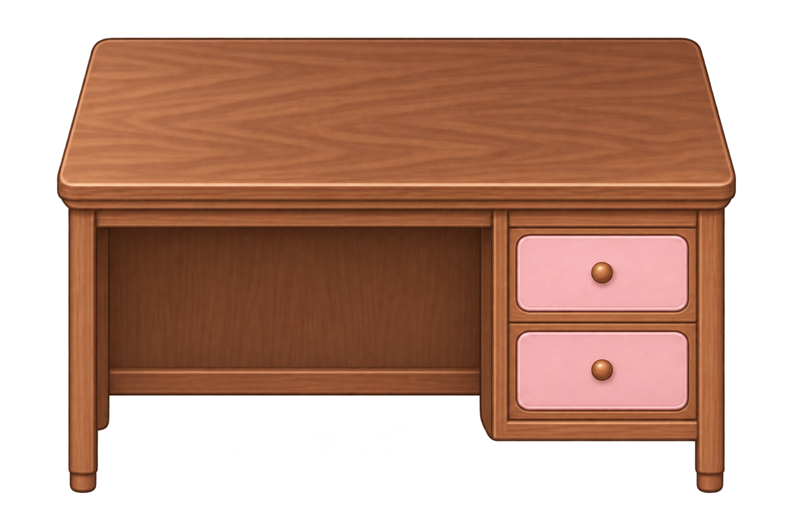
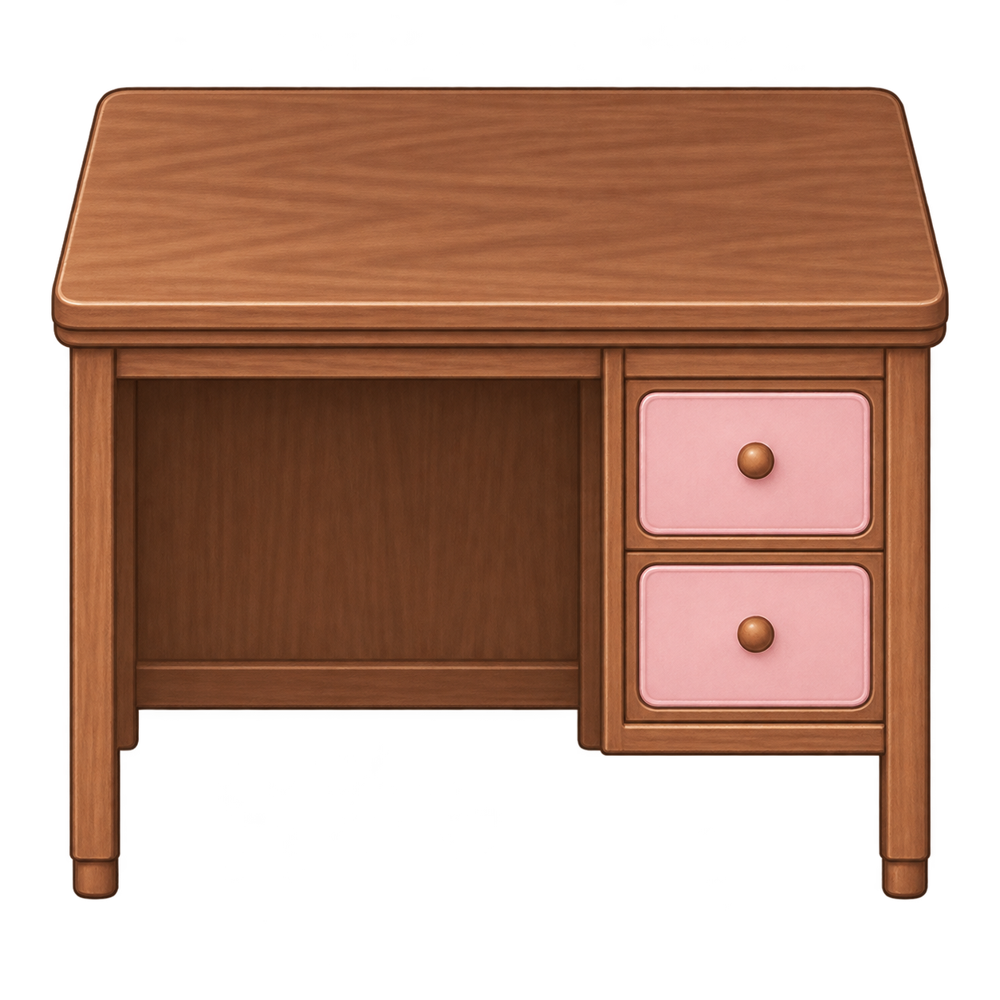
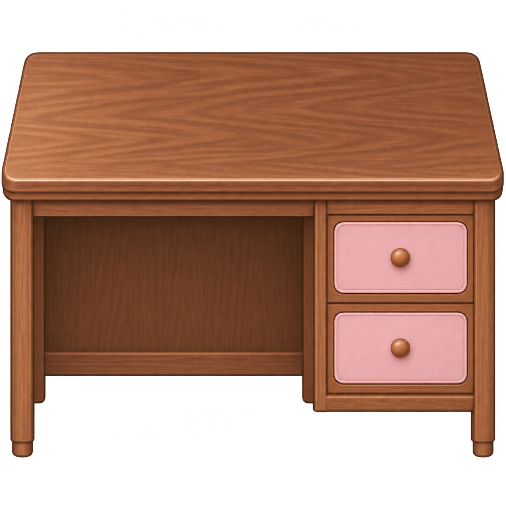
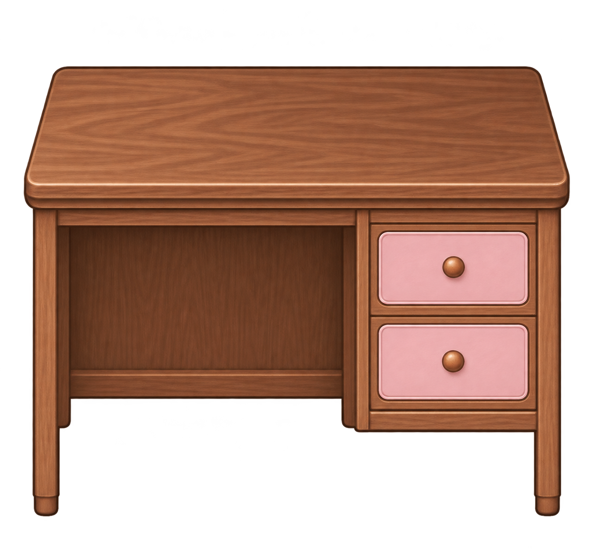
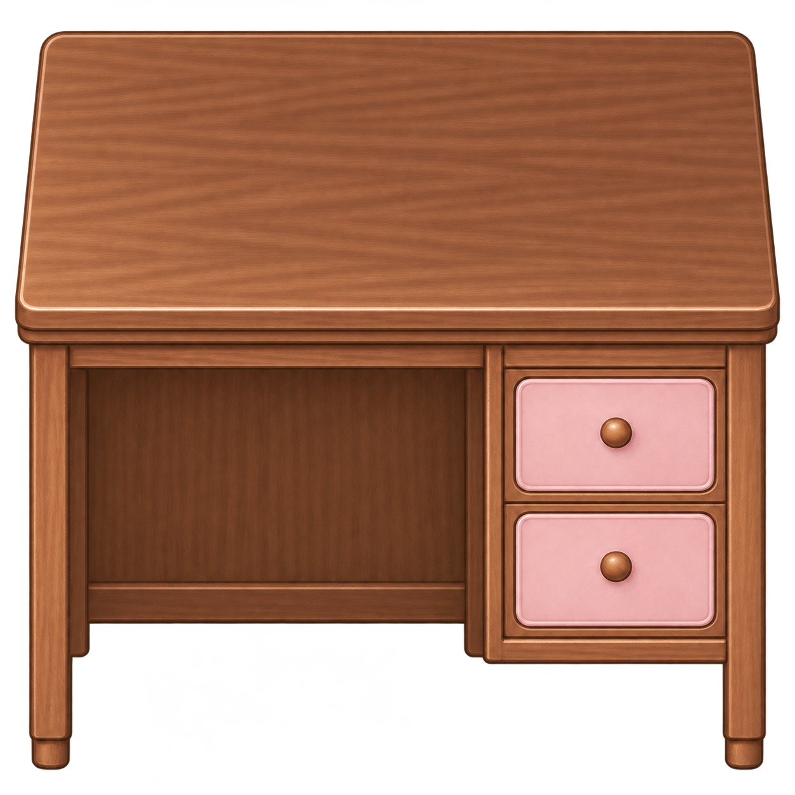

# prop_desk_zila v002 — Batch B Round2 review

Visual approval pending Creative Director. NOT PRODUCTION READY.

## Candidate comparison

A: too squat. B: front height close but shallow top. C: wider/shorter with convergence. D: fully conditioned references but shallow top. E SELECTED: targeted B edit, deep top and near-square overall geometry; minor taper remains.

### candidate-a

### candidate-b

### candidate-c

### candidate-d

### candidate-e

## Measurements and known limitations

- Estimated painted top back y27, front y118: depth91 vs84 target (within25%); front height146 vs150 (within10%). Floor264. Nominal target rows30/114. Estimates allow about2px edge ambiguity.
- Top retains slight trapezoidal taper (~10px each side), contrary to strict parallel depth edges. No external side face, but projection is not mathematically exact. Review required; no automatic visual approval.
- Clean empty desktop. No laptop/mug baked in. Static proposed laptop/mug anchors checked separately; integration remains Claude's task.

## Validation and review

Run npm ci, npm run validate:art and npm run gallery. Gallery is generated locally/CI and ignored, not committed as an extra asset. Same-scale bed/nightstand and light/dark alpha review required. No engine, approved assets, wardrobe, spec, or integration changes. No gameplay claims.

## Actual verification — 20 November 2026

TECHNICAL PASS: 23/23 official checks. Official gallery generated and inspected in Chromium on checker, light/dark backgrounds and same-scale approved bed/nightstand. Static desk/laptop/mug and vanity/stool placement inspected; no gameplay or seated-avatar test claimed. All raw candidate SHA256 checks match original generator outputs. Metadata includes per-file checksums. Privacy scan passed. Visual approval remains pending.
