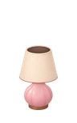
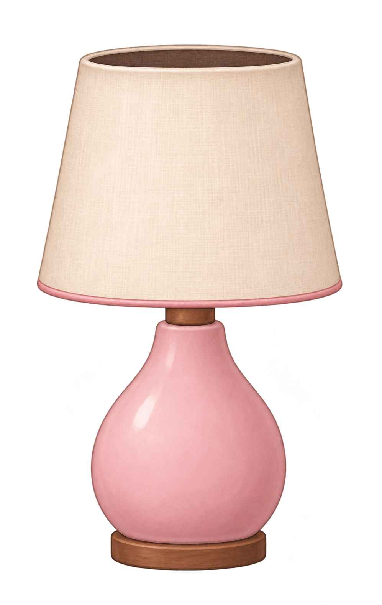
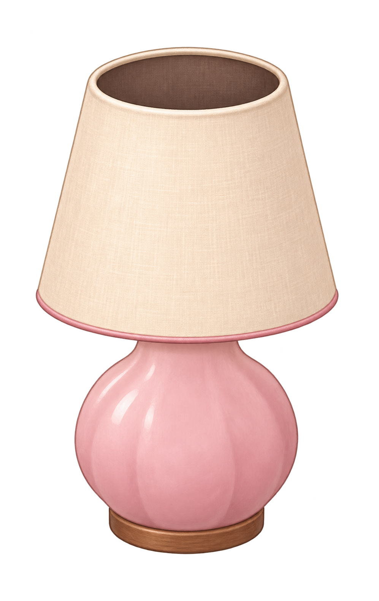
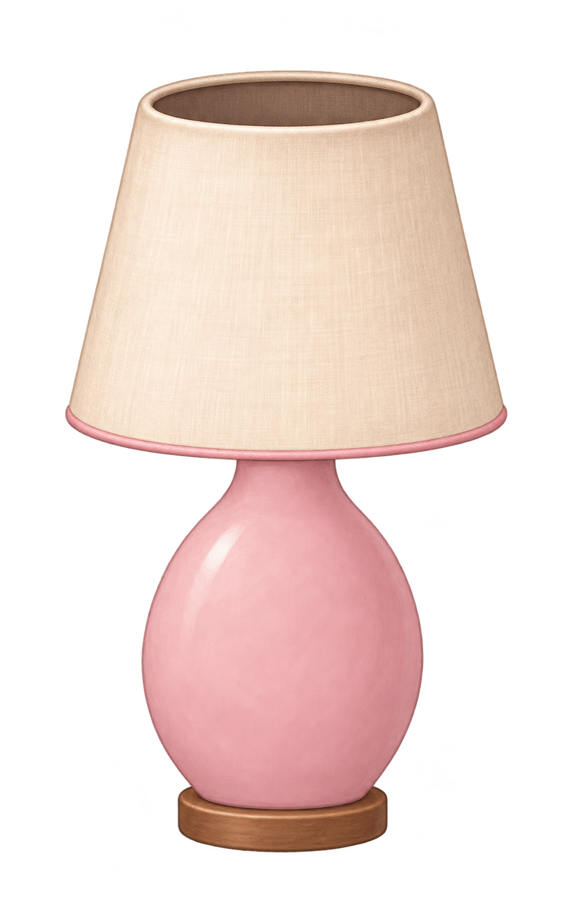

# prop_lamp_zila v001 review

VISUAL PENDING. NOT PRODUCTION READY. Candidate B is the strongest of three imperfect options. Geometry is outside tolerance; request a targeted revision or explicit CD geometry exception before integration. This is NOT visual approval.

## Raw candidates

## Measurements and limitations

- Measured fitted base front row135 (target135); shade bottom rim approximately101 (target80); shade top opening centre approximately62 (target40). Both shade rows exceed the requested tolerance. Selected candidate is too short after width-based fitting; no nonuniform stretching used.
- Upper opening ellipse approximately32x10px (ratio~0.31), shallower than target0.7; base also shallower/narrower than32x22px. Host contact is provisional, not certified.
- B selected for deeper visible opening than A/C. A has an exposed wooden neck; C has a smoother ceramic silhouette but shallower opening.
- Unlit warm cream can still read bright; no painted glow or bulb present. Linen texture and glaze highlights are stronger than reference contours. No gameplay integration or lit-state test.

## Reproduction

Run npm ci, npm run validate:art and npm run gallery. The generated gallery is ignored, not committed; official PR CI uploads it when available. Existing gameplay screenshots are baseline evidence, not integration tests of this asset. Metadata records checksums and all references. No engine or approved asset changes.

Local result: TECHNICAL PASS (23 checks). Official gallery inspected in Chromium: 78 images loaded, none failed. Pairings show coherent cream/pink/walnut materials but insufficient lamp height and shallow ellipses; not ready for visual approval.
