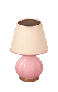

# Lamp v002

No regeneration. Original candidate B checksum preserved. Controlled height export follows corrected Request004 and PR9 review. VISUAL PENDING, no self-approval.

- Base front row135 matches target135; shade top ellipse centre~37 vs40, bottom rim centre~85 (front curve~91) vs80. Row estimates within height tolerance.
- Shallow ellipse persists from original candidate B; this limitation is explicitly accepted for game-scale evaluation in the authoritative PR9 review, not independently approved by Codex.
- Shade width~63 exceeds nominal48 while staying inside artBounds. Host contact and glow location checked statically; no new gameplay or lit-state regression claimed.

## Verification

23/23 official asset checks pass. Official review gallery built and viewed through local Chromium. Static host composition inspected at native scale: lamp base stays inside nightstand top at anchor (100,52), clear of letter. Shade emission anchor (48,60) lies inside shade. No lit-state or gameplay integration test claimed. Local review screenshots are in ignored review-gallery/ and are not submission files.
