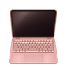
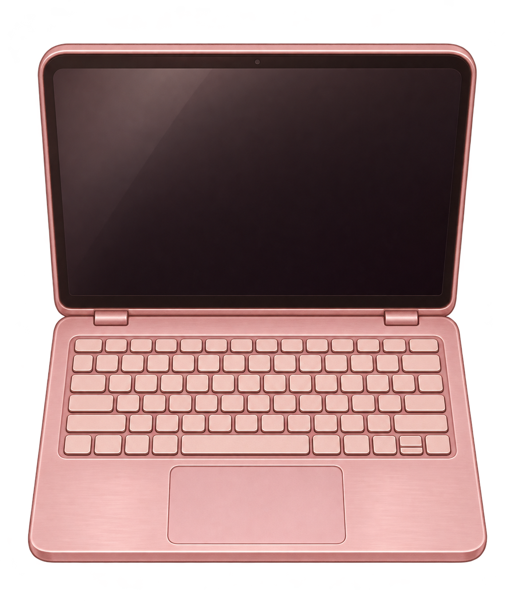

# prop_laptop_zila v001 — Batch B Round2 review

Visual approval pending Creative Director. NOT PRODUCTION READY.

## Candidate comparison

A SELECTED: screen faces viewer correctly, independent surface prop. One new original candidate.

### candidate-a

## Measurements and known limitations

- Base front91, hinge~54, screen top14. Keyboard/base depth~37 vs31 target; pivot basecentre at76 is ~3px south of visualcentre72.5. Screen upperedge14 vs~17 nominal.
- Display and keyboard face SOUTH toward seated Zila, hinge NORTH. Screen OFF, no logo/text. Some keyboard detail softens at native70px painted width.
- Slight side-edge convergence persists; static host placement only, no use/screen-glow gameplay check. Single new candidate; no claim of three-way selection for this newly specified prop.

## Validation and review

Run npm ci, npm run validate:art and npm run gallery. Gallery is generated locally/CI and ignored, not committed as an extra asset. Same-scale bed/nightstand and light/dark alpha review required. No engine, approved assets, wardrobe, spec, or integration changes. No gameplay claims.

## Actual verification — 20 November 2026

TECHNICAL PASS: 23/23 official checks. Official gallery generated and inspected in Chromium on checker, light/dark backgrounds and same-scale approved bed/nightstand. Static desk/laptop/mug and vanity/stool placement inspected; no gameplay or seated-avatar test claimed. All raw candidate SHA256 checks match original generator outputs. Metadata includes per-file checksums. Privacy scan passed. Visual approval remains pending.
