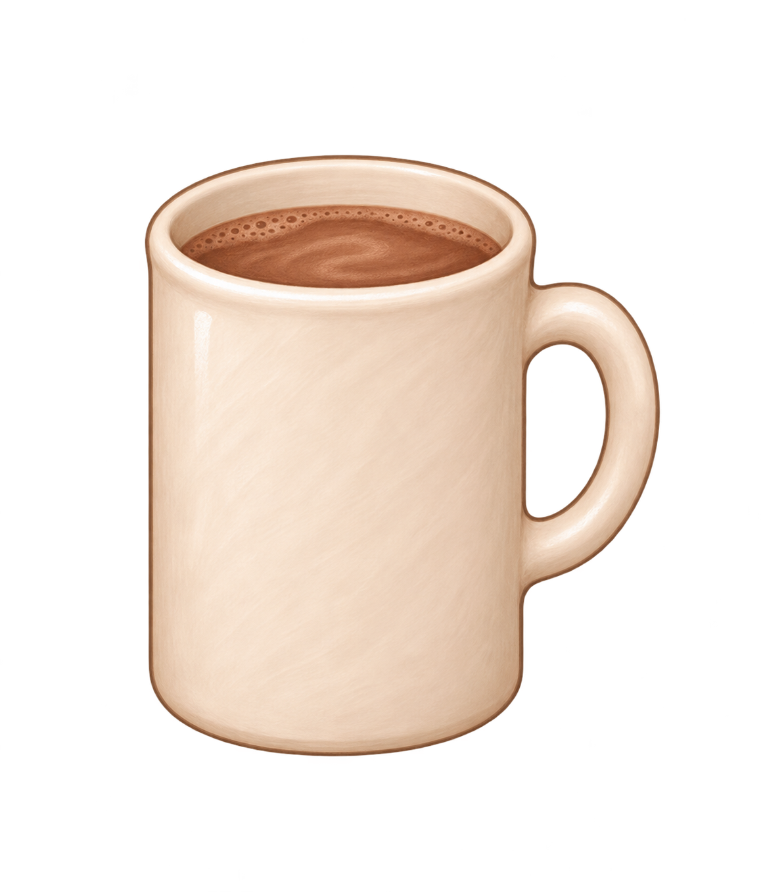
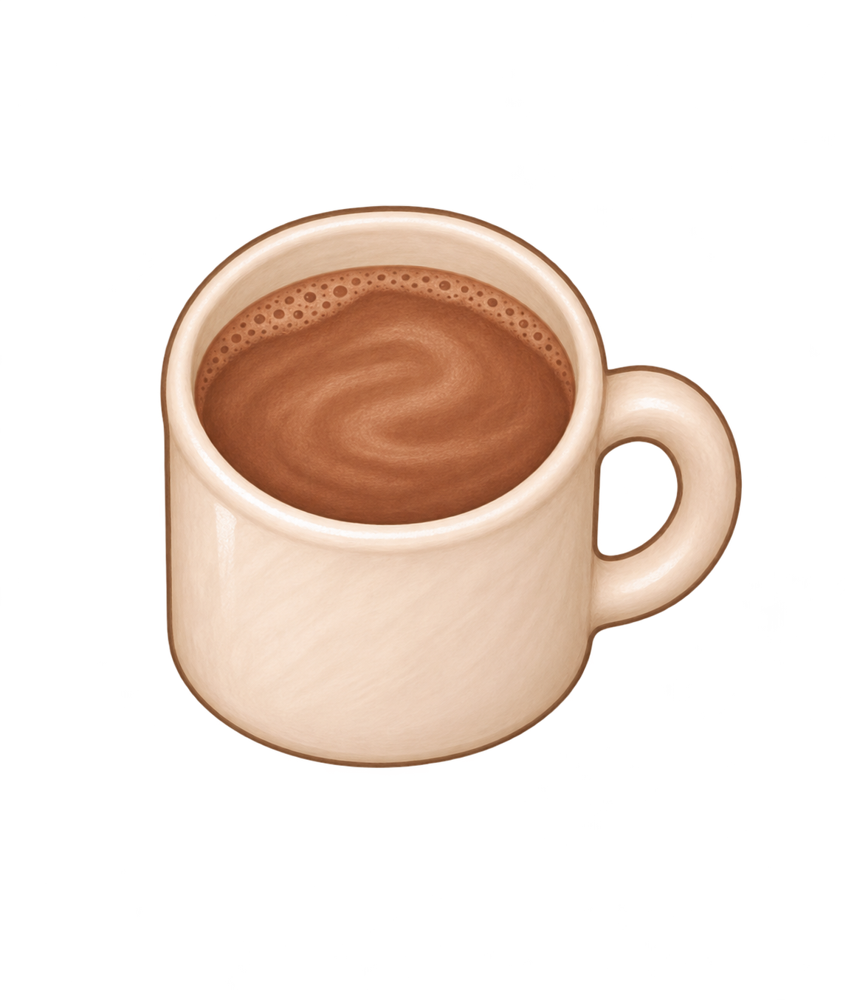

# prop_mug_zila v001 — Batch B Round2 review

Visual approval pending Creative Director. NOT PRODUCTION READY.

## Candidate comparison

A: taller profile, shallow rim. B SELECTED: targeted edit yields correct deep rim but shorter body; retain this limitation for review.

### candidate-a

### candidate-b

## Measurements and known limitations

- --width26 including handle; basefront44. Rimtop~20/front34, centre27; bodywidth~20, ellipse~14/20=0.70. Nominal rimcentre18 is not achieved; illustrated vertical body is shorter than the10cm profile implies.
- Body base centre visually~21 vs declaredpivot24 because fitter centres handle-inclusive bounds. Host review exposes this3px offset; do not silently change spec/engine anchor.
- A was taller but rim too shallow; B selected for corrected rim perspective. Only two candidates for this new prop. Final size/readability and pivot need technical director review.

## Validation and review

Run npm ci, npm run validate:art and npm run gallery. Gallery is generated locally/CI and ignored, not committed as an extra asset. Same-scale bed/nightstand and light/dark alpha review required. No engine, approved assets, wardrobe, spec, or integration changes. No gameplay claims.

## Actual verification — 20 November 2026

TECHNICAL PASS: 23/23 official checks. Official gallery generated and inspected in Chromium on checker, light/dark backgrounds and same-scale approved bed/nightstand. Static desk/laptop/mug and vanity/stool placement inspected; no gameplay or seated-avatar test claimed. All raw candidate SHA256 checks match original generator outputs. Metadata includes per-file checksums. Privacy scan passed. Visual approval remains pending.
