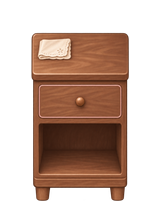
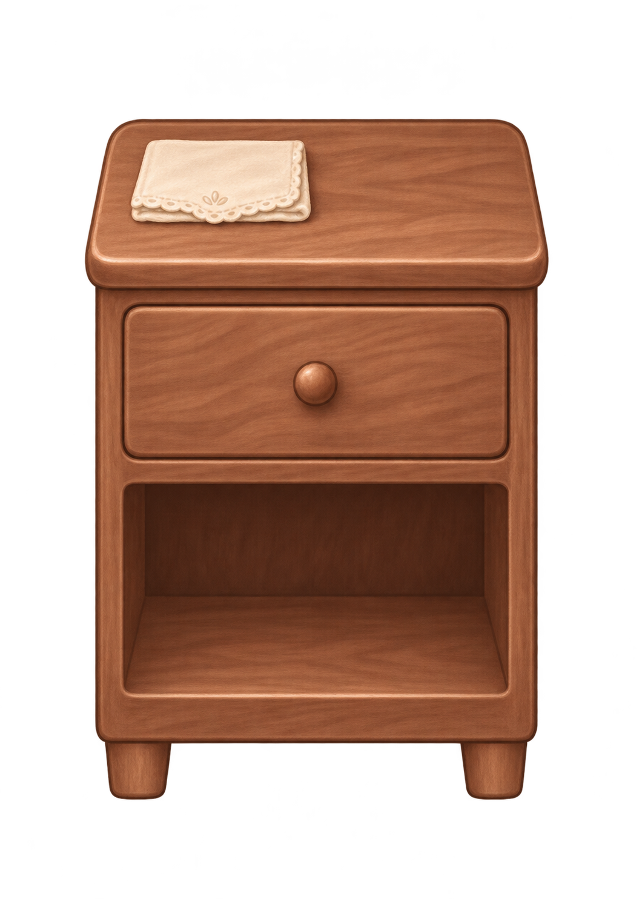
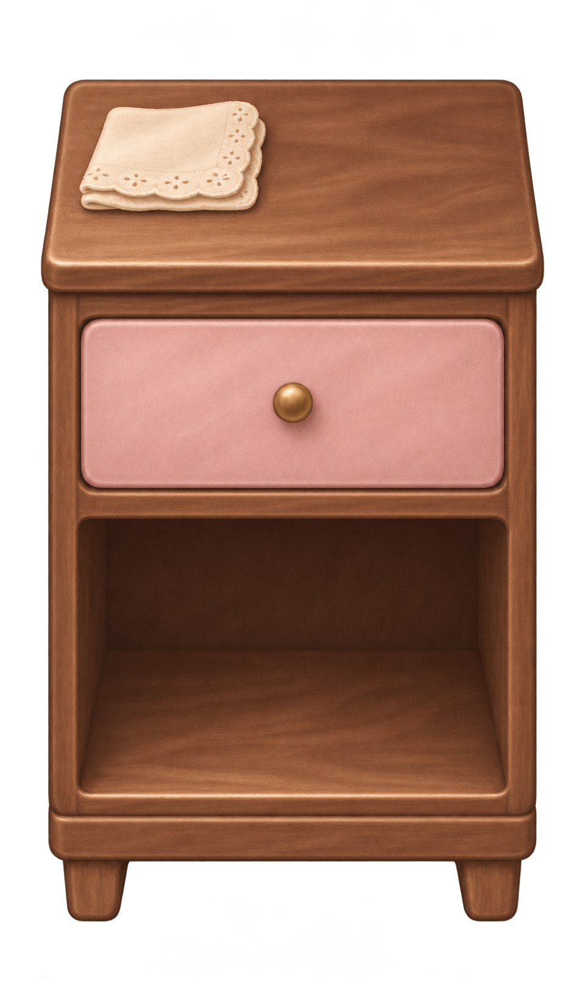
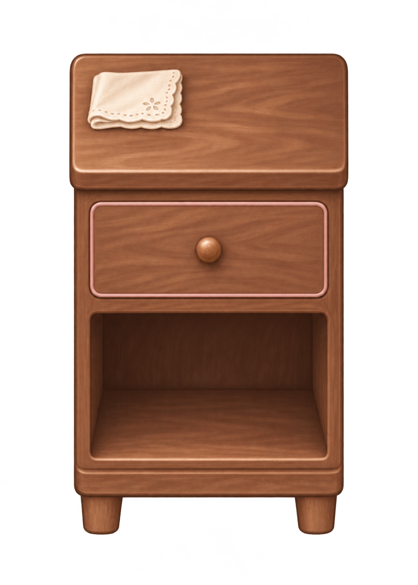
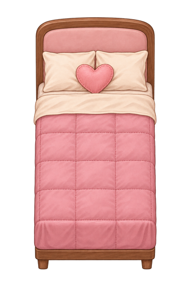

# Nightstand v001 review

TECHNICAL PASS locally. VISUAL PENDING Creative Director review. NOT PRODUCTION READY. Based on foundation e04c0eb363802aa7f2b5a7bd0b60ac45a61a58b2; Art Bible v1.2 and request002. No engine, approved artwork, spec or integration changes.

## Selected C

## Candidate comparison

| A | B | C — selected |
| --- | --- | --- |
|  |  |  |

A has a plain walnut drawer and wooden knob, but is squat and has a tapering tabletop. B adds a large pink panel and brass knob; its pink area dominates more than requested, and top edges still converge. C has only thin blush trim, a wooden knob and more parallel outer edges. C best balances the reference identity and restrained nightstand design; it is not an exact geometric match.

## Approved reference

The actual approved PNG was attached to all three generation calls, alongside the nightstand and projection templates. Wood grain softness, cream cloth, rounded edges and warm finish read as the same furniture family. Nightstand wood is slightly brighter/oranger and the highlight stronger. A visual consistency pass is still required; automated tests do not approve the match.

## Geometry and limitations

- Export160x224 RGBA8 sRGB; content98x169 at31,32; feet reach row200. No anisotropic scaling or repainting.
- Back top edge approximately y33 matches target34. Front edge approximately y78–80 does not match target90: top depth is roughly10–12px too shallow, with correspondingly excessive apparent front height. Do not infer exact55cm height from the validator's bounds/pivot pass.
- Outer side faces are not exposed. Shelf interior necessarily shows its inner cheeks. Rear legs are occluded, so four-leg construction cannot be independently verified from this sprite.
- No floor or cast shadow; light/dark gallery inspection shows no obvious broad halo. SD drawer/shelf remain legible, but tiny lace detail simplifies.
- Gallery pairing uses equal2px/cm density and aligned ground pivots. It is a comparison, not a rendered room placement. Headboard-side placement and gameplay have not been integrated or tested.
- PR template still mentions Zila158cm; official v1.2 and current gallery use165cm. No template was modified.

## Verification and reproduction

Run npm ci, npm run validate:art, npm run gallery. Gallery output is ignored/generated, not committed. Official PR CI publishes its gallery artifact when available.

Local checks: all23 nightstand technical checks pass; required bed reference recorded without warning; PNG34267bytes, opaque coverage0.425, bbox31,32 98x169, lowest solid row200, no edge padding violations. SHA-25613473053a483cd4db2813cb66d9f539098ec545f56d3c4dc42e5f454cef93f79.

Chromium reviewed the official checker/geometry overlay, light/dark floors, SD size and equal-scale approved-bed pairing. All33 gallery images loaded. Local review screenshots: review-gallery/nightstand-bed-pair.png and review-gallery/nightstand-review.png. Existing gameplay screenshots in the gallery are foundation evidence, not nightstand integration tests.

Only three raw PNGs and four submission files are intended for the artwork branch. No additional paid service used; generator model identifier was not exposed. Metadata contains all raw checksums, references, export processing and known issues.
