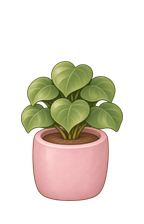
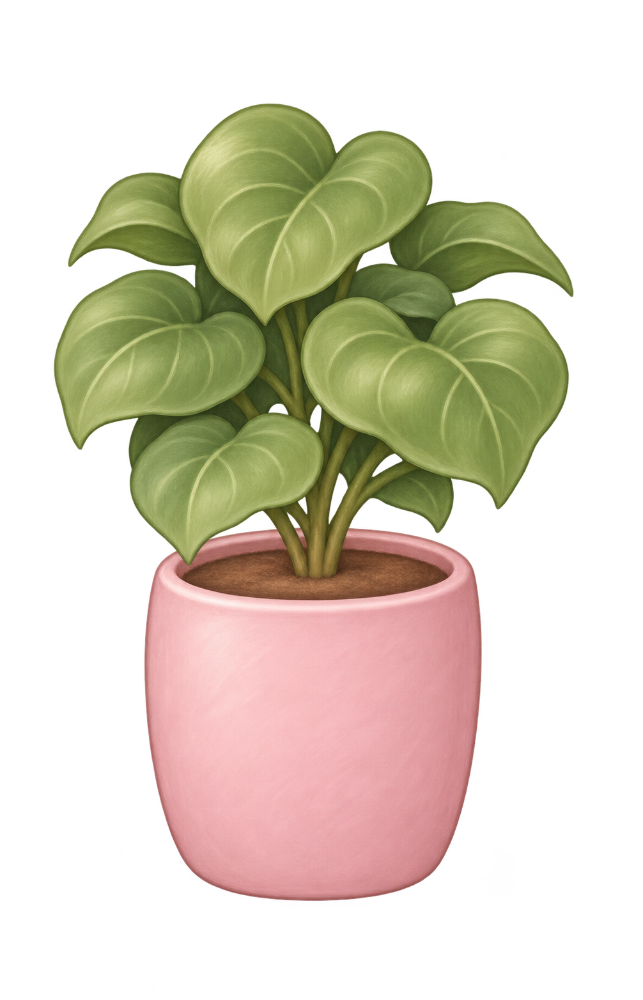
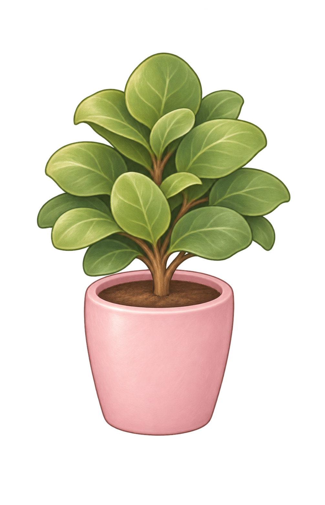
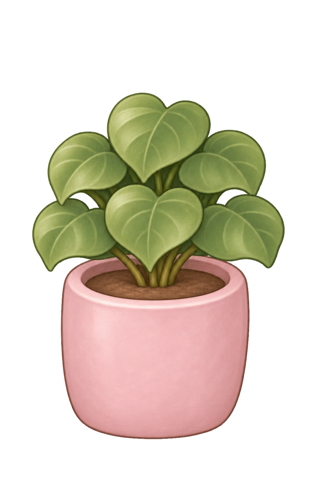

# prop_plant_small v001 — Batch D review

Not visually approved. Do not merge or integrate automatically.

## Selected export

## Candidate comparison

A: broad heart leaves but tall foliage; B: oval leaves and tree-like silhouette; C selected: compact heart leaves, larger pot and cleaner clusters.

### Candidate A

### Candidate B

### Candidate C

## Measured geometry and limitations

Top61/base200; pot rim back~127/front highlight~145, base200. Front55px vs60px target within6px tolerance; depth18px versus49px FAIL. Potwidth~77px vs70px nominal, foliage102px vs100px. Base centre~72 at pivot. Leaves obscure rear rim; deeper perspective still needed.

Measurements are visual estimates on fitted native-resolution PNGs (typically ±2px); automated canvas/bounds checks do not validate perspective, contact or artistic quality. No pivot/spec/engine changes used to hide discrepancies.

## Review reproduction

Run `npm run validate:art` and `npm run gallery`. Inspect this asset on light, dark, checker, native and SD views next to approved bed and nightstand at the same 2px/cm scale. Candidate raw SHA-256 and master hash are in metadata.json.

## Actual validation

TECHNICAL PASS: 23/23 automated checks. Official gallery inspected in Chromium. Palette and illustration are cohesive with approved references; perspective/height discrepancies above remain unresolved and are not covered by automated validation. Screenshots retained in ignored local review-gallery; recreate with npm run gallery.
