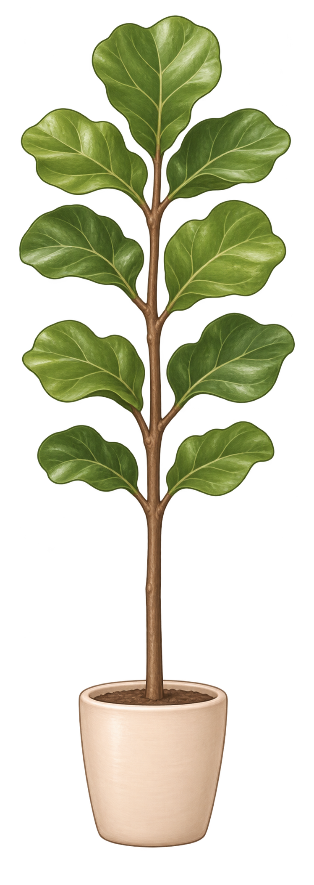
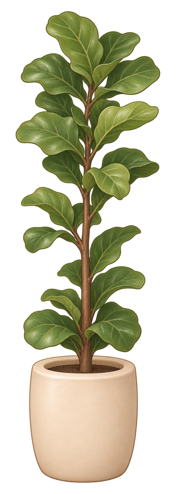
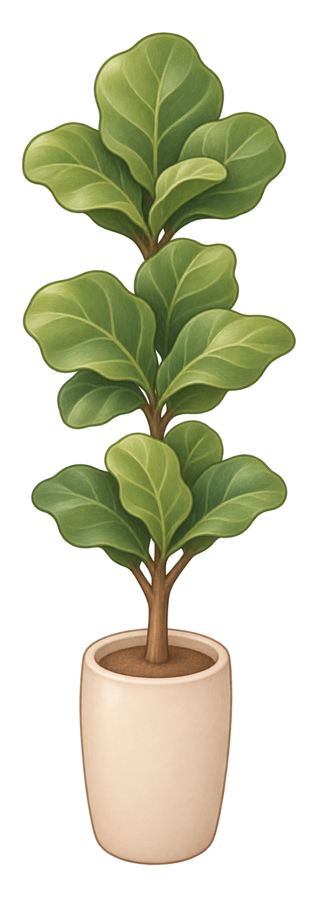

# prop_plant_tall_zila v001 — Batch D review

Not visually approved. Do not merge or integrate automatically.

## Selected export

## Candidate comparison

A: sparse symmetric leaves; B: dense foliage and larger pot; C selected: layered leaf groups and cleaner occlusion silhouette.

### Candidate A

### Candidate B

### Candidate C

## Measured geometry and limitations

Top51/base408; pot back~307/front highlight~330/base408. Front78px vs80px target passes; top depth23px vs56px FAIL. Pot width~64px vs80px target. Foliage width118px vs128px. Base centre~80 matches pivot. Tall foliage works as static cutout; no gameplay occlusion implemented.

Measurements are visual estimates on fitted native-resolution PNGs (typically ±2px); automated canvas/bounds checks do not validate perspective, contact or artistic quality. No pivot/spec/engine changes used to hide discrepancies.

## Review reproduction

Run `npm run validate:art` and `npm run gallery`. Inspect this asset on light, dark, checker, native and SD views next to approved bed and nightstand at the same 2px/cm scale. Candidate raw SHA-256 and master hash are in metadata.json.

## Actual validation

TECHNICAL PASS: 23/23 automated checks. Official gallery inspected in Chromium. Palette and illustration are cohesive with approved references; perspective/height discrepancies above remain unresolved and are not covered by automated validation. Screenshots retained in ignored local review-gallery; recreate with npm run gallery.
