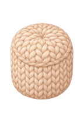
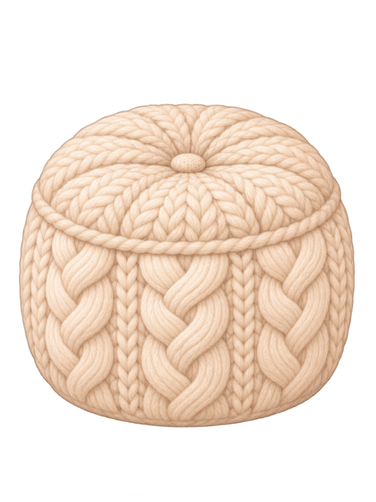
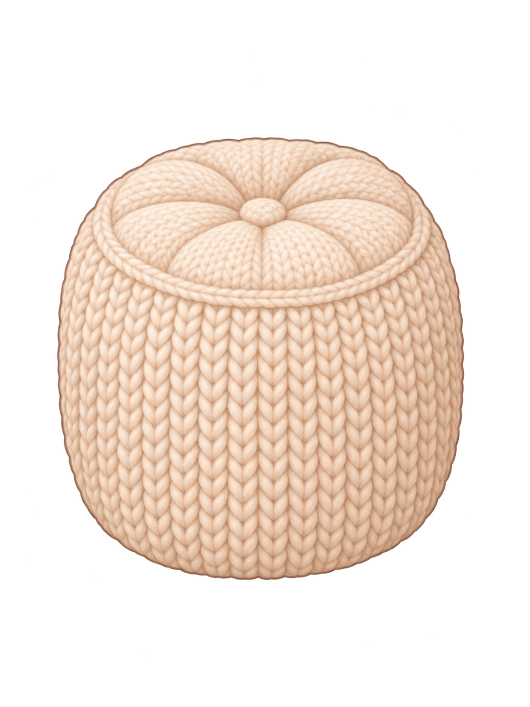
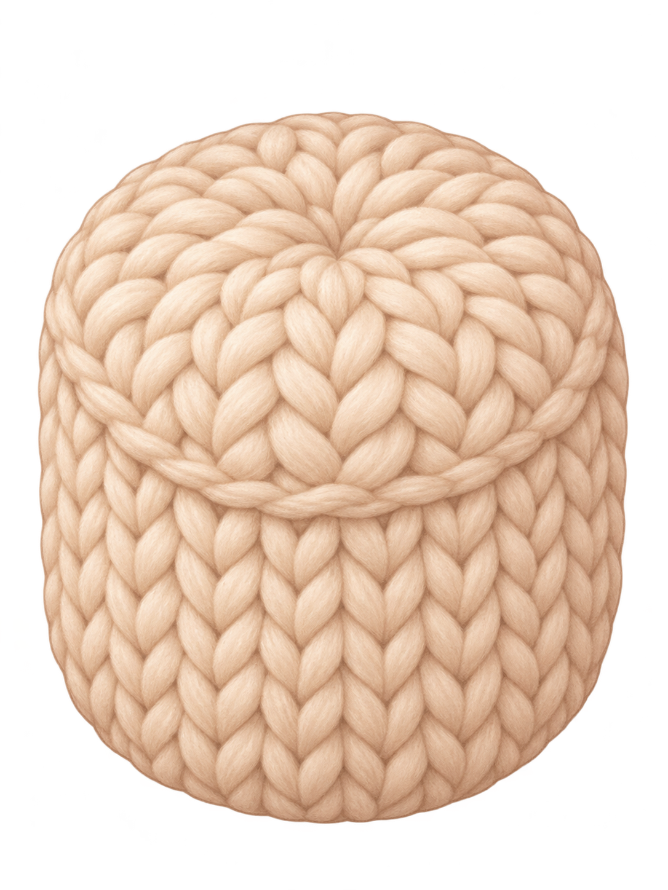

# prop_pouf_floor v001 — Batch D review

Not visually approved. Do not merge or integrate automatically.

## Selected export

## Candidate comparison

A: chunky cable stitches but shallow seat; B: finer regular knitting and taller body; C selected: deepest seat plane and large readable stitches.

### Candidate A

### Candidate B

### Candidate C

## Measured geometry and limitations

Top~39/base168; seat front highlight~111, back~40. Top depth~71px versus70px passes. Frontbody~57px versus76px target FAIL. Knit/curved rim makes measurement approximate±3px. Seat centre~76px vs nominal57px: seating anchor not yet visually aligned. Do not integrate for seated interaction without correction.

Measurements are visual estimates on fitted native-resolution PNGs (typically ±2px); automated canvas/bounds checks do not validate perspective, contact or artistic quality. No pivot/spec/engine changes used to hide discrepancies.

## Review reproduction

Run `npm run validate:art` and `npm run gallery`. Inspect this asset on light, dark, checker, native and SD views next to approved bed and nightstand at the same 2px/cm scale. Candidate raw SHA-256 and master hash are in metadata.json.

## Actual validation

TECHNICAL PASS: 23/23 automated checks. Official gallery inspected in Chromium. Palette and illustration are cohesive with approved references; perspective/height discrepancies above remain unresolved and are not covered by automated validation. Screenshots retained in ignored local review-gallery; recreate with npm run gallery.
