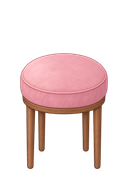
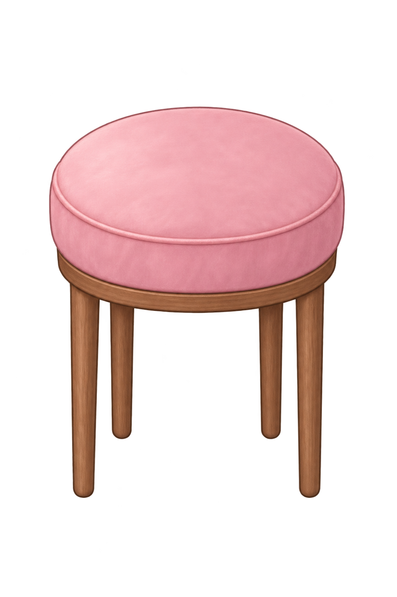

# prop_stool_vanity v001 review

VISUAL PENDING. NOT PRODUCTION READY. Batch B round1; one original generated candidate for this asset. Wardrobe was generated first and selected as the batch finish reference; the four remaining assets were also conditioned on its fitted master. This is a working style reference, NOT a visual approval. Official approved bed and nightstand condition every asset. Measurements are manual approximate master-pixel readings, not a geometric certification.

## Raw candidates

## Measurements and limitations

- Measured approximate seat top backEdgeY54 and frontEdgeY94, floor168. Front height74 vs90 (-17.8%, outside10%); top depth40 vs56 (-28.6%, outside25%). Seat ellipse ratio~0.45 vs0.7, so it reads too low and too shallow.
- Four legs are visible, blush cushion and walnut match furniture. Raw preview background color is transparent in the fitted export; no large floor shadow observed. Needs geometry revision or explicit CD exception before integration.

## Reproduction

Run npm ci, npm run validate:art and npm run gallery. The generated gallery is ignored, not committed; official PR CI uploads it when available. Existing gameplay screenshots are baseline evidence, not integration tests of this asset. Metadata records checksums and all references. No engine or approved asset changes.

Local technical result: TECHNICAL PASS, 23 checks, no validator errors; coverage 0.254. Privacy and branch ownership checked separately. Official gallery inspected in Chromium; all114 images loaded. Both approved references were visually compared at the same2px/cm scale, with light/dark and SD views. Warm wood/pink/cream family is coherent; the geometry issues above remain unresolved. No visual approval is granted.
