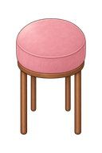
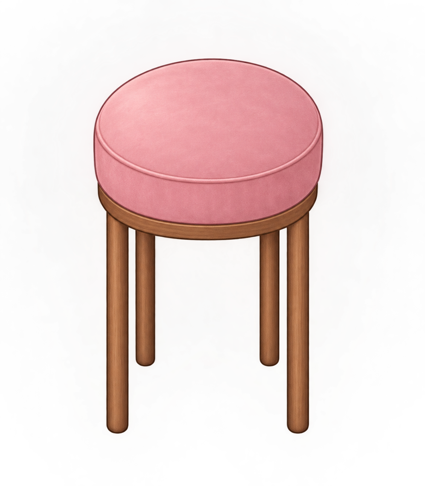
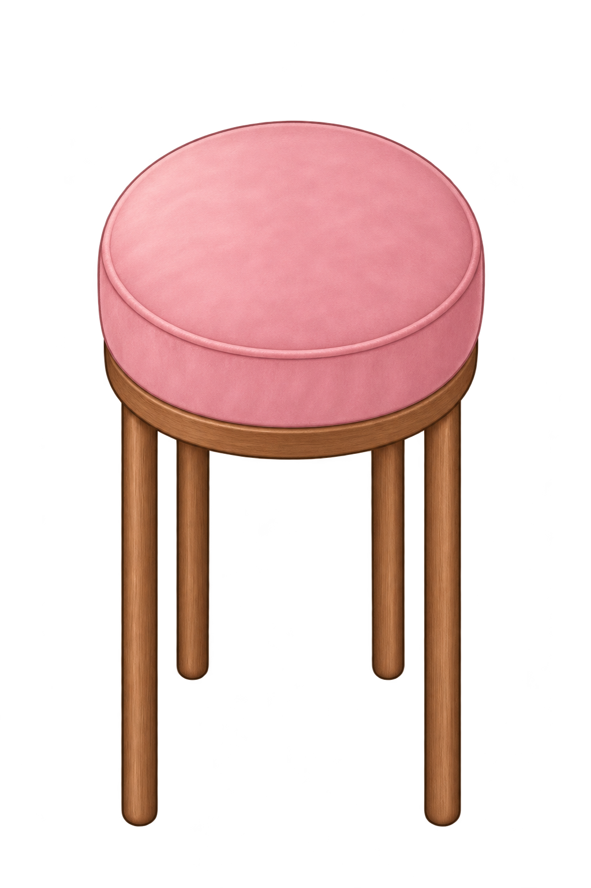
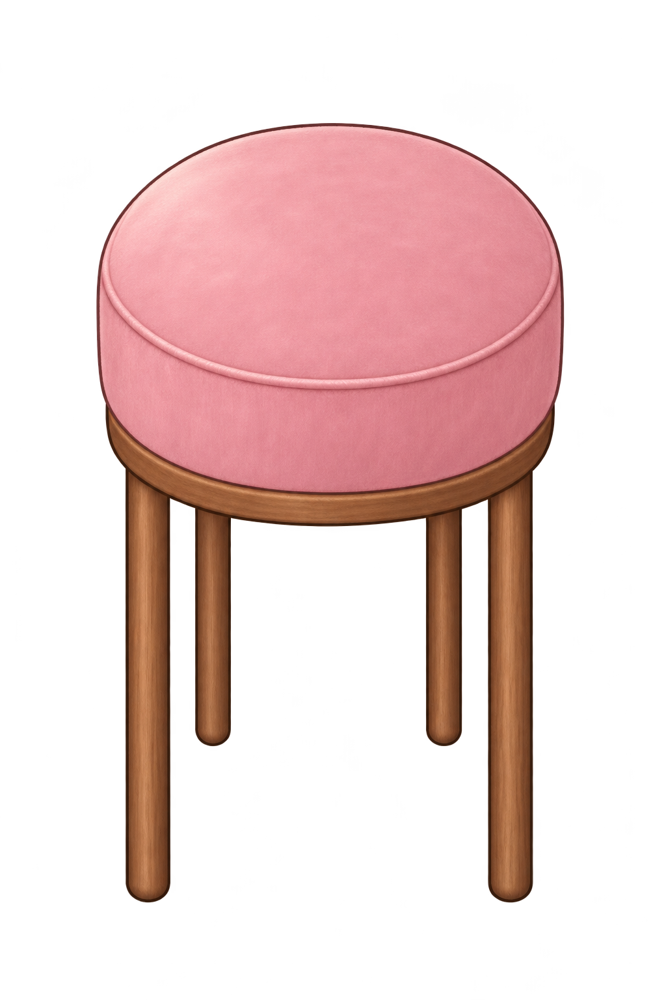

# prop_stool_vanity v002 — Batch B Round2 review

Visual approval pending Creative Director. NOT PRODUCTION READY.

## Candidate comparison

A: alpha haze causes excessive trim bounds and tiny fitted body. B: deeper ellipse, height-limited fit. C SELECTED: stable scale and clean fitted silhouette, still not exact0.70 ellipse.

### candidate-a

### candidate-b

### candidate-c

## Measurements and known limitations

- Estimated seat top back y24, front y73: depth49 vs56 nominal (within25%); front-to-floor95 vs90 (within10%). Floor168.
- Measured top ellipse ~49/86=0.57, still shallower than0.70 target, though deeper thanR1~0.45. Retain as explicit visual limitation, not exact perspective pass.
- Four legs readable; near/far pair lengths differ with projection. Raw translucent haze is preserved in source; fitted output inspected for edge/background contamination.

## Validation and review

Run npm ci, npm run validate:art and npm run gallery. Gallery is generated locally/CI and ignored, not committed as an extra asset. Same-scale bed/nightstand and light/dark alpha review required. No engine, approved assets, wardrobe, spec, or integration changes. No gameplay claims.

## Actual verification — 20 November 2026

TECHNICAL PASS: 23/23 official checks. Official gallery generated and inspected in Chromium on checker, light/dark backgrounds and same-scale approved bed/nightstand. Static desk/laptop/mug and vanity/stool placement inspected; no gameplay or seated-avatar test claimed. All raw candidate SHA256 checks match original generator outputs. Metadata includes per-file checksums. Privacy scan passed. Visual approval remains pending.
