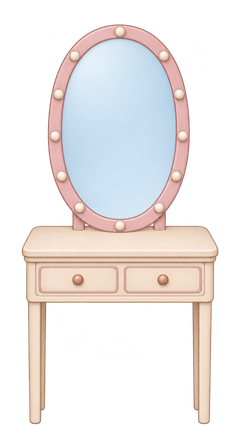
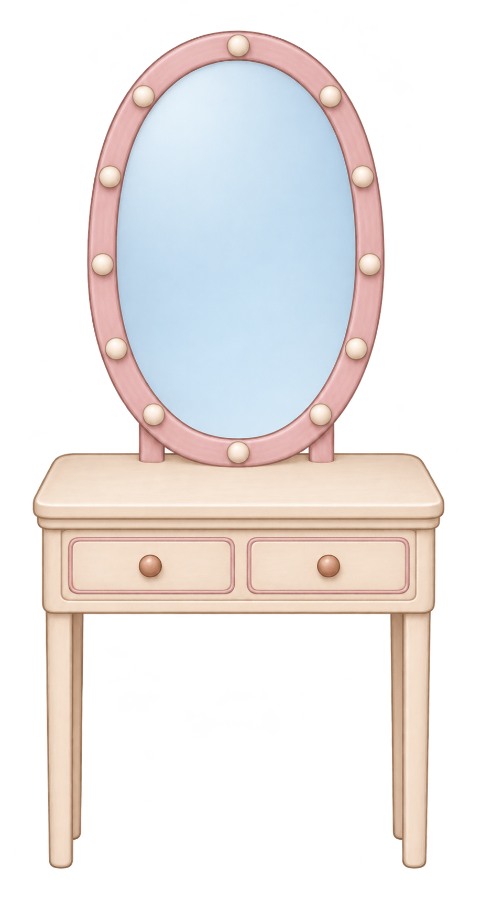

# prop_vanity_zila v001 review

VISUAL PENDING. NOT PRODUCTION READY. Batch B round1; one original generated candidate for this asset. Wardrobe was generated first and selected as the batch finish reference; the four remaining assets were also conditioned on its fitted master. This is a working style reference, NOT a visual approval. Official approved bed and nightstand condition every asset. Measurements are manual approximate master-pixel readings, not a geometric certification.

## Raw candidates

## Measurements and limitations

- Measured approximate tabletop backEdgeY225, frontEdgeY250, floor424. Front height174 vs150 (+16%, outside10%); depth25 vs63 (-60.3%, outside25%). Mirror top approximately25. Height-limited export198x401 vs desired208px width; no distortion applied.
- Several stray semi-transparent colored flecks remain around mirror supports and beneath drawers. These require targeted alpha cleanup before approval; bounding-box tests do not certify clean edges.
- Cream/pink finish is coherent, oval glass has only pale-blue gradient, bulbs have no glow. Oversized mirror relative to tabletop and large front drawers need CD review.

## Reproduction

Run npm ci, npm run validate:art and npm run gallery. The generated gallery is ignored, not committed; official PR CI uploads it when available. Existing gameplay screenshots are baseline evidence, not integration tests of this asset. Metadata records checksums and all references. No engine or approved asset changes.

Local technical result: TECHNICAL PASS, 23 checks, no validator errors; coverage 0.400. Privacy and branch ownership checked separately. Official gallery inspected in Chromium; all114 images loaded. Both approved references were visually compared at the same2px/cm scale, with light/dark and SD views. Warm wood/pink/cream family is coherent; the geometry issues above remain unresolved. No visual approval is granted.
