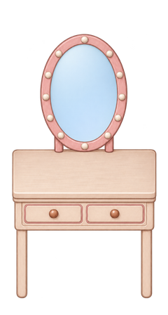
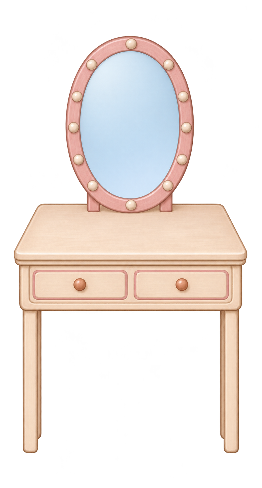
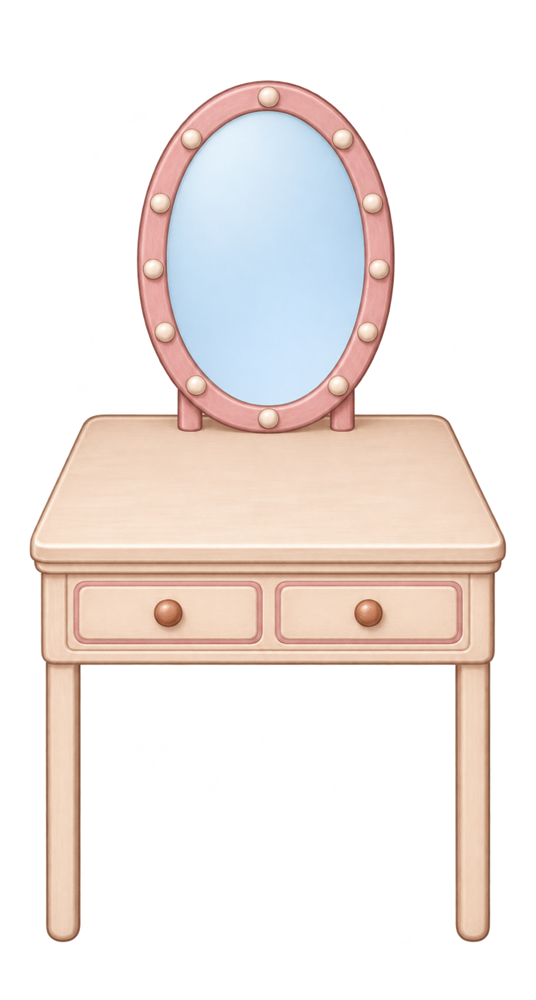
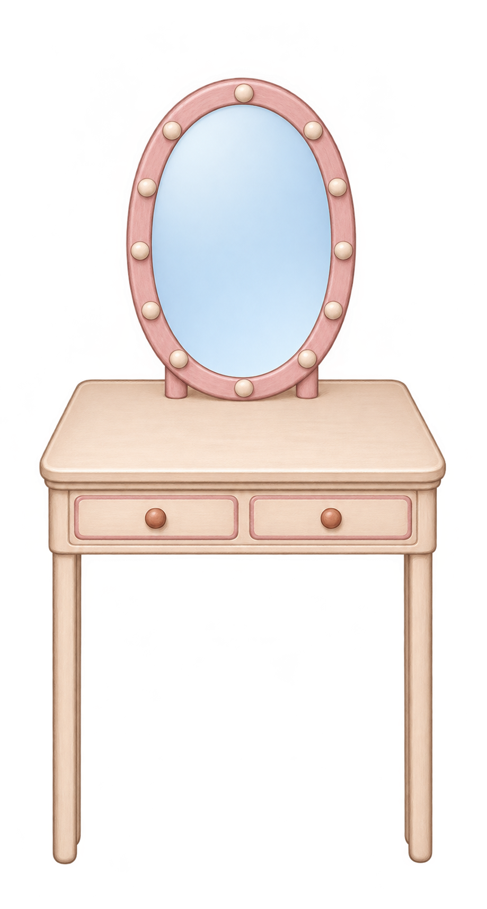
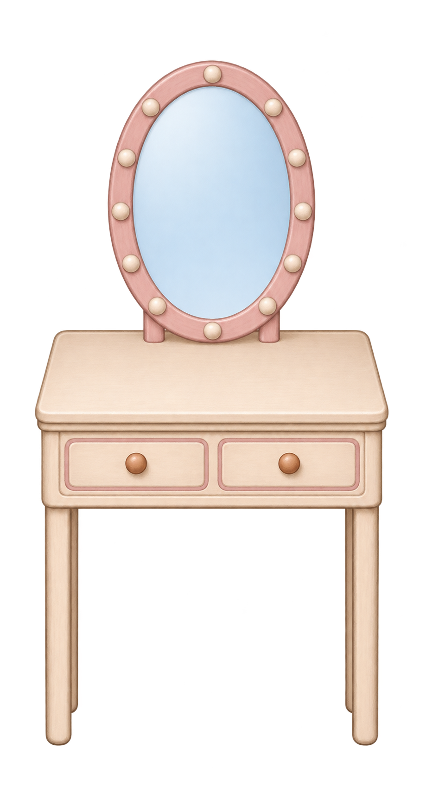
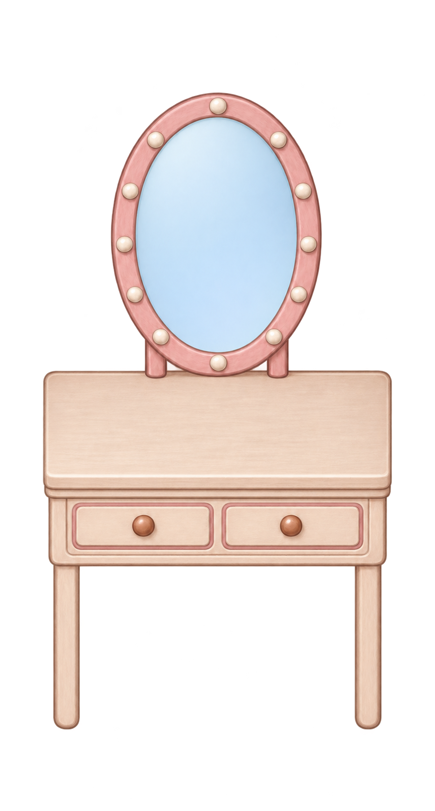

# prop_vanity_zila v002 — Batch B Round2 review

Visual approval pending Creative Director. NOT PRODUCTION READY.

## Candidate comparison

A: front too tall. B: deeper top and smaller mirror but front still too tall. C: stronger fringe and shallow top. D: clean silhouette but tall legs/front. E SELECTED: targeted B edit lowers tabletop and preserves smaller centered mirror.

### candidate-a

### candidate-b

### candidate-c

### candidate-d

### candidate-e

## Measurements and known limitations

- Estimated top back y212, front y276: depth64 vs63 target; front height148 vs150. Floor424. Within specified height/depth tolerances.
- Centered mirror approximately125x169 vs R1 about144x206: ~13% narrower and18% shorter, close to requested15% reduction, not identical shrink on both axes.
- Official --despeckle60 removed3 islands/4px in raw. No detached flecks visible at native scale; edge alpha still warrants close review on dark floors.

## Validation and review

Run npm ci, npm run validate:art and npm run gallery. Gallery is generated locally/CI and ignored, not committed as an extra asset. Same-scale bed/nightstand and light/dark alpha review required. No engine, approved assets, wardrobe, spec, or integration changes. No gameplay claims.

## Actual verification — 20 November 2026

TECHNICAL PASS: 23/23 official checks. Official gallery generated and inspected in Chromium on checker, light/dark backgrounds and same-scale approved bed/nightstand. Static desk/laptop/mug and vanity/stool placement inspected; no gameplay or seated-avatar test claimed. All raw candidate SHA256 checks match original generator outputs. Metadata includes per-file checksums. Privacy scan passed. Visual approval remains pending.
