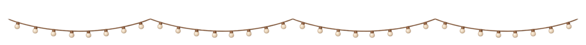
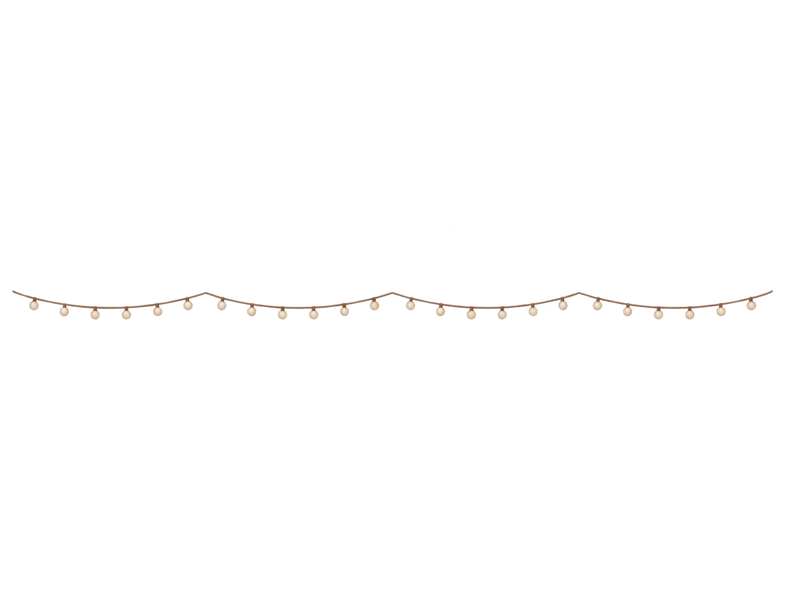
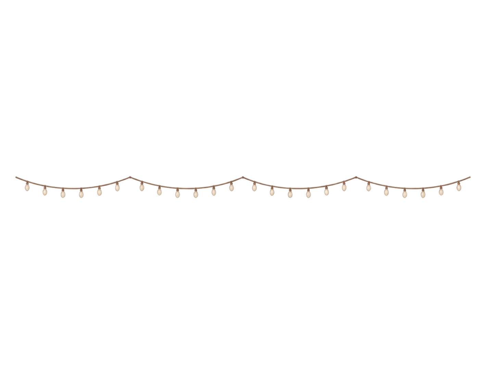
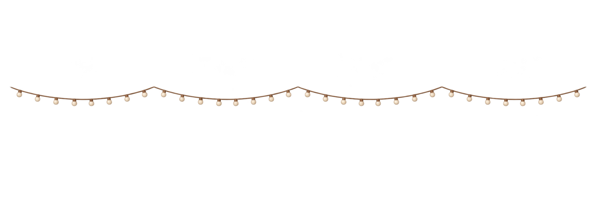

# wall_fairy_lights v001 — Batch C review

Not visually approved. Do not merge or integrate automatically.

## Selected export

## Candidate comparison

A: round bulbs,47px high; B: elongated bulbs and height-limited1085px span; C selected: full1200px span,42px height and pearl bulbs.

### Candidate A

### Candidate B

### Candidate C

## Measured geometry and limitations

Top39/bottom80; full width1200px. Target height44px, actual42px. Bulbs unlit, no halo. Generator produced32 bulbs rather than24 requested in prompt; official spec does not fix count. Thin cord needs actual gameplay motion/readability review.

Measurements are visual estimates on fitted native-resolution PNGs (typically ±2px); automated canvas/bounds checks do not validate perspective, contact or artistic quality. No pivot/spec/engine changes used to hide discrepancies.

## Review reproduction

Run `npm run validate:art` and `npm run gallery`. Inspect this asset on light, dark, checker, native and SD views next to approved bed and nightstand at the same 2px/cm scale. Candidate raw SHA-256 and master hash are in metadata.json.

## Actual validation

TECHNICAL PASS: 23/23 automated checks. Official gallery inspected in Chromium. Palette and illustration are cohesive with approved references; perspective/height discrepancies above remain unresolved and are not covered by automated validation. Screenshots retained in ignored local review-gallery; recreate with npm run gallery.
