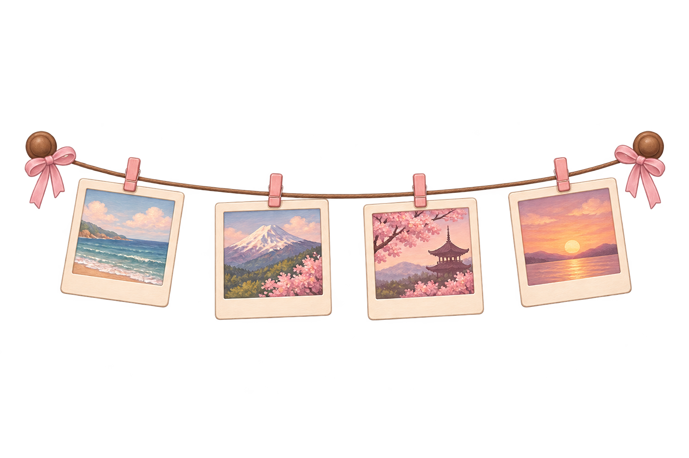
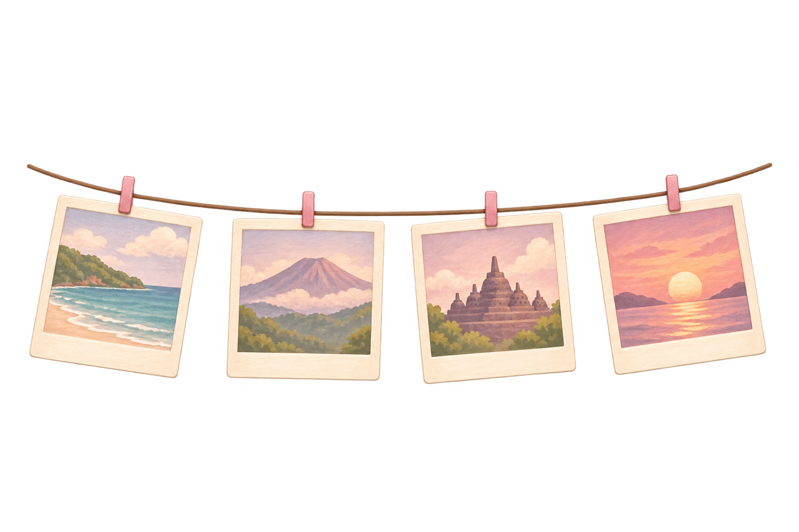
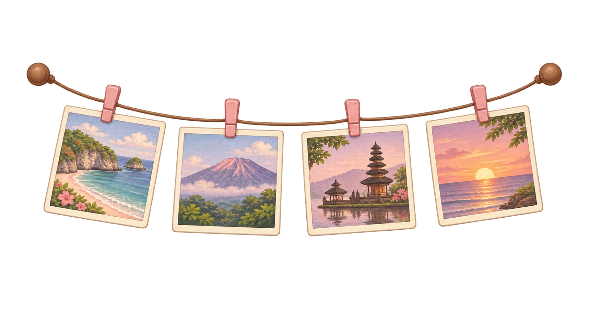

# wall_photos_string v001 — Batch C review

Not visually approved. Do not merge or integrate automatically.

## Selected export

## Candidate comparison

A: bows and Japanese-like scenes; B: simpler mounts and Indonesian abstract temple; C selected: strongest clear silhouettes and four readable Indonesian travel scenes.

### Candidate A

### Candidate B

### Candidate C

## Measured geometry and limitations

Top~61/bottom112; height52px vs80px nominal. Width160px correct. No people, faces or private photos. Tiny scenes reduce to colour masses at SD; mounts are extra detail. Transparent outside objects after official alpha normalization.

Measurements are visual estimates on fitted native-resolution PNGs (typically ±2px); automated canvas/bounds checks do not validate perspective, contact or artistic quality. No pivot/spec/engine changes used to hide discrepancies.

## Review reproduction

Run `npm run validate:art` and `npm run gallery`. Inspect this asset on light, dark, checker, native and SD views next to approved bed and nightstand at the same 2px/cm scale. Candidate raw SHA-256 and master hash are in metadata.json.

## Actual validation

TECHNICAL PASS: 23/23 automated checks. Official gallery inspected in Chromium. Palette and illustration are cohesive with approved references; perspective/height discrepancies above remain unresolved and are not covered by automated validation. Screenshots retained in ignored local review-gallery; recreate with npm run gallery.
