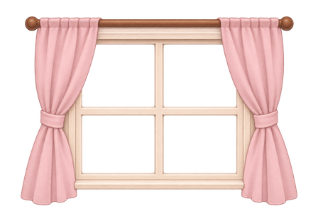
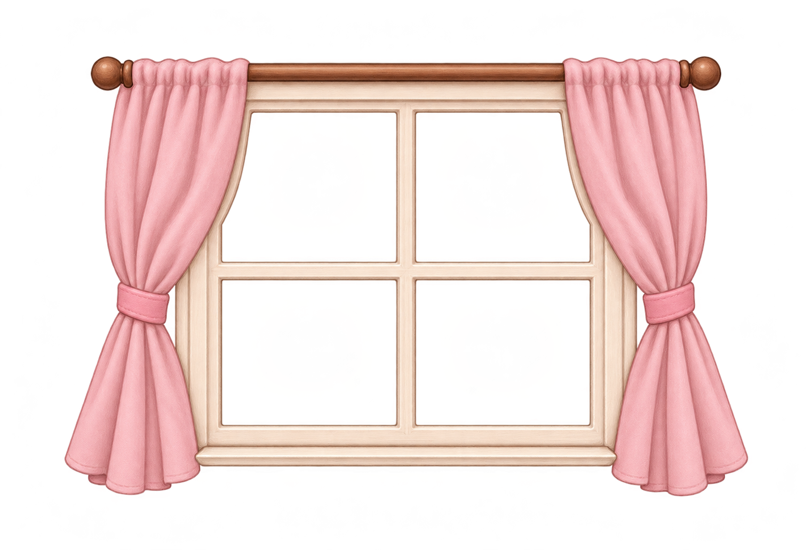
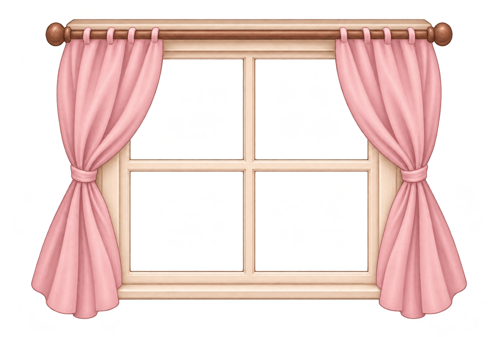
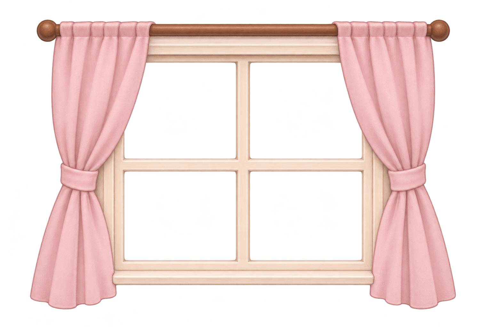

# wall_window_bedroom v001 — Batch C review

Not visually approved. Do not merge or integrate automatically.

## Selected export

## Candidate comparison

A: widest curtain spread; B: heavier folds; C selected: tailored folds, balanced framing and clear panes.

### Candidate A

### Candidate B

### Candidate C

## Measured geometry and limitations

Overall top23/bottom288; cream frame top~40/bottom~268. Wall pivot288 follows curtain hem, not frame sill: 20px mismatch requires review. Frame width~240px versus nominal280px; height-limited export. Four interior samples excluding curtains/muntin have alpha exactly0. Curtain and frame edge antialias is intentional.

Measurements are visual estimates on fitted native-resolution PNGs (typically ±2px); automated canvas/bounds checks do not validate perspective, contact or artistic quality. No pivot/spec/engine changes used to hide discrepancies.

## Review reproduction

Run `npm run validate:art` and `npm run gallery`. Inspect this asset on light, dark, checker, native and SD views next to approved bed and nightstand at the same 2px/cm scale. Candidate raw SHA-256 and master hash are in metadata.json.

## Actual validation

TECHNICAL PASS: 23/23 automated checks. Official gallery inspected in Chromium. Palette and illustration are cohesive with approved references; perspective/height discrepancies above remain unresolved and are not covered by automated validation. Screenshots retained in ignored local review-gallery; recreate with npm run gallery.
