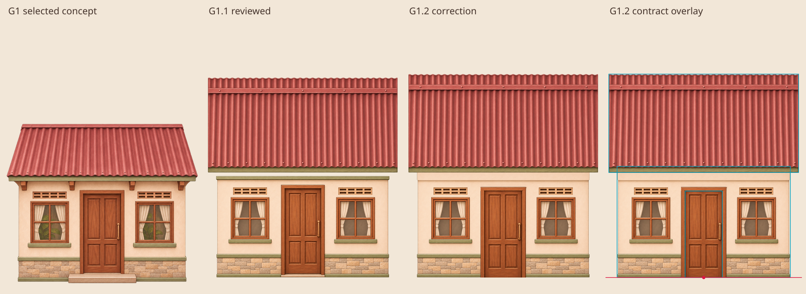
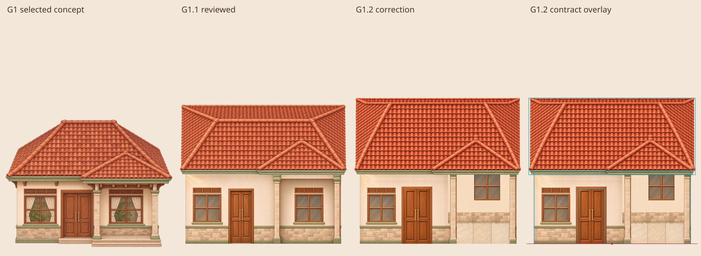
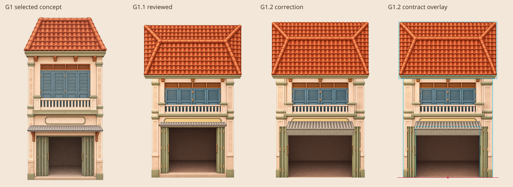
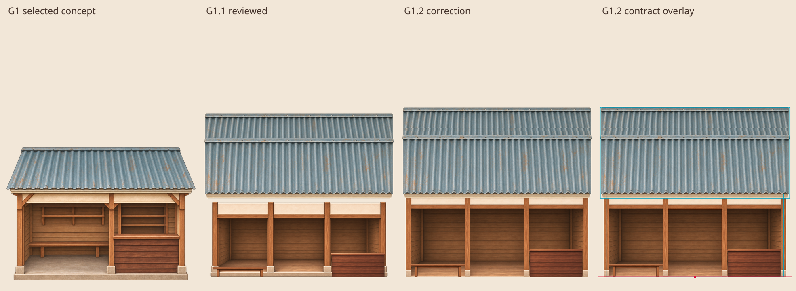
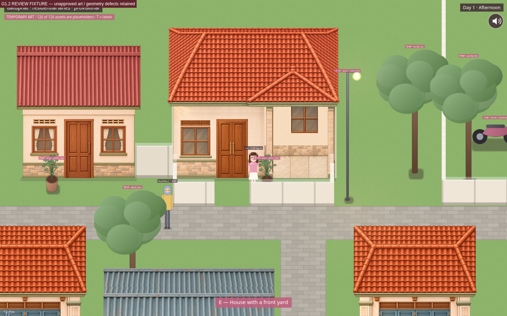
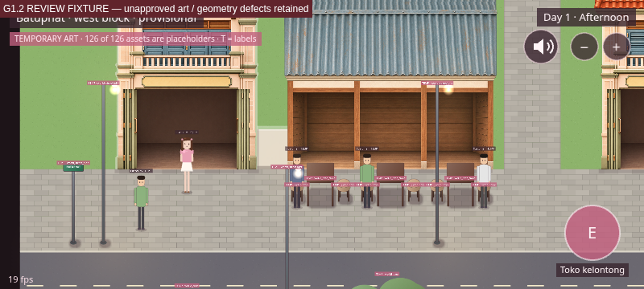
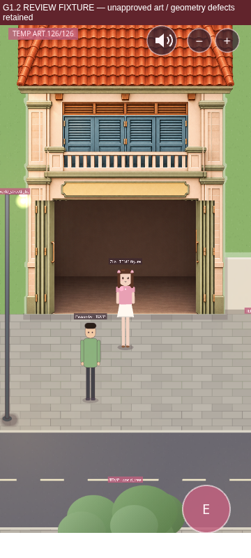

# G1.2 precision correction — review package

**Not production-ready. No visual approval.** Continued4731dea, preserving all11 v001 layers and original G1 selections. Artwork branch `codex/art/g1-2-production-r1`.

## Results

- 11 independent v002 layers, transparent masters, original generator outputs, component sources, prompts, metadata and SHA-256.
- Official world validator43926cf: **10/11 TECHNICAL PASS**; warkop front **TECHNICAL FAIL** (padding/art bounds/width). Roof footprint coverage passes all4.
- 44/44 official pipeline/architecture unit tests passed. Initial sandbox blocked2 subprocess tests; rerun with permitted subprocess execution passed.
- Candidate browser fixture: desktop1440×900, emulated Android800×360 and360×800; all12 checks passed (one roof, behind fade, front no fade, coupled facade/roof alpha).18 screenshots. This is temporary in-memory texture registration, not approved integration or physical A05 testing.
- P6.1 baseline QA regression:4/8 passed. Market and warkop cases failed final error assertions on2 HTTP404s each; game interaction assertions before that passed. Engine remains untouched. See test-results.md and network diagnostic.
- PR43 SHA d5830d7 verified through remote refs and public HTML. GitHub GraphQL Forbidden; REST check-runs unavailable. **Remote CI success cannot be independently confirmed in this session.** Local checks are separately reported.

## Contract conflict requiring Claude / Creative Director decision

The frozen contract specifies warkop post centres−300/−100/+100/+300cm, each16cm wide. That creates616cm total painted frontage. The official canvas envelope permits600cm and an8px transparent rim. v002 preserves the post centres and184cm centre opening; it cannot also meet the smaller outer envelope. No narrowing, collision alteration or invisible alpha padding used to disguise this. Decide whether to revise the outer-post location/width or production envelope; Codex has changed neither contract nor engine.

## Measured artwork

|Layer|Measured content px|Target px|Difference cm|
|---|---:|---:|---:|
|Small front|840×539|840×540|height−0.5|
|Small roof|920×478|920×478|0|
|Large front|1206×560|1200×560|width+3|
|Large roof|1280×590|1280×590|0|
|Ruko front|840×959|840×960|height−0.5|
|Ruko roof|920×534|920×534|0|
|Awning|640×136|640×144|height−4; tolerance boundary|
|Warkop front|1232×560|1200×560|width+16; FAIL|
|Warkop roof|1280×618|1280×618|0|
|Counter|368×190|368×190|0|
|Bench|368×90|368×90|0|

Opening authoring measurements: [opening-measurements.json](opening-measurements.json). Full measured alpha envelopes: [measurements-all.json](measurements-all.json). Automated validator cannot establish semantic doorway clearance by itself.

## Comparisons

Each sheet shows selected G1, previous G1.1, G1.2 and contract overlay. G1 concept is a reference, not normalized to contract scale. Separate HD/SD assemblies retain contract scale and independent layers.

## Gameplay evidence

See browser-fixture.json. Ruko uses a seeded TEMP texture ID; fixture explicitly aliases the v002 master to that ID so screenshots show actual art. Add-ons are included in static host-placement assemblies; they are not installed as gameplay interactions. Candidate fixture does not change collision or the on-disk manifest.

## Known artistic / integration limitations

- Warkop contract conflict blocks full technical approval.
- Small-house upper plaster repair boundary remains perceptible at HD.
- Large-house porch retains a narrow old-post remnant beside the left post; porch plaster/floor texture matching needs further artistic review. Porch remains non-walkable per contract.
- Ruko pilasters show duplicated moulding details from source recomposition; shutter/header joins need cleanup. The opening is deliberately resized through authored components rather than image stretching.
- Warkop metal roof has a visible corrugation material-band repair; geometric coverage PASS does not make this a visual PASS.
- Awning height remains4cm below exact target, accepted only within official tolerance. Its top/fascia proportions need artistic sign-off.
- Ruko roof is partly cropped at default close Android landscape framing. Do not shrink the architecture to hide this; review camera framing separately with Claude.
- Short rear-rim crops in hip roofs and component crop/downsample operations are disclosed in source records. No nonuniform resampling or artificial upscale.
- The11 layers are a review candidate, not a claim that all requested aesthetic defects are resolved. No G2/G3 work.

## Preservation and reproduction

Only `art/source/<11 G1 IDs>/v002/` and `art/submissions/<same>/v002/` are submitted. No v001, approved asset, source engine, map, manifest, spec or main edits. Source contains original generated PNGs and ordered working scripts; composition.json is the initial stage and later parts/paint-repair/refinement-export records supersede it. Scripts preserve original component pixels and describe local paths; run only in an isolated copy, never on v001.

Validation used detached43926cf worktree so Claude's pipeline support was not copied into this artwork branch. On older foundation CI the loader may still reject world submissions until that pipeline dependency is integrated. Draft review must remain blocked, not merged.

Network diagnostic note: the two404 errors were captured by the official QA suite; a separate dev-scene probe did not reproduce them. The missing URLs remain unidentified, so no engine fix or full-suite PASS is claimed. All11 official gallery cards loaded via explicit image decoding.

PR ancestry: this correction continues4731dea from PR45 and therefore depends on the existing PR43/PR45 stack. Its new commit contains artwork directories only. World validator43926cf is an additional unmerged validation dependency; no pipeline code is copied into the correction.
