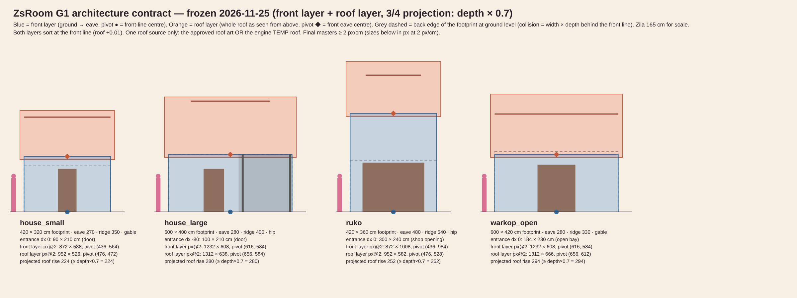

# G1 architecture contract — house_small, house_large, ruko, warkop_open

**Status:** frozen by Claude on 2026-11-25 for G1 production. The source of truth is `src/data/archetypes.json` → `contract` (the runtime reads the same file).

**Inputs:**
- P6.1 runtime: PR #41, `claude/world01-p6.1` @ `fc8b954`.
- Codex G1 concept proposals: PR #42, `CONTRACT_HANDOFF.md` and `measurements.json` @ `12bf710`.
- G1 visual validation: 319/320 checks; the failing check was "a spec exists for this id".

**What this does and doesn't do:** it decides sizes and the layer model. It does **not** approve any G1 artwork, and none is integrated. Creative Director review still decides style.

## 1. Why a contract was needed

**The two drawing models differ.** G1 concepts are **front elevations**: the roof is a front slope about 80 cm tall above the eave. ZsRoom renders in a **3/4 projection**:
- render x = ground x;
- render y = ground y × 0.7 − height.

So a roof must cover the **whole footprint seen from above**: at least depth × 0.7 above the eave (224–294 px at 1 px/cm for these four archetypes).

**What happens if the elevation art is used as-is:**
- with the engine roof still on → **two roofs**;
- with the engine roof off → **ground visible inside the building**, between the short painted roof and the footprint's back edge.

**Two other mismatches:** the sizes differed (see §4), and P6.1 TEMP specs use `footprint.depthCm = 4` as wall-panel thickness, while the real building depth is in `archetypes.json`.

## 2. Rendering model (no double roofs)

Every building is drawn from two stacked layers that share **one depth key, the front line** (the placement's `y`):

| Layer | Asset id | Covers | Pivot | Depth |
|---|---|---|---|---|
| **front** | the facade spec id (`world_house_small`, `world_house_large`, `world_ruko`, `world_warkop_open`) | ground → eave on the front plane: walls, doors, windows, posts, porch floor, sign boards | bottom-centre of the **front line** | `y` |
| **roof** | `world_house_small_roof`, `world_house_large_roof`, `world_ruko_roof`, `world_warkop_roof` | the whole roof mass **as seen in 3/4 projection**: near slope, ridge, visible far slope, gable ends, overhangs, the porch roof | **front eave centre** (render y = `y × 0.7 − eave`) | `y + 0.01` (over the facade's top edge it overlaps) |
| add-ons | `world_ruko_awning`, `world_warkop_counter`, `world_warkop_bench` | separate pieces that carry interactions or must not be baked | per spec | `y + 0.02`, or their own ground y if they stand in front of the front line |

- **One roof source per building** (`src/world/buildingLayers.ts → roofSource`):
  - while the roof layer has no *approved* art, the engine draws its TEMP roof;
  - once it is approved, only the art is drawn.

  Tested in unit tests (both states) and in game (`state().roofs`: engine + art = number of buildings).
- **Occlusion:** when Zila is behind a building, the front and roof fade together. E2E: behind a ruko it fades; in front it does not.
- **Collision:** a rectangle `width × depth` behind the front line, **never** the alpha bounding box of the art. A porch inside the footprint is not walkable.
- **Culling:** both layers are view-culled (P6 culling).

### Projection maths (1 render px = 1 cm at density 1)
- Front layer canvas: `(W + 16) × (E + 24)`; pivot `((W + 16) / 2, E + 12)`.
- Projected roof rise above the front eave, for a ridge parallel to the street: `max(D × 0.7, D/2 × 0.7 + (ridge − eave))`. For flat or skillion roofs: `D × 0.7`.
- Roof layer canvas: `(W + 2 × overhang + 16) × (rise + 15 + 24)`. The 15 cm front drop of the eave overlaps the facade's fascia. Pivot `((W + 2 × overhang + 16) / 2, rise + 12)`.
- **Final masters:** at least **2 px/cm**. Multiply every number above by 2; the exact pixel values are in the table below.

## 3. Final contracts

| | house_small | house_large | ruko | warkop_open |
|---|---|---|---|---|
| **Footprint W × D (cm)** | 420 × 320 | 600 × 400 | 420 × 360 | 600 × 420 |
| **Eave / ridge (cm)** | 270 / 350 | 280 / 400 | 480 / 540 | 280 / 330 |
| **Roof** | gable, ridge ∥ street | hip, plus a porch gable | hip | zinc gable |
| **Projected roof rise (cm)** | 224 | 280 | 252 | 294 |
| **Entrance** | door dx 0, 90 × 210 | door dx −80, 100 × 210 | shop opening dx 0, 300 × 240 (inspect only) | open centre bay dx 0, 184 × 230 |
| **Door trigger** | 110 wide | 120 wide | none (background) | 160 wide |
| **Other openings** | 2 windows at dx ±130, 80 wide, sill 90, head 190 | 2 windows at dx −220 and +190 (inside the porch), 100 wide | sign board 300 × 40 at 250–290; upper floor 300–480 | three 200 cm bays, post centres at dx −300 / −100 / 100 / 300 (posts 16 cm); counter in the right bay (95 cm), bench/shelf in the left bay |
| **Porch / add-ons** | — | porch dx 40 → 300, wall set back 110, posts at dx 60 and 290, **not walkable** | awning at 240–270, projecting 60 (add-on) | counter + bench are separate add-on layers |
| **Front layer px @2 px/cm** (canvas; pivot) | 872 × 588; (436, 564) | 1232 × 608; (616, 584) | 872 × 1008; (436, 984) | 1232 × 608; (616, 584) |
| **Roof layer px @2 px/cm** (canvas; pivot) | 952 × 526; (476, 472) | 1312 × 638; (656, 584) | 952 × 582; (476, 528) | 1312 × 666; (656, 612) |
| **Anchors** | inspect at (x, y+40), r ≤ 120 | inspect (x, y+40); yard gate centred on the door | inspect (x, y+40) | door at (x, y+25), r 50 |
| **Front yard** | — | fence 150 cm in front, 130 cm gate at the door | — | — |

The overhang is 20 cm on each side for all four; the front drop is 15 cm.

### Decisions (P6.1 runtime vs G1 proposal → final)

| | P6.1 TEMP | G1 proposal | **Final** | Why |
|---|---|---|---|---|
| house_small | 380 × 360/300, top 300 | 420 × 320, eave 270, ridge 350 | **420 × 320, eave 270** | G1 width fits a 90 × 210 door and two windows; one depth for every placement, since the roof art is drawn for one depth. The lane gaps still work (walls recomputed). |
| house_large | 620 × 460, two-storey, top 470 | 600 × 400 porch house, eave 280, ridge 400 | **600 × 400, single-storey porch house** | Adopt G1 B's design; it is narrower, so the yards and gaps stay valid. A real porch makes the porch-house type readable. |
| ruko | 420 × 360/400, top 430, flat roof | 420 × 500, eave 560, ridge 620 | **420 × 360, eave 480, hip** | At 560 the ruko covers the **whole** north lane behind it (≈ 8 m² each) and is cropped on the phone camera; 430 is too low for two storeys. At 480 each covers 76 cm of the lane (3.2 m², audit WARN, the building fades). The 500 cm depth would only make the roof sprite taller. |
| warkop_open | 600 × 420, top 320 | 500 × 320, eave 240, ridge 320, left open bay | **600 × 420, eave 280, three 200 cm bays, centre entrance** | The P6.1 warkop gameplay (door, outside tables and stools, patrons, interior) depends on 600 × 420. Eave 240 is too low for a 230 cm clear opening. G1 C is re-composed with a third bay, **not stretched**. |

## 4. Gameplay compatibility (what changed in P6.1 data)

- **Town data:**
  - house_small placements 380 → 420 wide;
  - the south row's 300 cm depth override is removed (now 320);
  - the ruko's 360 cm override is moved into the archetype;
  - large houses 620 → 600 wide, 460 → 400 deep, single storey;
  - ruko eave 430 → 480;
  - warkop eave 320 → 280;
  - garden walls recomputed for the new widths.
- **Unchanged:** road topology, lanes, gangs, the avenue, both routes, the market, NPC routes and crowds, interiors, doors and spawns, saves.
- **Tests:**
  - `tests/unit/architecture-contract.test.ts`, 11 tests:
    - spec, runtime and contract agree;
    - roof canvas and pivot formulas;
    - entrance clearances;
    - no placement overrides;
    - footprint = collision;
    - warkop door and large-house gates at the entrance;
    - single roof source.
  - Existing tests still pass:
    - town, two routes, the N/S + E/W loop, park entrances;
    - P4/P5 save migration;
    - crowd legs walkable, shoppers' simulation;
    - geometry audit **FAIL 0** (WARN 10: the 4 ruko lane covers, 5 market tarps, the workplace).
  - E2E: P6 and P6.1 specs on desktop + Android, plus a contract E2E (one roof per building; fade behind the ruko, none in front).

## 5. Corrections Codex must make before production art

**General, all four:**
1. **Split each building into a front layer and a roof layer**, at the canvases and pivots above (≥ 2 px/cm), plus the listed add-ons. Ruko and warkop add-ons stay separate; nothing interactive is baked in.
2. **Redraw the roof for ZsRoom's projection.** It must reach the projected rise (224 / 280 / 252 / 294 cm above the eave), so the roof covers the whole footprint from above, with the visible far slope above the ridge. No front-elevation-only slope.
3. **Paint doors and openings at the contract sizes** (§3). No nonuniform scaling; redraw or recompose.
4. The **front layer's pivot is the front-line centre**. Anything below it (steps, kerb) must stay within 12 cm (padding); porch floors belong to the front layer.
5. **Transparent background, 16 px padding at 1 px/cm** (32 px at 2 px/cm), no baked ground shadow (the engine draws contact shadows).
6. **Batuphat plausibility, for the CD:** less ornament, fewer house-like curtains and plants in windows, fewer clay tiles. Zinc roofs are common, but this needs verified photos, so keep the roof colour a variant, not a redesign.

**Per archetype:**

| Archetype | Corrections |
|---|---|
| house_small (G1 A) | Door 176 → **210** high, 90 wide, centred. The roof needs the full **224 cm** projected rise for the 320 cm depth. Windows 80 wide at dx ±130. |
| house_large (G1 B) | Door 165 → **210** high, 100 wide, at **dx −80**. Proportions to **600 × 400**, eave 280, hip roof to ridge 400 (projected rise **280**). Porch from dx 40 to 300 with the wall set back 110 cm; posts at dx 60 and 290. The porch gable goes into the roof layer, floor and posts into the front layer. |
| ruko (G1 B) | Re-compose to **eave 480**: ground floor 0–300 (opening **300 × 240**), sign board 250–290, upper floor 300–480. The hip roof's projected rise is **252**. **≥ 840 px** content width at 2 px/cm (G1 had 757 px: re-author, no upscaling). Awning as a separate layer. Check the roof stays visible at the phone landscape camera. |
| warkop_open (G1 C) | Re-compose to **600 wide, three 200 cm bays** (posts 16 cm at dx −300 / −100 / 100 / 300); the centre bay is the entrance, clear **184 × 230**. Eave 280, zinc gable ridge 330, projected rise **294**. The counter (right bay, 95 cm) and the bench/shelf (left bay) are **separate layers**, not baked. Depth 420. |

**Submission:**
- Use the spec ids above: they now exist, which resolves the G1 validator's only failing check.
- Production PRs go on separate branches.
- Claude integrates them in an isolated branch, running the art validator and the P6.1 E2E.
- Nothing is approved until the CD signs off.

## 6. Open decisions for the Creative Director
- Roof material per archetype: clay tile vs zinc. There is no verified Batuphat photo evidence yet; see the source register.
- Large house: confirm the single-storey porch house (G1 B) replaces P6.1's TEMP two-storey look.
- Ruko roof: hip (G1 B) or flat with parapet (P6.1 TEMP). The contract allows both via the roof layer; footprint and rise stay the same.
