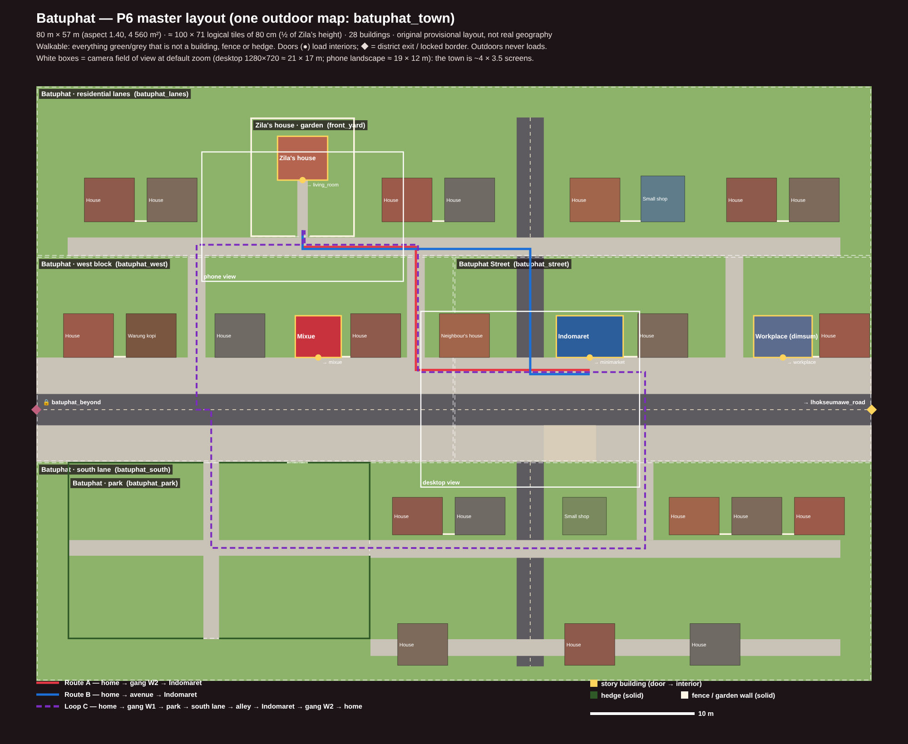
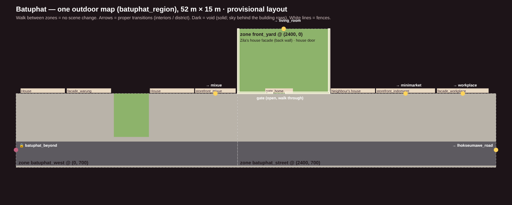
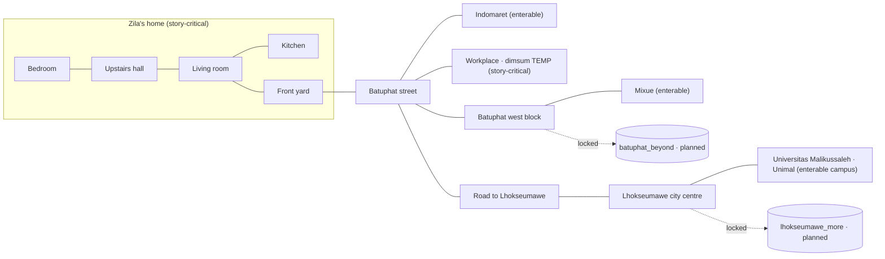

# World 01 — Batuphat–Lhokseumawe roadmap

**Zila is the only playable character. Febri is always an NPC:** in long-distance chapters he appears through chat, voice or video calls; in later Travel maps, as a companion NPC.
**Every layout, route and location below is PROVISIONAL** until the Creative Director reviews the world map and story. Nothing here claims real-world geography.
The source of truth for the registry is [`src/data/world/world01.json`](../../src/data/world/world01.json); `tests/unit/world-graph.test.ts` keeps it consistent with the map data.

## Progress
| Measure | P0 (PR #17, merged) | **P1 (this checkpoint)** |
|---|---|---|
| Connected playable maps | 7 | **10**: + kitchen, Batuphat west block, Mixue |
| Enterable buildings | 3 | **4**: Zila's house (4 interior maps + yard), Indomaret, workplace, Mixue |
| Two-way door links | 6 | **9**; 2 locked road ends (planned) |
| NPCs | 3 | **6**: neighbour, Indomaret cashier, coworker, becak driver, child in the park, Mixue staff |
| Interaction spots on objects (excluding NPCs and doors) | 36 | **47** |
| Gameplay loops | 2 (shop purchase, work shift) | **4**: + kitchen breakfast (fridge → stove → table), Mixue order (counter → table) |
| Route coverage (e2e, real doors) | bedroom ↔ street ↔ shop / work | + living room ↔ kitchen; street ↔ west block ↔ Mixue; save/reload after the new maps |
| Memory | textures released per map | + repeated map-change test: generated-texture count and bytes, and object count, flat after 16 transitions |

## Map registry
**Roles:**
- **story-critical:** interiors, characters, events and persistent state.
- **enterable:** a real interior with navigation.
- **background:** visual environment only.

| Map | District | Kind | Status | Doors (→ destination) | Building role / notes |
|---|---|---|---|---|---|
| `zila_bedroom` | Zila's home | interior | ✅ | south → upper_hall | story-critical · **20 approved HD assets** |
| `upper_hall` | Zila's home | interior | ✅ | north → bedroom; east stairs → living_room | story-critical · TEMP |
| `living_room` | Zila's home | interior | ✅ provisional | north stairs → hall; south → yard; **west → kitchen** | story-critical · TEMP |
| `kitchen` | Zila's home | interior | ✅ provisional (new) | east → living room | story-critical · breakfast loop and tea |
| `front_yard` | Zila's home | exterior | ✅ provisional · **zone of `batuphat_town` (P6)** | north → living room; south gate → street (walk, no transition) | story-critical |
| `batuphat_street` | Batuphat | exterior | ✅ provisional · **zone of `batuphat_town` (P6)** | home gate, Indomaret, workplace; west block (walk); east road → Lhokseumawe road | road drawn as a ground zone (no overdraw) |
| `batuphat_west` | Batuphat | exterior | ✅ provisional · **zone of `batuphat_town` (P6)** | street (walk); Mixue; west road 🔒 | homes and warung kopi (**background**), small park, **becak motor** + driver, child NPC |
| `minimarket` (**Indomaret**) | Batuphat | interior | ✅ provisional | south → street | **enterable** · real-world reference: Indomaret (TEMP colours and text only) · ⚠ brand review |
| `mixue` | Batuphat | interior | ✅ provisional (new) | south → west block | **enterable** · real-world reference: Mixue (TEMP colours and text only) · ⚠ brand review |
| `workplace` | Batuphat | interior | ✅ **story-configurable** (variants: **dimsum shop (active)**, office) | south → street | story-critical · no real name or layout; one registry line switches the variant |
| `lhokseumawe_road` | Lhokseumawe city | exterior | ✅ provisional (P3) | west → Batuphat street; east → city centre | warung, rice fields, fuel station, bus stop (background/inspectable) |
| `lhokseumawe_centre` | Lhokseumawe city | exterior | ✅ provisional (P3) | west → road; north gate → Unimal; east 🔒 planned | town square, grand mosque, bank, pharmacy, kedai kopi (background/inspectable) |
| `unimal_campus` | Unimal | exterior | ✅ provisional (P3) | south gate → city centre | enterable campus grounds; rectorate, library, faculty (background/inspectable) |
| `travel_maps` | — | exterior | ⏳ story-pending | — | Febri as a companion NPC; not in this sprint |

**Brand notice:**
- Indomaret and Mixue appear by name and colour **only to signal the intended real location**. ZsRoom is not affiliated with or endorsed by either brand.
- The TEMP art reproduces **no logos**: plain text signs and colour bands only.
- Exact logos, wordmarks and trade dress must be **reviewed before any public release** (flagged with `brandReview` in the registry and specs).
- The map id `minimarket` is kept unchanged for save compatibility.

## P4 — continuous floors and exploration camera (Issue #28)
**Goal:** a real exploration feel. Same-floor rooms are **one walkable map**: Zila walks through interior doorways with no fade and no scene restart, while the camera keeps following. Stairs, exterior doors, shop doors and separate districts still use transitions.

### How it works (reusable, data-driven)
- **Floors:** `src/data/floors/<id>.json` lists **zones**, which are the existing room files, placed side by side along X and sharing the north-wall line, plus **openings** between neighbouring zones.
- **Coordinates:** local room coordinates + the zone's X offset = floor coordinates.
- **Partition walls:** the two rooms' side walls stay solid, with collision. The opening is a gap with no stopper, no trigger and no transition.
- **Doors:** interior doors that used to lead to another zone of the same floor are dropped, because they are now openings. Exterior doors and stairs keep their targets.
- **Legacy room ids stay valid as aliases.** A door, URL or save that names `living_room` resolves to `home_ground`, using spawn `living_room.<spawn>` and the position offset by the zone origin. Stable external ids such as `minimarket` are unchanged.
- **Zones** still drive the HUD title, ambience, `onEnter` events, the visited list and per-room light flags (`light:<room>:<prop>`), so existing story state and lamp saves keep working.
- **Prop keys:** the primary zone (bedroom upstairs, living room downstairs) keeps its keys; the other zone's keys are prefixed (`kitchen/…`). Approved bedroom furniture is unchanged and at offset 0.

### Old vs new mapping (provisional geometry; no real floor plan claimed)
| Old map (P0–P3) | New map (P4) | Zone origin (x, cm) | Notes |
|---|---|---|---|
| `zila_bedroom` | `home_upper` | 0 | 20 approved assets, same positions |
| `upper_hall` | `home_upper` | 760 | opening at y 120–240 in the 40 cm partition; stairs down on the hall's east wall |
| `kitchen` | `home_ground` | 0 | opening at y 200–320 |
| `living_room` | `home_ground` | 660 | stairs up (north wall), front door → front yard |

**Saves:** v3 saves need no version bump. A saved `roomId` naming an old room resolves to its floor, and the position is offset by the zone origin (unit + e2e tested). Invalid positions still fall back to the spawn.

### Exploration camera (`src/core/framing.ts`)
The character is a small share of the screen, and maps are **never squeezed to fit**: small floors sit centred in the dark surround, big areas scroll with smooth follow and look-ahead. Manual zoom (wheel, pinch, ±) multiplies on top.

| | P3 | **P4** |
|---|---|---|
| Desktop interior | 22–25 % | **15 %** (target 12–18 %) |
| Desktop exterior | 17 % | **14 %** |
| Phone landscape interior | 36 % | **20 %** (target 16–24 %) |
| Phone landscape exterior | 28 % | **19 %** |

At the default zoom, both rooms of each house floor are visible at once. When zoomed in (or on larger areas), the camera pans with Zila; e2e tests measure the camera scroll and Zila's world position continuously across the doorway. Evidence: `docs/reviews/world01-p4/` (P3 vs P4 at the same character position on desktop and Android).

### Performance (headless software proxy, same positions, interleaved, median of 3, night — NOT device results)
| Map | Desktop P3 | Desktop P4 |
|---|---|---|
| Upper floor | 16.3 fps | 20.3 fps |
| Ground floor | 16.0 fps | 18.3 fps |
| Street | 12.7 fps | 14.3 fps |
| City centre | 12.0 fps | 13.0 fps |

- The emulated phone was equal or slightly better too: 6.0–7.3 fps (both builds were slow on the busy machine).
- **Why P4 is not slower:** the proxy is fill-bound. The wider camera draws the same number of screen pixels, the dark surround is cheap, and HD textures are minified.
- **Culling:** off-screen tile culling was already measured in P1 and made no difference, so no chunk culling was added. Revisit with real Galaxy A05 numbers (`?fresh&bench`).
- Adaptive render resolution and the Display setting are unchanged.

### Limits and next steps
- Zones are laid out along X only (shared north wall), which covers both house floors. N–S stacking would need wall-top rendering of the room in front, so it is deferred.
- **Next candidates** for the same model, after Creative Director review:
  - the Indomaret back room;
  - any multi-room shop;
  - joining the front yard with the street into one continuous outdoor area.

## P6 — Batuphat as an explorable 2D town (Issue #34)
**Goal:** World 01 feels like a small town you explore in every direction, not a corridor. Camera feel, map structure and transition rules borrow from large top-down life-sim town maps (Stardew-like game feel); art, layout, code and story stay ZsRoom's own (premium HD 2D illustrated, OG Art Bible, TEMP placeholders for now).

### Map design (proposal, provisional — no real street geometry)
- **Bounding area:** 80 × 57 m (aspect 1.40, ≈ 4 560 m²) ≈ 100 × 71 logical tiles of 80 cm (half of Zila's height). Default camera at the wide P4/P5 framing shows ≈ 21 × 17 m on desktop and ≈ 19 × 12 m on a phone in landscape: the town is ≈ 4 × 3.5 screens. The camera scrolls in X and Y; it never fits the whole town.
- **Network:**
  - north **residential lane**, with three **gangs** and the gaps between houses leading down to the **main street**;
  - the main street (road + pavements) runs west → east to the **Lhokseumawe road exit**; its west end is the locked `batuphat_beyond` border;
  - a north–south **avenue** crosses it at a **crossroads**;
  - a hedged **park** has four entrances;
  - the **south lane**, an **alley** back to the main street, and a **back path** along the south edge.
- **Places:**
  - **Zila's house** in a fenced garden, gate onto the lane;
  - on the main street: **warung kopi**, **Mixue**, **Indomaret** (map id `minimarket` unchanged), the **dimsum workplace**, the neighbour's house;
  - the **becak** stand, park, fountain and benches;
  - 20+ inspectable background houses and two small shops.
- **Routes (tested):**
  - **A:** home → lane → gang W2 → main street → Indomaret.
  - **B:** home → lane → avenue → crossroads → Indomaret.
  - **Loop C:** home → gang W1 → park → south lane → alley → Indomaret → gang W2 → home. It spans more than 35 m east–west and 25 m north–south (E2E-measured).
- **Transitions only at real boundaries:** house door, Indomaret, Mixue, workplace, and the east road to the Lhokseumawe road → city → Unimal, which stay separate districts. Everything outdoors in Batuphat is one map.

### Engine changes (reuse of the P5 compositor, no rewrite)
- `src/world/region.ts`: a region may carry **ground layers**, **free-standing buildings** and **region-level props** in region coordinates; zones become logical areas (title, ambience, events, NPCs, spawns) that may overlap by priority.
- **Buildings:** a TEMP facade asset paints the front; the engine adds the roof seen from above, the collision footprint, a contact shadow, and a front door (walk into it / E) or an inspect / talk anchor. Facade and roof sort by the front line and **fade** when Zila walks behind them.
- **Ground** is drawn once per region with pre-composited ~4 m "super tiles" (351 quads for the whole town instead of thousands); base grass skips quads fully covered by roads (no double ground). View culling draws ≈ 40–70 of them.
- **Pathfinding at town scale:**
  - the walk grid rasterises solids (8 ms for the town instead of seconds);
  - towns use a 16 cm grid;
  - string pulling is linear on the grid;
  - search buffers are reused.

  A long tap-to-move path costs ≈ 10–20 ms (desktop proxy, down from 58–345 ms).
- **Lightmap resolution** scales for very large maps (≤ 1 600 px).

### Migration and rollback
- `front_yard`, `batuphat_street` and `batuphat_west` stay **zones of `batuphat_town`** and keep every spawn name used by interior doors and the city road (`from_house`, `from_minimarket`, `from_workplace`, `from_mixue`, `from_lhokseumawe_road`, …).
- **P4 saves** (those room ids, local coordinates) and **P5 saves** (`batuphat_region`, region coordinates) migrate by **landmark anchors** (`legacyMaps` in the region file): the nearest old landmark maps to the same landmark in the town, keeping up to 80 cm of offset. A spot that is not standable falls back to the nearest free spot.
  - P4 Indomaret front (1420, 60) → P6 Indomaret front (5300, 2660).
  - P5 Mixue front (2160, 760) → (2700, 2660).
  - P5 doorstep (2900, 60) → (2550, 960).
  - The full anchor list is in the region file.
- Story flags, visited, vars, light flags and the `minimarket` id are untouched. No save version bump.
- **Rollback:** the P5 build (PR #33 / its preview) still reads v3 saves. A P6 save names `batuphat_town`, which P5 does not know, so the scene falls back to the default spawn there. No story state is lost.

### Performance (headless software proxy, interleaved P5/P6, median of 3, afternoon — NOT device FPS)
| Same story place | Desktop P5 | Desktop P6 | Emulated phone P5 | Emulated phone P6 |
|---|---|---|---|---|
| Doorstep (outside the house) | 12.0 | 12.3 | 11.7 | 12.0 |
| Indomaret front | 11.3 | 10.7 | 10.0 | 9.7 |
| Mixue front | 10.7 | 11.7 | 10.0 | 9.7 |
| Park | 11.7 | 12.0 | 10.0 | 11.0 |
| Main street middle | 12.0 | 11.3 | 10.7 | 10.0 |

- **On par with P5 within run-to-run noise** (−7 % … +10 %), although the town is ~2.9× the P5 area with 28 buildings.
- **First measurement was 5–17 % slower.** Profiling (hiding one layer at a time) showed the proxy is fill-bound on images. Fixes:
  - quads of a ground layer that a later layer fully covers are skipped (no grass under pavement, no pavement under road);
  - smaller super tiles mean less overdraw;
  - roofs, contact shadows, fences, prop shadows and props are view-culled.
- **Pathfinding (desktop proxy):**

  | | Before | After |
  |---|---|---|
  | Grid build for the town | seconds (estimated) | 8 ms |
  | Long tap-to-move path | 58–345 ms | 10–20 ms |
- **A physical Samsung Galaxy A05 benchmark (`?fresh&bench`) is still required.** No device FPS is claimed.

### Evidence (`docs/reviews/world01-p6/`)
- `town-layout.png`: the master layout, generated from the data (`node scripts/town-diagram.mjs`).
- `desktop-20-camera-follow-filmstrip.png` + `follow-walk-log.json`: one continuous walk of loop C across all 6 areas. `sceneStarts` stays 1 for 141 samples; the camera scrolls x 895 → 5185 and y 471 → 2603.
- `{desktop,android}-0N-*.png`: E2E player-eye captures along the loop (garden, gang W1, park, south lane, Indomaret front, gang W2, home gate).
- `{desktop,android}-1N-<place>-p5.png` vs `-p6.png`: the same story places in P5 and P6 at the default wide camera (`scripts/compare-p5-p6.cjs`).

### Bugs found while verifying the live preview (fixed in P6)
- **Off-screen HUD on slow phones.** Adaptive render resolution is on in production builds only. When it stepped down to exactly 1×, the canvas kept its previous, larger CSS size: the picture was cropped and the clock, zoom, sound and **E button went off-screen**, so doors could not be used. In addition, touch input was mapped to half its position at 1×, so a tap on E walked Zila away. The canvas CSS size and the input scale now always follow the window. An E2E regression test checks both at 1×.
- **Stall beside an obstacle.** Grid path smoothing could clip an obstacle corner by a few cm, so Zila stopped beside the south-lane motorbike. Smoothing now checks samples exactly next to obstacles, and the motorbike was moved off the lane (it also sat on that area's default spawn). Unit tests: every spawn is standable, and sampled routes are followed with real collision.

### Remaining limitations
- **Art is TEMP.** Facades are flat TEMP fronts and roofs are engine-drawn bands; final art is Codex's track. A building's roof can overlap the ground just north of it, so Zila is hidden there and the building fades.
- **Buildings face south only.** The 3/4 view shows fronts; the backs of buildings south of a street read as rooftops. North-facing fronts would need new art.
- **Single-floor ground.** There is no water, no height levels and no diagonal paths; paths are axis-aligned rectangles.
- **Long walks.** Crossing the town takes ~13 s at normal speed, and there is no fast travel yet (the becak is decorative).
- **Layout is provisional.** Names (gangs, avenue) are descriptive, not real Batuphat streets.

## P5 — outdoor region: one walkable Batuphat district (Issue #32)
**Goal:** the outside feels like one place. Zila leaves the house and walks from her doorstep through the yard, out of the gate, along the street past Indomaret and the workplace, west to the park, the becak and Mixue — **one map, no fade, no scene restart**, with the camera following her over a district larger than the screen. Interiors (house, Indomaret, Mixue, workplace) and distant districts (Lhokseumawe road → city → Unimal) keep proper transitions. Camera feel and map rules follow large farm/town maps in top-down life sims; art, code and layout are ZsRoom's own (HD 2D illustrated, OG Art Bible).

### How it works (reusable, data-driven: `src/world/region.ts`, `src/data/regions/<id>.json`)
- **Zones at (x, y) offsets.** A region lists existing room files as zones. Local coordinates + zone origin = region coordinates. Unlike P4 floors (X-only, shared north wall), zones may sit **north/south** of each other.
- **Open boundaries.** Where two zones touch there is no wall, cap, threshold or trigger: the ground simply continues. Doors that led from one zone to another (yard gate, street ↔ west block) are dropped.
- **Real collisions.** The **void** (inside the region's bounding box, outside every zone) is solid. **Fences** (`fences` in the region file) are low walls with collision and are depth-sorted (Zila walks behind or in front). The yard gate is a gap in the front fence.
- **Doors to other maps** on the outer edge keep a threshold gap and a stopper, exactly like a plain room. North doors stay recesses in the zone's back wall. Locked borders (west road → `batuphat_beyond`) stay solid with their message.
- **Rendering.** Each zone's ground and back wall are drawn at its offset. A back wall (building row, house facade) is drawn only where no zone continues north of it (`wallGaps`): the street's shop row opens onto the yard. Sky fills the space above each exposed wall run, so there are no dark seams. No double-rendered ground.
- **Zones keep their identity:** HUD title, ambience, `onEnter` events, visited list, NPC schedules and per-zone light flags (`light:<room>:<prop>`). Prop keys of non-primary zones are prefixed (`batuphat_street/…`).
- **Camera:** smooth follow with look-ahead, clamped gently to the region's box. The district is never auto-fitted (it is ~3× wider than the desktop view); manual zoom still works.
- **View culling (measured):** the region has ~550 ground/wall tile quads; only those near the view are drawn (`state().tiles`).

### Migration table — legacy map / spawn ids → region coordinates
Saves need no version bump: a saved `roomId` naming a zone resolves to `batuphat_region`; the position is offset by the zone origin, and content that moved is remapped (`legacy` in the region file). Doors in interiors (`living_room.front_door`, shop exits, the city road) still name the old ids and resolve the same way.

| Legacy map | Zone origin (x, y) | Legacy spawn → region position | Content moves (x range → shift) |
|---|---|---|---|
| `front_yard` | (2400, 0) | `from_house` (500, 60) → **(2900, 60)** just outside the house door · `default` (500, 350) → (2900, 350) · `from_street` (500, 640) → (2900, 640) | gate moved 50 cm west to line up with the street gate |
| `batuphat_street` | (2400, 700) | `from_home` (450, 60) → (2850, 760) · `from_minimarket` **(1820, 60)** → (4220, 760) · `from_workplace` **(2440, 60)** → (4840, 760) · `from_west` (60, 610) → (2460, 1310) · `from_lhokseumawe_road` (2740, 610) → (5140, 1310) | Indomaret frontage 1100–1740 → **+400**; workplace frontage 1970–2530 → **+190** (room for the yard); neighbour house 850 → 1250 |
| `batuphat_west` | (0, 700) | `default` (900, 420) → (900, 1120) · `from_mixue` (2160, 60) → (2160, 760) · `from_street` (2340, 610) → (2340, 1310) | none |
| `minimarket`, `mixue`, `workplace`, `lhokseumawe_road`, … | separate maps | unchanged ids (`minimarket` kept) | — |

### Phases
- **Phase A** (commit `bc023e3`): the compositor + yard and street as one region. Tested first; legacy route tests now walk through the gate.
- **Phase B:** the west block joined the same region (park, becak + driver, warung, Mixue front; west road end locked). The city road, city centre and Unimal remain larger **separate districts** reached through the east road (purposeful boundary); no streaming needed at this size.

### Evidence (`docs/reviews/world01-p5/`)
- `region-layout.png`: layout diagram drawn from the region data (`node scripts/region-diagram.mjs`).
- `{desktop,android}-1N-<spot>-p4.png` vs `-p5.png`: the same character position in P4 (separate maps) and P5 (one region), same viewport, default wide zoom (`scripts/compare-p4-p5.cjs`).
- `desktop-20-camera-follow-filmstrip.png` + `follow-walk-log.json`: one continuous walk from the yard through the gate and east along the street. `sceneStarts` stays 1 for all 82 samples, while the camera scroll moves 2210 → 3572 with Zila's world x: real follow, not a static full-district framing.
- `{desktop,android}-0N-*.png`: E2E captures (doorstep, yard gate, Indomaret front, park and becak, Mixue front).

### Performance (headless software proxy, interleaved, median of 3, afternoon — NOT device results)
| Spot | Desktop P4 | Desktop P5 | Emulated phone P4 | Emulated phone P5 |
|---|---|---|---|---|
| Front yard | 28.3 fps | 13.5 fps | 8.5 fps | 6.8 fps |
| Street | 14.3 fps | 13.8 fps | 6.3 fps | 6.0 fps |
| West block (park) | 13.8 fps | 13.5 fps | 6.3 fps | 6.3 fps |

- **The yard costs what the street costs.** In P4 the yard was a small, isolated map; in P5 the street, shops and NPCs are visible from it, so it renders like a street view.
- **View culling added:** without it, P5 was 10–15 % below P4 on the street. The region has 546 tile quads; only those near the view are drawn.
- **Physical Samsung Galaxy A05 benchmark still needed:** open the preview with `?fresh&bench`. Region streaming or chunking is not needed at this size (52 × 15 m); revisit only if device numbers ask for it.
- Adaptive render resolution and the Display setting are unchanged.

### Limits
- The layout is provisional. Frontages moved east to make room for the yard; no real geography is implied.
- The city road, city centre and Unimal remain separate maps by design (purposeful district boundary).
- All TEMP art is unchanged; final art is Codex's track.

## P3 — Lhokseumawe city, Unimal, inspectable background (Issue #23)
**Playable first, visual refinement later.** The topology is **fictionalised**: it is not a claim about real streets or distances.

### Provisional world diagram

### What P3 added
| | |
|---|---|
| **New maps** | `lhokseumawe_road`, `lhokseumawe_centre`, `unimal_campus`. The street's east road end is now **open** in both directions. |
| **World now** | **13 connected maps**, 12 two-way door links, 2 locked "planned" exits, **14 active NPCs**, 70 object interactions (19 of them inspectable landmarks) |
| **Unimal** | A campus destination reached through a named gate arch on the city square (text only, no logo). It has rectorate, library and faculty buildings (inspectable), a notice board, a campus map, benches, students and campus security. **No campus-specific personal events.** |
| **Dimsum workplace** | The **active** workplace variant (registry `placeholders.workplace.variant = "dimsum"`), still TEMP. Cashier loop: clock in → take the customer's order → send it to the kitchen pass → hand over & take payment ×3 → clock out. The customer is present only during an unfinished shift (NPC `showIf`). The office variant is kept (`?variant=office` in QA builds). |
| **Location tiers** | story-critical / enterable / background. Background landmarks are **inspectable**: tap/click or E shows their name and a neutral comment. Listed in the registry (`inspectables`), checked by tests. |
| **Reusable systems** | `inspect` shorthand on any placement; NPC `showIf` story conditions; per-placement TEMP restyling of generic facades; multi-world registry loader (`src/world/registry.ts`); **`scripts/new-map.mjs`** scaffolds a connected map (doors both ways, return spawns, registry entry) in one command. This is the base for Sabang and Jogja. |

### Locations by tier (World 01)
- **Story-critical:** Zila's house (bedroom, hall, living room, kitchen, yard); workplace (dimsum TEMP).
- **Enterable:** Indomaret; Mixue; Unimal campus grounds; the streets and city maps themselves.
- **Background / inspectable (18 registry entries):**
  - **Road:** warung nasi, rice fields, fuel station, bus stop, road sign.
  - **City:** bank, pharmacy, grand mosque, kedai kopi, town square fountain, campus sign.
  - **Unimal:** rectorate, library, faculty building, notice board, campus map.
  - **Batuphat:** neighbours' houses.

### Assumptions (safe and reversible; documented instead of blocking)
1. Batuphat → road → city centre → Unimal is a **provisional, compressed** layout. Rearranging means editing door data; the graph tests catch mistakes.
2. Background buildings show neutral placeholder comments only. **Interiors are built when the story asks for them.**
3. The grand mosque, bank and fuel station use **generic** names and no brands.
4. The dimsum workplace stays unnamed, with a TEMP layout.

### Optional review items (not blockers)
- Which Unimal buildings deserve interiors (e.g. a faculty, the library), and which story moments happen there.
- Whether the city centre should show a specific real landmark by name.
- The dimsum shop's real name and layout, and the cashier dialogue lines.

## P2 
- **Story-configurable workplace:** rooms can declare data-driven **variants** that share doors, spawns and size.
  - The workplace has two playable TEMP layouts: **office** (default) and **dimsum shop**.
  - Dimsum loop: clock in → pick up a steamer basket at the counter → serve 3 tables, one basket at a time → clock out. Placeholder cook and customer NPCs.
  - Switching is one line in `src/data/world/world01.json` (`placeholders.workplace.variant`). QA builds can preview with `?variant=dimsum`.
  - **No real name or floor plan is invented.**
- **Adaptive render resolution** (`src/systems/renderScale.ts`):
  - **Auto:** steps the canvas render scale down 2 → 1.75 → 1.5 → 1.25 → 1 after two consecutive slow 2-second windows (median < 40 fps). It never oscillates and remembers the scale per device.
  - **Sharp / Smooth:** player overrides in the settings panel (**Display** row).
  - **Measured basis:** headless proxy, emulated Android, street at night, scale 2 → 1.5 → 1 = **12.3 → 20.0 → 39.7 fps**. QA builds disable Auto unless `?adaptive`, so tests stay deterministic.
- **Device benchmark** (`?fresh&bench`): tours the bedroom, street and west block at native, 1.5× and 1× render scale, and produces a copyable JSON result. Procedure: [ANDROID_PERF_TEST.md](ANDROID_PERF_TEST.md). **A physical Galaxy A05-class run is still outstanding.**
- **Tests:** every variant of every configurable room is checked for completeness and reachability. E2E covers the dimsum loop, the adaptive step-down (with the game still playable and the setting persisting), and the bench run.

## P1 engineering changes
- **`?fast` is test-only:** it works only in dev and in the `--mode qa` build that Playwright serves. The production `npm run build` ignores it (unit test, plus a manual check: 145 cm/s with and without `?fast` on the production build).
- **NPCs make way:**
  - When an NPC blocks a tap-to-move route, it steps about 60 cm to the free side of Zila's direction of travel, once and for a bounded time.
  - Zila keeps her route and gives up after 1.5 s blocked. No per-frame pathfinding.
  - Covered by a unit test and an e2e test.
- **Ground zones:**
  - Roads, the park lawn and the like are tiled in place of the base ground. Base tiles straddling a zone are cropped, so each pixel is drawn once instead of a decal on top of the ground.
  - **Measured:** street median 10.5 → 11.5 fps (≈ +10 %), interleaved against the previous build, 4 runs each, headless software proxy.
  - **Rejected:** off-screen tile culling was measured and made no difference.
- **Outdoor camera:** frames slightly wider and biased upward, so shop signs and building tops are visible from the pavement.

## Engine systems added (reusable, data-driven)
- **World graph:** world → district → building → map registry, with stable map ids.
- **Doors:**
  - Bidirectional and on any side (north, south, east, west), with explicit spawns and facings.
  - Styles: door, stairs, gate, or painted by the art.
  - **Locked or story-gated** doors (`locked.unlessFlag`).
  - Arrival never bounces you straight back through the door (doorways arm only after you step away).
- **Map kinds:** interior and **exterior**. Exteriors show the time-of-day sky above the building row. Per-map ambience: room, street (traffic, motorbikes, birds) or shop (fridge hum). All are original procedural audio.
- **Per-placement interactions:** generic world props, where one counter spec serves both the shop checkout and the office reception.
- **Story events** (`src/data/story/events.json`):
  - Conditions: flag, notFlag, varEq, varNe, varGte, varLt.
  - Effects: dialogue, say, toast, setFlag, setVar, incVar, comms.
  - `once` events. Map `onEnter` hooks.
  - **Dialogue is data**, never engine code.
- **NPCs** (`src/world/npc.ts`):
  - Deterministic idle, wander and patrol behaviours.
  - Stop and face Zila when she's near; block her movement, but **make way** when they block her route.
  - Schedule by time of day; interact via dialogue or event.
  - No AI service.
- **Comms contract** (`src/story/comms.ts`): chat, voice and video thread data, plus a presenter interface. Today the dialogue panel shows "Febri · chat". Content is **fictional placeholder only** (unit-tested to be marked placeholder).
- **Memory:** only the active map's generated textures are kept; the previous map's TEMP art, glows, skies and lightmap are released on every map change (e2e-asserted).

## Temporary artwork (all clearly labelled TEMP in the HUD)
- **36 world placeholder props** in `specs/world/props`, each with a stable id, footprint, pivot and collision. New in P1:
  - kitchen counter, stove, home fridge
  - becak motor (Aceh motor rickshaw)
  - Indomaret storefront and checkout counter
  - Mixue storefront, order counter, ice-cream machines and menu board
  - warung kopi front
- **12 placeholder tiles** in `specs/world/environments`, including the asphalt road zone and the Mixue wall.
- **6 TEMP NPC figures.** Zila is still the TEMP figure.
- These specs live **outside** the art pipeline: they are not art requests and are not in the manifest. To commission final art, move a spec to `specs/props` with full art fields, then raise an art request. The gameplay data does not change.

## Performance (headless software Chromium proxy — not a device measurement)
All maps were measured in one run at 1280×720 (frames per second, afternoon / night). The shared machine was busy, so compare maps relative to each other only.

| Map | fps (afternoon / night) |
|---|---|
| Bedroom | 16.8 / 15.5 |
| Hall | 24.0 / 16.3 |
| Living room | 19.8 / 13.5 |
| Kitchen | 20.5 / 17.0 |
| Front yard | 18.8 / 15.5 |
| Street | 12.8 / 11.5 |
| West block | 11.5 / 11.8 |
| Indomaret | 18.5 / 16.5 |
| Mixue | 20.3 / 17.8 |
| Workplace | 20.8 / 16.8 |

- **Exteriors are the heaviest maps:** they fill the whole screen, and the proxy is fill-bound.
- **Mixed result from P1:** the ground-zone change gained ≈ 10 % on the street, but the wider outdoor camera framing gives part of it back (more fill per frame).
- **No leaks:** repeated map changes keep generated textures, objects and heap flat.
- **Galaxy A05-class physical test: still outstanding.** Candidate follow-ups depend on that test:
  1. A lower render scale outdoors.
  2. Merging static exterior layers into cached chunks.

### P3 exterior measurements (headless proxy — NOT device results)
- **Desktop 1280×720, fps (afternoon / night):**

  | Map | fps |
  |---|---|
  | Bedroom | 18.5 / 17.3 |
  | Street | 15.3 / 14.0 |
  | Road | 14.5 / 13.0 |
  | **City centre** | **9.8 / 11.3** (heaviest: 351 display objects) |
  | Unimal | 13.3 / 13.5 |

- **Emulated Android, render scale 2 / 1.5 / 1, night:**

  | Map | Scale 2 | Scale 1.5 | Scale 1 |
  |---|---|---|---|
  | City centre | 10.7 fps | 17.7 fps | 34.0 fps |
  | Unimal | 11.0 fps | 18.0 fps | 33.3 fps |

  Adaptive resolution (P2) handles this on slow devices.
- The device benchmark (`?fresh&bench`) now includes the city centre at night.
- Follow-up if a real device confirms the cost: cache the static exterior layers of the city centre into chunks.

## Next work packages
1. **Real-world references:** with CD-supplied photos, refine the Indomaret front and interior, Mixue, the warung, the house front and the street proportions (TEMP data only until the art direction is confirmed).
2. **Workplace:** once the CD confirms its type (dimsum candidate), swap `placeholders.workplace` and its task loop data (no engine change).
3. **Neighbourhood:**
   - A residential lane off the west block (only if story-relevant).
   - The warung kopi as an interior, if it matters to the story.
4. **Systems:**
   - A wallet and price list for the shops.
   - NPC schedules across maps.
   - A phone UI for the comms presenter.
5. **Codex art (when available), in order:**
   1. Zila character
   2. Remaining bedroom shell tiles
   3. Zila's house (living room, kitchen, front)
   4. Batuphat street facades
   5. Indomaret exterior / interior
   6. Mixue

   No expensive art specs for buildings whose real design or role is unconfirmed.

## Creative Director decisions needed
1. **House topology:** bedroom and hall upstairs; living room, kitchen and yard downstairs; one gate onto the street?
2. **Street order and proximity:** home → Indomaret → workplace, with Mixue one block west. All provisional, and none of it is real geography.
3. **Workplace:** confirm the dimsum variant (or another type), then its name, layout and daily activity. The switch is ready in data.
4. **Reference photos** (private, never committed): Zila's house front, the Indomaret and Mixue branches, the street, the workplace.
5. **Brand use before public release:** Indomaret and Mixue names and colours (logos are not reproduced).
6. **Next locations** that matter to the story (residential lane, warung, mosque or meunasah, school, Lhokseumawe city centre).
