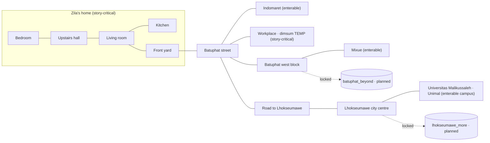

# World 01 — Batuphat–Lhokseumawe roadmap

**Zila is the only playable character. Febri is always an NPC:** in long-distance chapters he appears through chat, voice or video calls; in later Travel maps, as a companion NPC.
**Every layout, route and location below is PROVISIONAL** until the Creative Director reviews the world map and story. Nothing here claims real-world geography.
The source of truth for the registry is [`src/data/world/world01.json`](../../src/data/world/world01.json); `tests/unit/world-graph.test.ts` keeps it consistent with the map data.

## Progress
| Measure | P0 (PR #17, merged) | **P1 (this checkpoint)** |
|---|---|---|
| Connected playable maps | 7 | **10**: + kitchen, Batuphat west block, Mixue |
| Enterable buildings | 3 | **4**: Zila's house (4 interior maps + yard), Indomaret, workplace, Mixue |
| Two-way door links | 6 | **9**; 2 locked road ends (planned) |
| NPCs | 3 | **6**: neighbour, Indomaret cashier, coworker, becak driver, child in the park, Mixue staff |
| Interaction spots on objects (excluding NPCs and doors) | 36 | **47** |
| Gameplay loops | 2 (shop purchase, work shift) | **4**: + kitchen breakfast (fridge → stove → table), Mixue order (counter → table) |
| Route coverage (e2e, real doors) | bedroom ↔ street ↔ shop / work | + living room ↔ kitchen; street ↔ west block ↔ Mixue; save/reload after the new maps |
| Memory | textures released per map | + repeated map-change test: generated-texture count and bytes, and object count, flat after 16 transitions |

## Map registry
**Roles:**
- **story-critical:** interiors, characters, events and persistent state.
- **enterable:** a real interior with navigation.
- **background:** visual environment only.

| Map | District | Kind | Status | Doors (→ destination) | Building role / notes |
|---|---|---|---|---|---|
| `zila_bedroom` | Zila's home | interior | ✅ | south → upper_hall | story-critical · **20 approved HD assets** |
| `upper_hall` | Zila's home | interior | ✅ | north → bedroom; east stairs → living_room | story-critical · TEMP |
| `living_room` | Zila's home | interior | ✅ provisional | north stairs → hall; south → yard; **west → kitchen** | story-critical · TEMP |
| `kitchen` | Zila's home | interior | ✅ provisional (new) | east → living room | story-critical · breakfast loop and tea |
| `front_yard` | Zila's home | exterior | ✅ provisional | north → living room; south gate → street | story-critical |
| `batuphat_street` | Batuphat | exterior | ✅ provisional | home gate, Indomaret, workplace; **west → west block**; east road 🔒 | road drawn as a ground zone (no overdraw) |
| `batuphat_west` | Batuphat | exterior | ✅ provisional (new) | east → street; Mixue; west road 🔒 | homes and warung kopi (**background**), small park, **becak motor** + driver, child NPC |
| `minimarket` (**Indomaret**) | Batuphat | interior | ✅ provisional | south → street | **enterable** · real-world reference: Indomaret (TEMP colours and text only) · ⚠ brand review |
| `mixue` | Batuphat | interior | ✅ provisional (new) | south → west block | **enterable** · real-world reference: Mixue (TEMP colours and text only) · ⚠ brand review |
| `workplace` | Batuphat | interior | ✅ **story-configurable** (variants: **dimsum shop (active)**, office) | south → street | story-critical · no real name or layout; one registry line switches the variant |
| `lhokseumawe_road` | Lhokseumawe city | exterior | ✅ provisional (P3) | west → Batuphat street; east → city centre | warung, rice fields, fuel station, bus stop (background/inspectable) |
| `lhokseumawe_centre` | Lhokseumawe city | exterior | ✅ provisional (P3) | west → road; north gate → Unimal; east 🔒 planned | town square, grand mosque, bank, pharmacy, kedai kopi (background/inspectable) |
| `unimal_campus` | Unimal | exterior | ✅ provisional (P3) | south gate → city centre | enterable campus grounds; rectorate, library, faculty (background/inspectable) |
| `travel_maps` | — | exterior | ⏳ story-pending | — | Febri as a companion NPC; not in this sprint |

**Brand notice:**
- Indomaret and Mixue appear by name and colour **only to signal the intended real location**. ZsRoom is not affiliated with or endorsed by either brand.
- The TEMP art reproduces **no logos**: plain text signs and colour bands only.
- Exact logos, wordmarks and trade dress must be **reviewed before any public release** (flagged with `brandReview` in the registry and specs).
- The map id `minimarket` is kept unchanged for save compatibility.

## P3 — Lhokseumawe city, Unimal, inspectable background (Issue #23)
**Playable first, visual refinement later.** The topology is **fictionalised**: it is not a claim about real streets or distances.

### Provisional world diagram

### What P3 added
| | |
|---|---|
| **New maps** | `lhokseumawe_road`, `lhokseumawe_centre`, `unimal_campus`. The street's east road end is now **open** in both directions. |
| **World now** | **13 connected maps**, 12 two-way door links, 2 locked "planned" exits, **14 active NPCs**, 70 object interactions (19 of them inspectable landmarks) |
| **Unimal** | A campus destination reached through a named gate arch on the city square (text only, no logo). It has rectorate, library and faculty buildings (inspectable), a notice board, a campus map, benches, students and campus security. **No campus-specific personal events.** |
| **Dimsum workplace** | The **active** workplace variant (registry `placeholders.workplace.variant = "dimsum"`), still TEMP. Cashier loop: clock in → take the customer's order → send it to the kitchen pass → hand over & take payment ×3 → clock out. The customer is present only during an unfinished shift (NPC `showIf`). The office variant is kept (`?variant=office` in QA builds). |
| **Location tiers** | story-critical / enterable / background. Background landmarks are **inspectable**: tap/click or E shows their name and a neutral comment. Listed in the registry (`inspectables`), checked by tests. |
| **Reusable systems** | `inspect` shorthand on any placement; NPC `showIf` story conditions; per-placement TEMP restyling of generic facades; multi-world registry loader (`src/world/registry.ts`); **`scripts/new-map.mjs`** scaffolds a connected map (doors both ways, return spawns, registry entry) in one command. This is the base for Sabang and Jogja. |

### Locations by tier (World 01)
- **Story-critical:** Zila's house (bedroom, hall, living room, kitchen, yard); workplace (dimsum TEMP).
- **Enterable:** Indomaret; Mixue; Unimal campus grounds; the streets and city maps themselves.
- **Background / inspectable (18 registry entries):**
  - **Road:** warung nasi, rice fields, fuel station, bus stop, road sign.
  - **City:** bank, pharmacy, grand mosque, kedai kopi, town square fountain, campus sign.
  - **Unimal:** rectorate, library, faculty building, notice board, campus map.
  - **Batuphat:** neighbours' houses.

### Assumptions (safe and reversible; documented instead of blocking)
1. Batuphat → road → city centre → Unimal is a **provisional, compressed** layout. Rearranging means editing door data; the graph tests catch mistakes.
2. Background buildings show neutral placeholder comments only. **Interiors are built when the story asks for them.**
3. The grand mosque, bank and fuel station use **generic** names and no brands.
4. The dimsum workplace stays unnamed, with a TEMP layout.

### Optional review items (not blockers)
- Which Unimal buildings deserve interiors (e.g. a faculty, the library), and which story moments happen there.
- Whether the city centre should show a specific real landmark by name.
- The dimsum shop's real name and layout, and the cashier dialogue lines.

## P2 
- **Story-configurable workplace:** rooms can declare data-driven **variants** that share doors, spawns and size.
  - The workplace has two playable TEMP layouts: **office** (default) and **dimsum shop**.
  - Dimsum loop: clock in → pick up a steamer basket at the counter → serve 3 tables, one basket at a time → clock out. Placeholder cook and customer NPCs.
  - Switching is one line in `src/data/world/world01.json` (`placeholders.workplace.variant`). QA builds can preview with `?variant=dimsum`.
  - **No real name or floor plan is invented.**
- **Adaptive render resolution** (`src/systems/renderScale.ts`):
  - **Auto:** steps the canvas render scale down 2 → 1.75 → 1.5 → 1.25 → 1 after two consecutive slow 2-second windows (median < 40 fps). It never oscillates and remembers the scale per device.
  - **Sharp / Smooth:** player overrides in the settings panel (**Display** row).
  - **Measured basis:** headless proxy, emulated Android, street at night, scale 2 → 1.5 → 1 = **12.3 → 20.0 → 39.7 fps**. QA builds disable Auto unless `?adaptive`, so tests stay deterministic.
- **Device benchmark** (`?fresh&bench`): tours the bedroom, street and west block at native, 1.5× and 1× render scale, and produces a copyable JSON result. Procedure: [ANDROID_PERF_TEST.md](ANDROID_PERF_TEST.md). **A physical Galaxy A05-class run is still outstanding.**
- **Tests:** every variant of every configurable room is checked for completeness and reachability. E2E covers the dimsum loop, the adaptive step-down (with the game still playable and the setting persisting), and the bench run.

## P1 engineering changes
- **`?fast` is test-only:** it works only in dev and in the `--mode qa` build that Playwright serves. The production `npm run build` ignores it (unit test, plus a manual check: 145 cm/s with and without `?fast` on the production build).
- **NPCs make way:**
  - When an NPC blocks a tap-to-move route, it steps about 60 cm to the free side of Zila's direction of travel, once and for a bounded time.
  - Zila keeps her route and gives up after 1.5 s blocked. No per-frame pathfinding.
  - Covered by a unit test and an e2e test.
- **Ground zones:**
  - Roads, the park lawn and the like are tiled in place of the base ground. Base tiles straddling a zone are cropped, so each pixel is drawn once instead of a decal on top of the ground.
  - **Measured:** street median 10.5 → 11.5 fps (≈ +10 %), interleaved against the previous build, 4 runs each, headless software proxy.
  - **Rejected:** off-screen tile culling was measured and made no difference.
- **Outdoor camera:** frames slightly wider and biased upward, so shop signs and building tops are visible from the pavement.

## Engine systems added (reusable, data-driven)
- **World graph:** world → district → building → map registry, with stable map ids.
- **Doors:**
  - Bidirectional and on any side (north, south, east, west), with explicit spawns and facings.
  - Styles: door, stairs, gate, or painted by the art.
  - **Locked or story-gated** doors (`locked.unlessFlag`).
  - Arrival never bounces you straight back through the door (doorways arm only after you step away).
- **Map kinds:** interior and **exterior**. Exteriors show the time-of-day sky above the building row. Per-map ambience: room, street (traffic, motorbikes, birds) or shop (fridge hum). All are original procedural audio.
- **Per-placement interactions:** generic world props, where one counter spec serves both the shop checkout and the office reception.
- **Story events** (`src/data/story/events.json`):
  - Conditions: flag, notFlag, varEq, varNe, varGte, varLt.
  - Effects: dialogue, say, toast, setFlag, setVar, incVar, comms.
  - `once` events. Map `onEnter` hooks.
  - **Dialogue is data**, never engine code.
- **NPCs** (`src/world/npc.ts`):
  - Deterministic idle, wander and patrol behaviours.
  - Stop and face Zila when she's near; block her movement, but **make way** when they block her route.
  - Schedule by time of day; interact via dialogue or event.
  - No AI service.
- **Comms contract** (`src/story/comms.ts`): chat, voice and video thread data, plus a presenter interface. Today the dialogue panel shows "Febri · chat". Content is **fictional placeholder only** (unit-tested to be marked placeholder).
- **Memory:** only the active map's generated textures are kept; the previous map's TEMP art, glows, skies and lightmap are released on every map change (e2e-asserted).

## Temporary artwork (all clearly labelled TEMP in the HUD)
- **36 world placeholder props** in `specs/world/props`, each with a stable id, footprint, pivot and collision. New in P1:
  - kitchen counter, stove, home fridge
  - becak motor (Aceh motor rickshaw)
  - Indomaret storefront and checkout counter
  - Mixue storefront, order counter, ice-cream machines and menu board
  - warung kopi front
- **12 placeholder tiles** in `specs/world/environments`, including the asphalt road zone and the Mixue wall.
- **6 TEMP NPC figures.** Zila is still the TEMP figure.
- These specs live **outside** the art pipeline: they are not art requests and are not in the manifest. To commission final art, move a spec to `specs/props` with full art fields, then raise an art request. The gameplay data does not change.

## Performance (headless software Chromium proxy — not a device measurement)
All maps were measured in one run at 1280×720 (frames per second, afternoon / night). The shared machine was busy, so compare maps relative to each other only.

| Map | fps (afternoon / night) |
|---|---|
| Bedroom | 16.8 / 15.5 |
| Hall | 24.0 / 16.3 |
| Living room | 19.8 / 13.5 |
| Kitchen | 20.5 / 17.0 |
| Front yard | 18.8 / 15.5 |
| Street | 12.8 / 11.5 |
| West block | 11.5 / 11.8 |
| Indomaret | 18.5 / 16.5 |
| Mixue | 20.3 / 17.8 |
| Workplace | 20.8 / 16.8 |

- **Exteriors are the heaviest maps:** they fill the whole screen, and the proxy is fill-bound.
- **Mixed result from P1:** the ground-zone change gained ≈ 10 % on the street, but the wider outdoor camera framing gives part of it back (more fill per frame).
- **No leaks:** repeated map changes keep generated textures, objects and heap flat.
- **Galaxy A05-class physical test: still outstanding.** Candidate follow-ups depend on that test:
  1. A lower render scale outdoors.
  2. Merging static exterior layers into cached chunks.

### P3 exterior measurements (headless proxy — NOT device results)
- **Desktop 1280×720, fps (afternoon / night):**

  | Map | fps |
  |---|---|
  | Bedroom | 18.5 / 17.3 |
  | Street | 15.3 / 14.0 |
  | Road | 14.5 / 13.0 |
  | **City centre** | **9.8 / 11.3** (heaviest: 351 display objects) |
  | Unimal | 13.3 / 13.5 |

- **Emulated Android, render scale 2 / 1.5 / 1, night:**

  | Map | Scale 2 | Scale 1.5 | Scale 1 |
  |---|---|---|---|
  | City centre | 10.7 fps | 17.7 fps | 34.0 fps |
  | Unimal | 11.0 fps | 18.0 fps | 33.3 fps |

  Adaptive resolution (P2) handles this on slow devices.
- The device benchmark (`?fresh&bench`) now includes the city centre at night.
- Follow-up if a real device confirms the cost: cache the static exterior layers of the city centre into chunks.

## Next work packages
1. **Real-world references:** with CD-supplied photos, refine the Indomaret front and interior, Mixue, the warung, the house front and the street proportions (TEMP data only until the art direction is confirmed).
2. **Workplace:** once the CD confirms its type (dimsum candidate), swap `placeholders.workplace` and its task loop data (no engine change).
3. **Neighbourhood:**
   - A residential lane off the west block (only if story-relevant).
   - The warung kopi as an interior, if it matters to the story.
4. **Systems:**
   - A wallet and price list for the shops.
   - NPC schedules across maps.
   - A phone UI for the comms presenter.
5. **Codex art (when available), in order:**
   1. Zila character
   2. Remaining bedroom shell tiles
   3. Zila's house (living room, kitchen, front)
   4. Batuphat street facades
   5. Indomaret exterior / interior
   6. Mixue

   No expensive art specs for buildings whose real design or role is unconfirmed.

## Creative Director decisions needed
1. **House topology:** bedroom and hall upstairs; living room, kitchen and yard downstairs; one gate onto the street?
2. **Street order and proximity:** home → Indomaret → workplace, with Mixue one block west. All provisional, and none of it is real geography.
3. **Workplace:** confirm the dimsum variant (or another type), then its name, layout and daily activity. The switch is ready in data.
4. **Reference photos** (private, never committed): Zila's house front, the Indomaret and Mixue branches, the street, the workplace.
5. **Brand use before public release:** Indomaret and Mixue names and colours (logos are not reproduced).
6. **Next locations** that matter to the story (residential lane, warung, mosque or meunasah, school, Lhokseumawe city centre).
